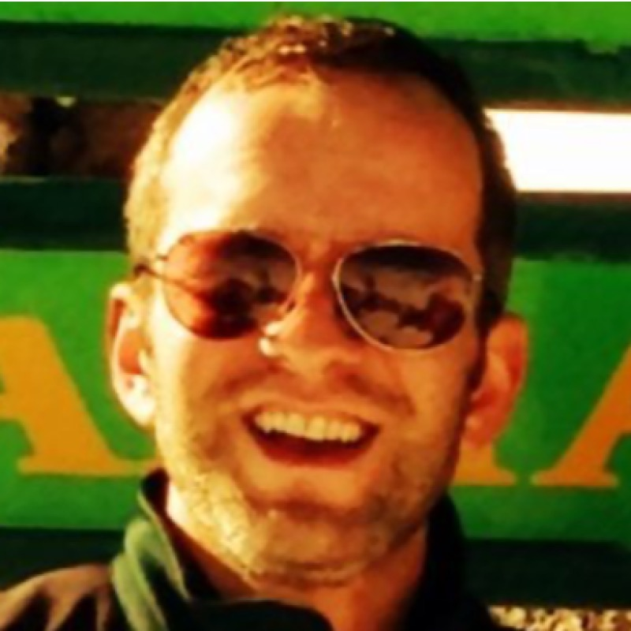

{width=200 .rounded style="float:right; margin:0 0 1rem 1.5rem;"}

Sol Messing is a Research Scientist at Google DeepMind and Research Associate Professor at New York University, with the Center for Social Media, AI, and Politics. Prior to joining NYU, Messing founded data science research teams at Pew Research Center, Acronym, and Twitter. He has industry experience working on recommender systems, complex experimentation, feature engineering/discovery, algorithm audits, and differential privacy. 

Messing’s published work on politics and digital media spans advertising, elections, social media, and Congressional communication. His most widely cited work shows how [ranking and social signals dominate ideological signals](/pdf/SocialNewsCommRes.pdf) in digital media, and how the networks we form more powerfully govern exposure to [ideologically diverse content than algorithmic bias or individual preference](/pdf/Science-2015-Bakshy-1130-2.pdf). His research on Congress consists of numerous works on inter-party criticism and conflict among [members on social media](https://www.pewresearch.org/politics/2017/02/23/partisan-conflict-and-congressional-outreach/), as well as [journal articles](https://www.cambridge.org/core/journals/american-political-science-review/article/abs/how-words-and-money-cultivate-a-personal-vote-the-effect-of-legislator-credit-claiming-on-constituent-credit-allocation/7538BBE494CE31274DAE7F9F2E220F04) and a co-authored book, [*The Impression of Influence*](/pdf/GrimmerWestwoodMessingBook.pdf) (Princeton University Press, 2014) about the impacts of credit-claiming on the voting public. He has also published work on the [consequences of election forecasts](/publications/wlm-2019-projecting/) and digital alterations to [candidate images in advertising](/pdf/HSVmetricsCampaignsDarknessPOQFINAL.pdf). Messing’s most recent work quantifies the impact of an entire digital Presidential advertising campaign in the 2020 election, in what is likely the largest [digital advertising field experiments in politics](/publications/aggarwal-2023-2-million-experiment/). 

During the 2020 election cycle, Messing was Chief Scientist at [ACRONYM](https://www.nytimes.com/2020/04/28/us/politics/Facebook-Acronym-advertising.html), where his team drove investment by (correctly) [modeling the electoral importance of Georgia](/blog/what-the-polls-got-wrong-in-2020/), oversaw a meta-analytic [ML system to generate estimates of persuasive messaging impact](https://towardsdatascience.com/the-haha-ratio-learning-from-facebooks-emoji-reactions-to-predict-persuasion-effects-of-fcd9180ea5dd) leveraging hundreds of past experiments and online behavioral data, and conducted the largest ever [digital advertising field experiment in politics](/publications/aggarwal-2023-2-million-experiment/).

At Facebook, Messing led the technical effort to release a [differentially private data set reflecting more than an exabyte of media data](/blog/condor-data-release/), helped to found the Civic Integrity and FORT groups, and worked on prototypes that blend ML and experimentation (heterogeneous effect estimation and contextual bandits). 

Messing founded the Data Lab at Pew Research Center, where his team conducted algorithmic audits of [Google Image searches](https://www.pewresearch.org/social-trends/2018/12/17/gender-and-jobs-in-online-image-searches/) and [news photos on Facebook](https://www.journalism.org/2019/05/23/men-appear-twice-as-often-as-women-in-news-photos-on-facebook/), used ML to [study inauthentic and automated behavior on Twitter](https://www.pewresearch.org/internet/2018/04/09/bots-in-the-twittersphere/), and used NLP to understand the role of ideology and [power structures](https://www.pewresearch.org/fact-tank/2017/08/21/highly-ideological-members-of-congress-have-more-facebook-followers-than-moderates-do/) embedded in how members of [congress use social media to communicate](https://www.pewresearch.org/politics/2017/02/23/partisan-conflict-and-congressional-outreach/). 

Messing received his PhD in Communication from Stanford University in 2013, earning a Masters of Science in Statistics. He has served on the advisory board of Journal of Quantitative Description, served as the Assistant Editor of Political Communication, and founded the Journal of International Policy Solutions. 

<!-- Some past work using [privacy tech](https://arxiv.org/abs/2002.04049) to [unlock research/ML](/pdf/Facebook_DP_URLs_Dataset.pdf) in corporate data warehouses. 

Accidentally fell into data science in 2006 when my team couldn't get budget for Stata and so got paid for 2 years to learn R. 
 -->
