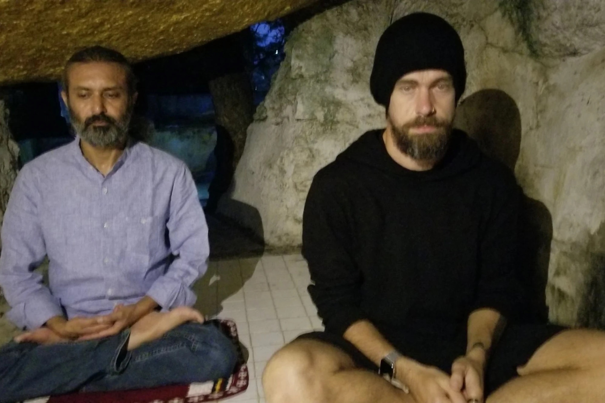
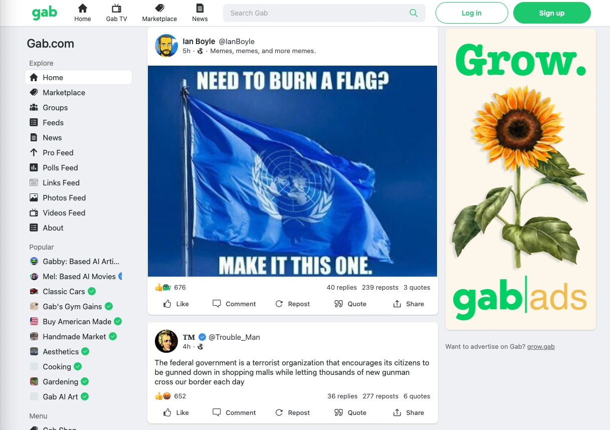
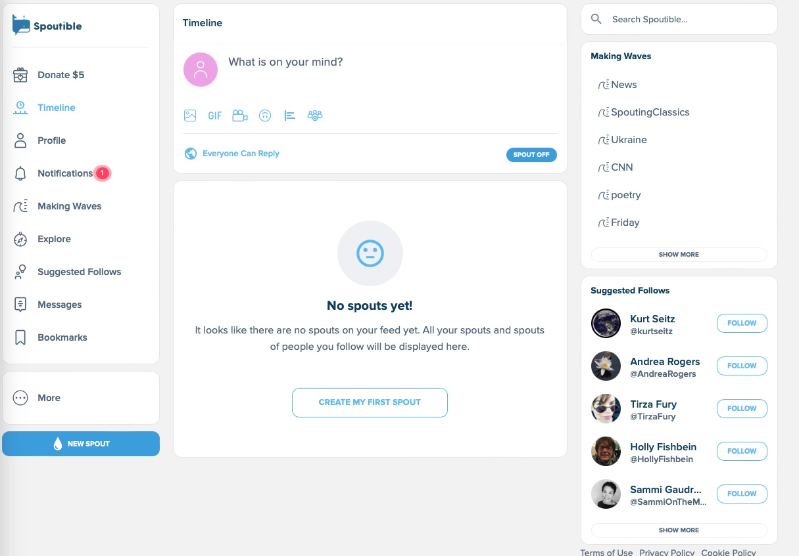

TL/DR Summary

1. BlueSky has a chance to dethrone twitter right now, but that path is narrow. 
2. Its exclusive invite only model means its user base is now small, elite, and homogenous with few bad actors. Almost everyone likes it. But the real test will be when it opens to the public. 
3. It is designed for true account portability and in theory should prevent a single company from owning the entire network as it scales up. 
4. However, it’s unclear if an ecosystem of small companies can do the job of content moderation in the same ways that centralized social networks do. The same is true of running modern feed-ranking and follow-recommendation systems. 
5. There will be growing pressure to make money using ads to cover costs as the network scales up, which will incentivize centralizing key data and resources, undermining the original model.
6. Future possibilities include: (1) BlueSky remains de-facto centralized, "in beta" until it can get composable moderation right, which turns out to be the foreseeable future; (2) big players (Google, Facebook) join the party and dominate the ecosystem; (3) small, unmoderated, ad-free apps proliferate and the network becomes overrun with spam, NSFW, hate, scams and gifts that come with a lack of moderation. 

***

Pretty much everyone at Twitter---and especially Jack Dorsey---has long known that BlueSky could replace Twitter. When I joined Twitter in 2021, I soon learned our CEO was terribly unpopular internally, sporting a job approval rating under 40 percent, by far the lowest of any executive at the company. 

In fact, Jack was obsessed with decentralization, he seemed convinced that it was a mistake to have Twitter organized as a corporation, and he would rant about this on company-wide calls, which he seemed to be taking from caves in South Asia. This is when everyone else at the company was desperately trying to increase revenues to save the company from implosion.

Enter BlueSky, which would decentralize Twitter. Jack launched the initiative in 2019, and his plan was to migrate Twitter to this new protocol. It puts user data including posts and follow lists on open, public portable data servers (PDSs) that mean true account portability. Any business or organization could index the those servers, or what I will call the “BlueSkyVerse” (technically the [AT Protocol](https://blueskyweb.xyz/blog/10-18-2022-the-at-protocol)), rank posts, and create a front end interface. 

But wait a minute! Remember during Elon Musk’s acquisition how everyone said that the value of twitter isn’t the tech, but rather the network of creators and the communities that exist there? If you decouple that network from the platform you give up your most valuable asset—Google, Meta, others can index the network, develop a user interface, create some algorithms, show ads, and eat your lunch. 

And yet, Jack was about to do just that, filling Twitter’s moat by turning its most valuable asset into a protocol. Of course, this did not go over well with employees who weren't independently wealthy, nor the board, who eventually pushed him out. 

BlueSky nicely captures the essence of Jack’s reign as half-time CEO: how little he cared about Twitter as a business and how much he cared about Twitter as an ecosystem. 

But back to the question everyone cares about right now: will this new system lead to a better social network, or set of networks? Is this finally the Twitter alternative we’re looking for? 

Make no mistake about it---BlueSky was designed by Twitter to replace Twitter. This makes it very different from the other new social media protocols, apps, etc. that we’ve seen come on the scene of late. As [John Gruber put it](https://mastodon.social/@gruber/110314523447694321), “If you hated Twitter, you’ll like Mastodon. If you liked Twitter, you’ll love BlueSky.” 

So it’s a contender, despite how hard it is to start a social network from scratch. And don’t get any funny ideas about a post-surveillance-capitalism social network---if BlueSky takes off, it will most likely devolve into a less-moderated, less-profitable version of Twitter, Inc (aka Twitter 1.0). It will indeed encourage competition for front-end interfaces to explore the BlueSkyVerse. But the biggest challenges that social networks have to face—content moderation, discoverability, and monetization—require big technical and infrastructural investments to do well. They may only be viable for well-capitalized companies that generate big profits. 

But of course, I would be very nervous if I still worked at Twitter. 

**Will it work?**

Now is a unique opportunity for a Twitter rival. Twitter CEO Elon Musk tends to say [all manner of nutty things](https://www.cnn.com/2022/10/30/business/musk-tweet-pelosi-conspiracy/index.html), he has [decimated Twitter's trust and safety org](https://techcrunch.com/2022/11/21/elon-musk-twitter-netzdg-test/), and cut staffing by more than 80%. And the company slashed infrastructure budgets needed for automated content moderation---internal sources say the company has cut 3bn since peak spending prior to the recession, while external accounts say [Musk ordered a 1bn cut himself](https://www.reuters.com/technology/musk-orders-twitter-cut-infrastructure-costs-by-1-bln-sources-2022-11-03/). 

It shows: in the wake of the Allen massacre on Saturday, [graphic videos and misinformation spread across the platform](https://www.dallasnews.com/news/2023/05/11/gore-conspiracies-spread-on-elon-musks-loosely-moderated-twitter-after-allen-shooting/). Advertisers don't want to risk putting their brands next to that kind of content and [many have suspended advertising](https://www.cnbc.com/2022/11/01/ad-giant-ipg-advises-brands-to-pause-twitter-spending.html) on the platform. 

We’ve all wondered which alternative social media system might replace Twitter. Could it be Mastodon, Spoutible, Post News, maybe Substack Notes? Or perhaps Truth Social or Gab or Gettr?! 

I’m guessing it’s not going to be those other networks. The new centralized social network entrants—Spoutible, Post News, and Substack Notes—feel sterile and inauthentic when you first get started, partially because they are built around conventional media outlets, partially because they didn’t pay enough attention to discoverability in onboarding. Gettr/gab/truth social have libertarian-borderline-right-wing moderation setups, and the vast majority of people on Twitter have little interest in a right-wing echo chamber where there's no one to troll. 

Mastodon is losing steam for many reasons---onboarding is terribly confusing, it’s broken into communal servers that are all very different but that all seem uptight. Moderation there has been characterized as “[petulant nannyism](https://mastodon.social/@gruber/110328355532624579).” 

Like Twitter, and [unlike Mastodon](https://werd.io/2023/the-fediverse-and-the-at-protocol), BlueSky can surface content from this entire web of activity across the BlueSkyVerse and delight you with memes and witticisms, many of which were about [”Sexy” ALF (yes, the 80s TV star)](https://faineg.substack.com/p/how-i-accidentally-ruined-bluesky) when I signed up. 

Many beta users say BlueSky feels like a breath of fresh air, like a throwback to early Twitter. For now, BlueSky is invite-only and so missing are the scammers, crypto bros, right-wing nuts, and tone policing randos looking for followers you find on Twitter. It feels more communal and less exhausting. Unclear how long that will last.

So maybe BlueSky has a legit claim to the Throne of Discourse, post-Twitter. 

**Content Moderation**

First of all, content moderation is not just a “nice-to-have” thing that keeps the press happy. Facebook and others have found that content moderation [increases retention](http://tecunningham.github.io/2023-04-28-ranking-by-engagement.html). And look at the flip side: most people don’t want to hang out at what Mike Masnick calls “[Nazi bars](https://www.techdirt.com/2023/05/04/on-social-media-nazi-bars-tradeoffs-and-the-impossibility-of-content-moderation-at-scale/),” which is what platforms with permissive moderation policies will often become known for, whether they are actually Nazis or just radical free-speech advocates. Once that happens, kiss a lot of your core user base and ad revenue goodbye---which is what seems to be happening at Twitter.

Of course, content moderation is the bane of the modern social media network. It’s expensive, [it will always be wrong](https://www.techdirt.com/2019/11/20/masnicks-impossibility-theorem-content-moderation-scale-is-impossible-to-do-well/), it can easily create a PR dumpster file, and its benefits are extremely difficult to measure. This new protocol was designed with content moderation in mind so let me break that down before talking about the problems that will surely come up. 

On BlueSky, speech happens on your PDS, but reach happens on the centralized app—Bluesky for now. And they [are in fact moderating](https://blueskyweb.xyz/blog/4-13-2023-moderation), so if they find a post that violates policy, they may take it off their app. It’s still up on the PDSs, it’s just not indexed in BlueSky. So great, it allows for a slightly truer form of “freedom of speech but not reach.” 

How does this actually work? The BlueSky team wants to create a “[moderation ecosystem](https://blueskyweb.xyz/blog/4-13-2023-moderation),” in which labels (“spam”, “nsfw”) can be created by anyone, and apps like BlueSky can then choose what labels to act upon. Right now, it’s completely centralized at BlueSky, and they have an automated layer and decisions are made by “server administrators.” Eventually though, there will be other label sources, other apps besides BlueSky and many servers beyond bsky.social.  They’re proposing a “choose your own moderation” approach.

OK what are the downsides? 

First, there are key parts of moderation that raise questions under this framework. If you doxx someone’s home address for targeted harassment, post a bunch of Child Sexual Abuse Material (CSAM) or non-consensual sexual imagery, it feels insufficient to merely de-index those posts. There are cases where it [may not be legally sufficient](https://www.nytimes.com/2023/05/03/technology/dorsey-musk-twitter-bluesky-nostr.html) under the Digital Services Act, NetzDG, or U.S. Copyright Law. 

The spam-detection arms race is another example—the more you are open with how it works, the faster the spammers get around your detection systems. Somewhat relatedly, the fact that blocklists are public on BlueSky due to the BlueSkyVerse architecture, is [already stirring controversy](https://twitter.com/MattBinder/status/1652142389165797377?s=20). 

Finally, a big part of a healthy information ecosystem is keeping bad actors off your platform in the first place. In centralized networks, that’s often done by IP screening, cell phone/text message screening, email validation, and/or by using other private data. But a PDS hosts public data, so the centralized app would need to create parallel user accounts to collect and maintain that data. 

All that means it’s difficult to see an alternative to a world where BlueSky and other AT apps need to start collecting private user data, even if it’s inconsistent with the clean decentralized, portable data model illustrated above. The line between PDS and user account will get very fuzzy very fast. 

And, once apps do this for content moderation, wouldn’t they also wish to do it for advertising as well? Content moderation isn’t free.

Right now, signups are based on invites, which helps keep out bad actors. But eventually BlueSky will need to open up fully once it’s out of beta. 

When that happens, the job of content moderation will be far more complex than in a place like Mastodon, because the BlueSky architecture is meant to enable “scale and global discoverability.”  With Mastodon/the Fediverse, each server has its own policies, norms, and content moderation, which is far simpler in its small, federated worlds. In the BlueSkyVerse, you have no choice but to scale up moderation. 

**Recommender systems in the BlueSkyVerse**

Will BlueSky be incentivized to build a feed-ranking system into their product and start logging the vast scope of data that inspired the phrase “surveillance capitalism?” They have already started down that path—in fact they’ve built the BlueSkyVerse to facilitate global discovery—large scale indexing and ranking across all PDSs in the network. 

Right now, the “What’s Hot” feed does global discovery, but in a way that is pretty basic—it’s showing popular stuff from the last 30 minutes. For now this is fine, [it’s the core of most modern recommender systems](http://tecunningham.github.io/2023-04-28-ranking-by-engagement.html) in social media websites. 
 
Contrast this with Mastodon, where you can technically follow people from another server but the system isn’t designed so servers index each other and form one network. This is an important reason I think BlueSky could have legs, but Mastodon will probably not replace Twitter.

Setting aside any monetary pressures facing BlueSky for a minute, I suspect they will be driven toward increased data collection and deployment, simply because you need to do that to move the metrics that tell you your product is improving. This may be further cemented by the culture of modern engineering organizations—where engineering leaders and PMs ruthlessly focus on moving a “north star” metric, which is almost alway some variant of time spent. “Time spent, daily active users, session counts, these are measures of whether you’re making your product better—the fact that they are all highly correlated with potential ad revenue is coincidental. 

Of course, to do anything like what Twitter and Facebook do with their recommender systems—for both follow recommendations and for feed-ranking—will require a lot more resources. For the follow graph, that entails predicting which users are likely to form mutual follow relationships or satisfactory follow-only relationships, which can be done with shortcuts but is ultimately a difficult (graph machine learning) problem. For feed-ranking, that requires predicting what users are likely to interact with what content, which both Twitter and Facebook had entire divisions of engineers and data scientists working on. 

**Pressures to centralize and monetize the BlueSkyVerse**
Venture capitalists and startups in Silicon Valley are always talking about “moats.” If you invest a great deal of resources to build a technology or a new marketplace, what’s to stop a competitor from drinking your milkshake? 

There’s an influential idea among “Web 3.0” circles, which is that Facebook, Instagram, and Twitter are the landlords of castles you can’t leave. That’s not supposed to happen this time—the BlueSkyVerse was designed around account portability and front-end/algorithmic competition. The hope is this will create an ecosystem of small companies doing bits and pieces of what big social media companies do today. 

At the same time, everything I’ve seen so far suggests that large investments are going be required to even start playing in the BlueSkyVerse—there are barriers to entry on data processing to even index it as users grow, to create a legit feed and UX, and to do content moderation at that kind of scale. Jack has given billions to the BlueSky team to get the system to where it is today. 

So what happens if the BlueSkyVerse really takes off? We might indeed see real competition for front-end apps that do custom algorithmic ranking and figure out innovative ways to moderate content. We might see further media fragmentation—perhaps front-end providers will try to differentiate themselves by topic or political orientation like television channels do. 

But running a modern social media website is expensive. If it grows as big as Twitter, indexing the BlueSkyVerse will become a challenge, same for running modern recommender systems. And if you want ad revenue you need content moderation, which you can’t solve with AI alone—you need humans in the loop, which means you don’t get the kind of economies of scale you’d see with automated systems. What’s more, you often need sensitive user data to do these things well, and you need bespoke solutions to new adversarial tactics you find. So it’s hard to fully rely on an external company for these solutions, as the creators of BlueSky seemed to envision. 

**The future of the network**

I see a few possibilities if BlueSky gets really big: the first is that BlueSky the app simply dominates this system—they moved first, they understand the system, they can do content moderation, they figure out how to scale up, and they may decide to sell ads. At the same time if BlueSky does become “Twitter 3.0,” there have to be consequences to the fact that I can simply take my posts and follow-graph to a competing service and still be on the same network. 

Or maybe not. Maybe they will realize that the challenges of content moderation favor keeping the network as is, and the BlueSkyVerse will remain closed for a long time. Perhaps forever. 

But if it does really launch and open up, it seems likely that established tech starts to play—Google jumps in, dedicates a small fraction of the resources it used to fund Google+, indexes the BlueSkyVerse in a day, and boom… has a competitor to Facebook. Maybe Facebook jumps in too, but that’s a tricky proposition because once part of Facebook/Instagram has true account portability what happens to the rest of the company? 

Of course, another outcome that seems likely is a conservative social media front-end provider. Maybe Truth Social integrates with the BlueSkyVerse. It won’t make much money because many in that demographic seem happy with Twitter for now, and there will be substantial brand risk for potential advertisers. 

Finally, we might see pure anarchy. In this "race to the bottom" scenario, a set of small, unmoderated, ad-free apps proliferate. Since people don't like ads, they use these apps. The network becomes overrun with spam, NSFW, hate, scams and gifts that come with a lack of moderation. Of course, it's unclear these apps would be tolerated by the app stores, but this is one direction things might generally go.
