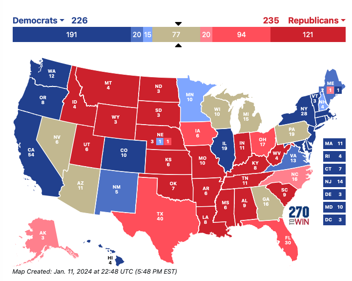
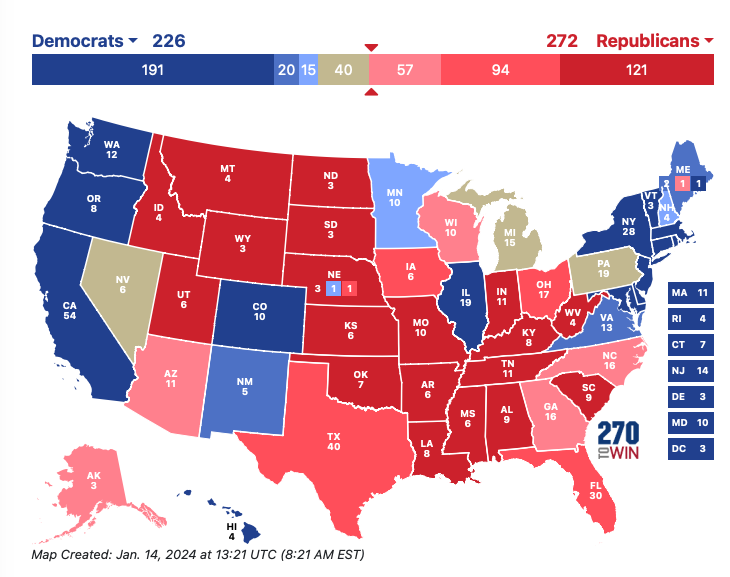
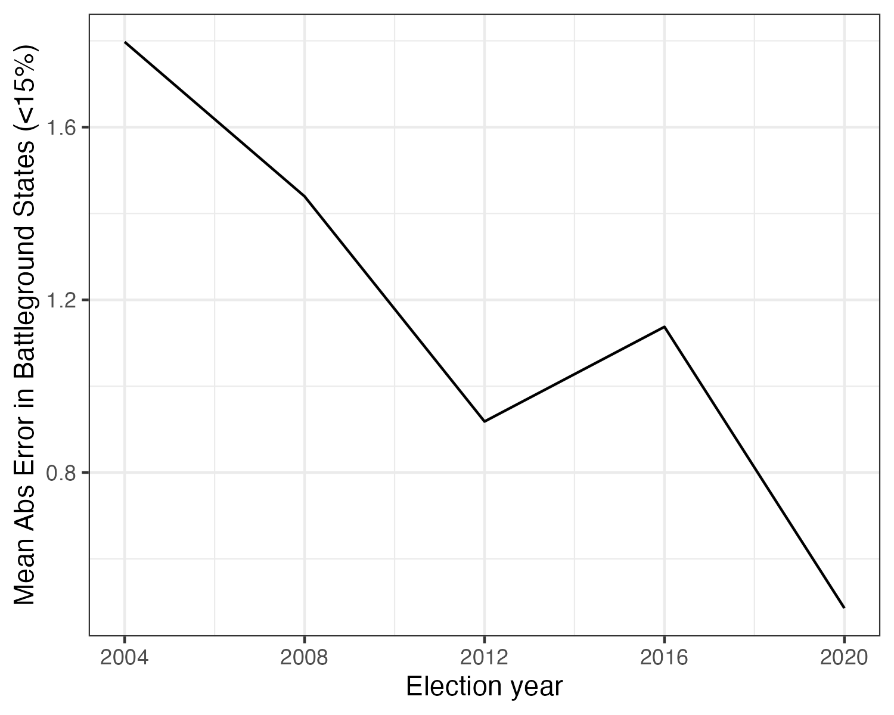
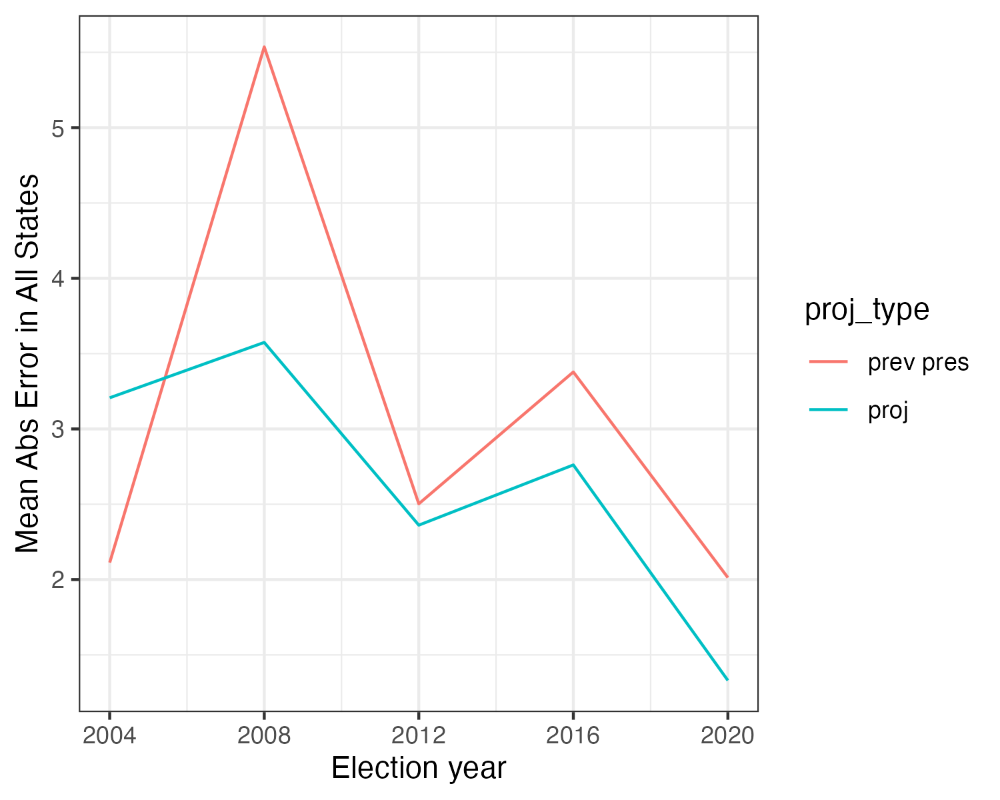

Early projections for 2024 based on previous Presidential and House returns slighly favor Republicans. These projections are completely unrelated to Biden’s recent polling numbers. 

<!--  -->

Here's the story behind this approach: In early 2020, I ran battleground state election forecasts for Acronym. The results suggested Georgia would be extremely competitive—and Acronym spent more $ there than many other non-profit actors. After the election, we could see that those projections had much lower forecasting error than polling data https://solomonmg.github.io/post/what-the-polls-got-wrong-in-2020/.

Because this approach does not use polling data, it's not suspetible to any of the potential problems with polls I talk about in that post: undecided voters breaking late, low education non-response, bad likely voter modeling, partisan non-response, shy Trumpers, etc.

The core idea behind this approach is a fact not emphasized enough in most stats/ML courses: if you’re going to try to predict something, it’s very hard to do better than using the same variable at t - 1 if you can. And we can. This approach goes one step further and looks at the direction that variable has been moving and assume that things are likely to keep moving in that same direction.

What that means for presidential election forecasts: for each state, estimate the "swing" from 2016 to 2020 for president and 2018-2022 for the U.S. house; then simply add that to 2020 presidential returns. Then those estimates of state-level swing are regularized---mathematically "nudged'' toward national trends, which you’ll like if you believe “uniform swing” is particularly important. The projected state-level swing is weighted 60-40 toward presidential results. 

Here's a cleaner plot showing the actual forecast values in potential 2024 battleground states: 

 who suggested this plot design.")

I should now point to a link to the data and code: https://github.com/SolomonMg/election_projection_regularized_swing, and thank the [MIT Election Data + Science Lab](https://electionlab.mit.edu) for curating [these](https://dataverse.harvard.edu/dataset.xhtml?persistentId=doi:10.7910/DVN/42MVDX) [data](https://dataverse.harvard.edu/dataset.xhtml?persistentId=doi:10.7910/DVN/IG0UN2). 

### Electoral Math:
I'm going to rely on www.270towin.com to translate these projections into an electoral map. A better way to do this might be to come up with conservative estimates of error and simulate a few thousand elections, but I'm not estimating an extremely rigorous Bayesian model nor including enough extant data to really justify a FiveThirtyEight style forecast. 

If you call anything lower than a 3 point margin either way a "tossup," here's what the electoral map looks like: 


That looks OK for Biden, but if you really trust this approach, you might want to say anything lower than 2% is a tossup. Then the electoral math looks very bad for Biden:




### Observation: Polarization and Accuracy

These projections essentially assume party identification, demographic trends, and voting behavior will mostly continue in the same general direction as in the past. They should have a lot of appeal if you think polarization means most people have already made up their minds about who to vote for for President, that Presidential campaign effects are relatively small (in equilibrium at least), and/or that “demographics are destiny.” What's more, the results are regularized toward national trends, which you’ll like if you believe that [local politics has been "nationalized,'' as Dan Hopkins argues](https://press.uchicago.edu/ucp/books/book/chicago/I/bo27596045.html) and thus that [“uniform swing” in the electorate is an increasingly important factor explaining state-level election results](https://projects.fivethirtyeight.com/2020-swing-states/)---despite that Florida bucked the national trend in 2020. 

In fact, over time, as polarization seems to worsen, this approach improves in accuracy:



However, these projections do not account for events since 2022. Older voters pass away and younger voters become eligible to vote changing the makeup of the electorate. Public opinion/sentiment may change related to economic conditions (inflation/income/unemployment/etc), policy developments e.g., related to abortion, international affairs like the Gaza conflict, or candidate-attributes like Biden’s age or Trumps legal troubles.

### Observation: Patterns in U.S. Elections

These projections also do not explicitly model well-known voting patterns, instead relying on change from one cycle to another to get reasonable estimates. The most notable trend is that the president’s party almost always tends to lose seats in the house in midterm elections. https://www.jstor.org/stable/2130810 https://fivethirtyeight.com/features/why-the-presidents-party-almost-always-has-a-bad-midterm/

Because the model only looks at the state-level the difference between the last two *midterm* cycles, these projections are capturing how midterm returns *change* in each state, which goes a ways toward correcting the consistent lower performance in midterms pattern, and in part may reflect changes in sentiment toward the president.

A less reliable trend that’s held since FDR’s time is that incumbent presidents have tended to get a higher percent of the popular vote in their election for a second term---Obama in 2012 was a notable exception. https://www.presidency.ucsb.edu/statistics/data/presidential-election-mandates What’s more, house midterm results seem to be particularly bad just before an incumbent is voted out of office. It's not clear if this is a bug or a feature, or how reliably this would be picked up using this method, but it's worthing pointing out. 

### Observation: Accuracy over Previous Election Results
If it's hard to do better than election returns at t - 1, does this approach actually do better? Yes, by a little. Including all states, these projections have lower mean absolute error (MAE). For some reason these projections miss badly in 2004, and excluding that earliest year I can compute these projections using the MIT data, shows they do in fact do quite a bit better than simply relying on previous presidential election results alone. 




```r
> bt_dat %>% group_by(proj_type) %>% summarise(mean(mae))
# A tibble: 2 × 2
  proj_type `mean(mae)`
  <chr>           <dbl>
1 prev pres        3.11
2 proj             2.65

> bt_dat %>% filter(years != 2004) %>% group_by(proj_type) %>% summarise(mean(mae))
# A tibble: 2 × 2
  proj_type `mean(mae)`
  <chr>           <dbl>
1 prev pres        3.36
2 proj             2.51
```

Results are more subtle if we restrict to battleground states: 

```r
> bt_dat %>% group_by(proj_type) %>% summarise(mean(mae))
# A tibble: 2 × 2
  proj_type `mean(mae)`
  <chr>           <dbl>
1 prev pres        1.19
2 proj             1.16
> bt_dat %>% filter(years != 2004) %>% group_by(proj_type) %>% summarise(mean(mae))
# A tibble: 2 × 2
  proj_type `mean(mae)`
  <chr>           <dbl>
1 prev pres       1.28 
2 proj            0.995
```

### Observation: Regularization toward 0 or the Mean? 
Here’s the map with shrinkage toward 0, which will move the estimates toward the prior year's election. Biden does worse in WI and slightly worse in AZ and PA, because the presidential swing estimates get pulled down toward zero instead of up toward the nation-wide state-level mean (3.5%). But he does better in NC, where the relatively good house results get pulled toward zero instead of down to the state-level average midterm swing (-11.5%). 


However, based on my updated backtesting, the MAE estimates are worse when you shrink toward zero, which is what I did back in 2020. This makes me feel good because the mathematical/statistical theory says that shrinking toward the group mean should produce high quality estimates, while there's not much theory that suggests shrinking toward zero should improve estimation. 


### Methological Details
For each state it estimates the "swing" from 2016 to 2020 for president and 2018-2022 for the U.S. house; then simply adds that to 2020 presidential returns. The projected state-level swing is weighted 60-40 toward presidential results.

Now, the tricky bit is I estimate “swing” using James-Stein-adjusted state-level slope. This method “shrinks” the slant of each slope toward 50-50 or toward the average slope. 50-50 is what I used in 2020 and but recent corrections I've made to my backtesting scrips reveals that has a slightly higher mean absolute error going back to the 2004 election.

I've since updated the approach in a number of important ways, based on backtesting (looking at how well the method performs on past elections). I now regularize (or "shrink") fewer quantities and do so toward the mean instead of toward zero. I should also note that the original code I used a few minor errors, which I've since fixed.
