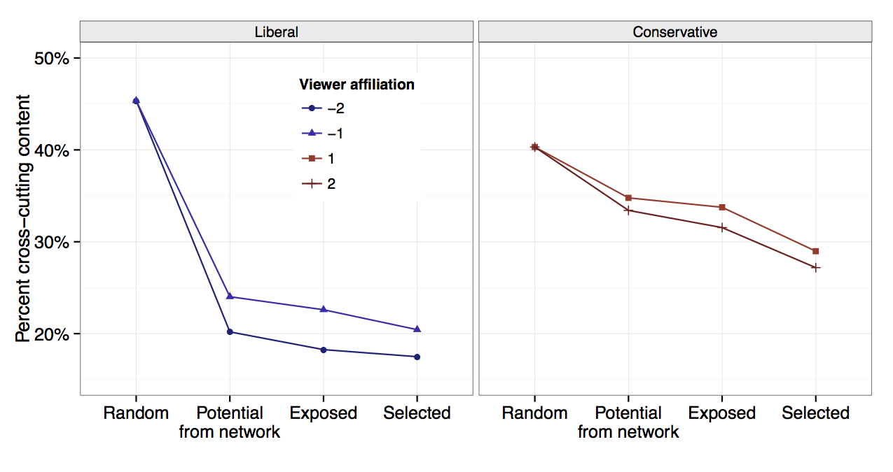
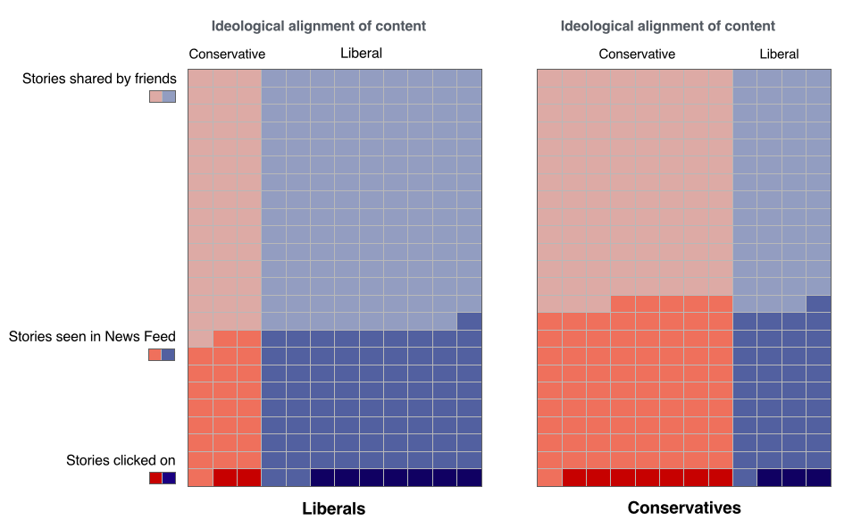

Earlier this month, we published an early access version of our paper in ScienceExpress ([Bakshy et al. 2015](/pdf/Science-2015-Bakshy-1130-2.pdf)), "Exposure to ideologically diverse news and opinion on Facebook." The paper constitutes the first attempt to quantify the extent to which ideologically cross-cutting hard news and opinion is shared by friends, appears in algorithmically ranked News Feeds, and is actually consumed (i.e., click through to read).

We are grateful for the widespread interest this paper, which grew out of two threads of related research that we began nearly five years ago: Eytan and Lada\'s work on the role of social networks in information diffusion ([Bakshy et al. 2012](http://arxiv.org/pdf/1201.4145v2.pdf)) and Sean and Solomon\'s work on selective exposure in social media ([Messing and Westwood 2012](http://crx.sagepub.com/content/41/8/1042)).

While *Science* papers are explicitly prohibited from suggesting future directions for research, we would like to shed additional light on our study and raise a few questions that we would be excited to see addressed in future work.

**Tradeoffs when Selecting a Population**

There were tradeoffs when deciding on who to include in this study. While we could have examined all U.S. adults on Facebook, we focused on people who identify as liberals or conservatives and encounter hard news, opinion, and other political content in social media regularly. We did so because many important questions around "echo chambers" and "filter bubbles"on Facebook relate to this subpopulation, and we used self-reported ideological preferences to define it.

Using self-reported ideological preferences in online profiles is not the only a way to measure ideology or define the population of interest. Yet, people who publicly identify as liberals or conservatives in their Facebook profiles are an interesting and important subpopulation worthy of study for many reasons. As [Hopkins and King 2010](http://gking.harvard.edu/files/gking/files/words.pdf) have pointed out, studying the expression and behavior of those who are politically engaged online is of interest to political scientists studying activists ([Verba, Schlozman, and Brady 1995](http://www.hup.harvard.edu/catalog.php?isbn=9780674942936)), the media ([Drezner and Farrell 2004](http://195.130.87.21:8080/dspace/handle/123456789/979)), public opinion ([Gamson 1992](https://scholar.google.com/scholar?cluster=15572370959137190849&hl=en&as_sdt=2005&sciodt=0,5)), social networks ([Adamic and Glance 2005](http://dl.acm.org/citation.cfm?id=1134277); [Huckfeldt and Sprague 1995](http://www.langtoninfo.co.uk/web_content/9780521542234_frontmatter.pdf)), and elite influence ([Grindle 2005](http://press.princeton.edu/titles/8425.html); [Hindman, Tsioutsiouliklis, and Johnson 2003;](http://citeseerx.ist.psu.edu/viewdoc/download?doi=10.1.1.160.8347&rep=rep1&type=pdf) [Zaller 1992](https://books.google.com/books?hl=en&lr=&id=83yNzu6toisC&oi=fnd&pg=PR8&dq=The+Nature+and+Origins+of+Mass+Opinion&ots=6oEwiBZtSM&sig=ySnwRZUuVtOyTkC-3raaL88pYns#v=onepage&q=The%20Nature%20and%20Origins%20of%20Mass%20Opinion&f=false)).

This subpopulation has limitations and is not the only population of interest. The data are not appropriate for those who seek estimates of the entire U.S. public, people without strong opinions, or people not on Facebook (at least not without additional extrapolation, re-weighting, additional evidence, etc.). While our data *could plausibly* also provide good estimates of the population of people who are ideologically active and have clear preferences, we are not claiming that\'s necessarily the case\-\--that remains to be determined in future work.

We\'d like to help other researchers looking to study other populations understand more about the population we\'ve defined. An important question in this regard is what proportion of active U.S. adults actually report an identifiable left/right/center ideology in their profile. That number is 25%, or 10.1 million people.

It\'s also informative to examine the proportion of those users who provide identifiable profile affiliations conditional on demographics and Facebook usage:

<table style="border-collapse:collapse;width:473px;height:512px;" border="0" width="174" cellspacing="0" cellpadding="0"><colgroup> <col style="width:65pt;" span="2" width="87" /> </colgroup>
<tbody>
<tr style="height:18pt;">
<td class="xl63" style="height:18pt;width:65pt;" width="87" height="24"><strong>Age</strong></td>
<td class="xl63" style="width:65pt;" width="87"><strong>Percent reporting ideological affiliation</strong></td>
</tr>
<tr style="height:18pt;">
<td class="xl63" style="height:18pt;" height="24">18-24</td>
<td class="xl64">21.60%</td>
</tr>
<tr style="height:18pt;">
<td class="xl63" style="height:18pt;" height="24">25-44</td>
<td class="xl64">28.50%</td>
</tr>
<tr style="height:18pt;">
<td class="xl63" style="height:18pt;" height="24">45-64</td>
<td class="xl64">24.30%</td>
</tr>
<tr style="height:18pt;">
<td class="xl63" style="height:18pt;" height="24">65+</td>
<td class="xl64">21.40%</td>
</tr>
<tr style="height:18pt;">
<td class="xl63" style="height:18pt;" height="24"></td>
<td class="xl63"></td>
</tr>
<tr style="height:18pt;">
<td class="xl63" style="height:18pt;" height="24"><strong>Gender</strong></td>
<td class="xl63"><strong>Percent reporting ideological affiliation</strong></td>
</tr>
<tr style="height:18pt;">
<td class="xl63" style="height:18pt;" height="24">Female</td>
<td class="xl64">21.90%</td>
</tr>
<tr style="height:18pt;">
<td class="xl63" style="height:18pt;" height="24">Male</td>
<td class="xl64">30.60%</td>
</tr>
<tr style="height:18pt;">
<td class="xl63" style="height:18pt;" height="24"></td>
<td class="xl63"></td>
</tr>
<tr style="height:18pt;">
<td class="xl63" style="height:18pt;" height="24"><strong>Login Days</strong></td>
<td class="xl63"><strong>Percent reporting ideological affiliation</strong></td>
</tr>
<tr style="height:18pt;">
<td class="xl63" style="height:18pt;" height="24">105-140</td>
<td class="xl64">18.90%</td>
</tr>
<tr style="height:18pt;">
<td class="xl63" style="height:18pt;" height="24">140-185</td>
<td class="xl64">26.70%</td>
</tr>
</tbody>
</table>

Clearly those who report an ideology in their profile tend to be more active on Facebook. They are also more likely to be men, which is consistent with the well-documented gender gap in American politics ([Box-Steffensmeier 2004](http://journals.cambridge.org/action/displayAbstract?fromPage=online&aid=245226&fileId=S0003055404001315)).

It\'s possible that these individuals differ from other Facebook users in other ways. It seems plausible to expect these people to have higher levels of political interest, a stronger sense of political ideology and political identity, and to be more likely to be active in politics than most others on Facebook. It\'s also possible that these individuals are more extroverted than the average user, especially in the somewhat taboo domain of politics. These possibilities also strike us as interesting questions for study in future work.

**How to Measure Ideology**

We hope others will replicate this work using other populations and ways of measuring ideology, which will provide a broader view of exposure to political media. Data on ideology could be collected by, for example, surveying users, imputing ideology based on user behavior, or joining data to the voter file. Each of these methods have advantages and potential challenges.

Using surveys in future work would allow researchers to collect data on ideology in a way that can facilitate comparisons with much of the extant literature in political science, and allow researchers to sample from a less politically engaged population. Of course, this could be tricky because survey response rates might be affected by the phenomenon under study. In other words, the salience of political discussion from the right or left, and/or prior choices to consume content could make people more/less likely to respond to a survey asking about ideology, or affect the way they report the strength of their ideological preferences. This could confound measurement in a way that would be difficult to detect and correct. Yet it would be fascinating to see how survey results compare to the results in this study.

We would also encourage the application of large-scale methods that impute individuals' ideological leanings using social networks or revealed preferences. This would have the advantage of allowing researchers to estimate ideological preferences for a broader population, and could be applied to empirical contexts for which self-reported ideological affiliations are not present.

However, these approaches present challenges. Imputing ideology based on social networks would make it difficult to estimate what proportion of people's networks contain individuals from the other side. [Bond and Messing, 2015](http://journals.cambridge.org/action/displayAbstract?fromPage=online&aid=9586211&fileId=S0003055414000525) and [Barberá 2014](http://pan.oxfordjournals.org/content/23/1/76.full.pdf?keytype=ref&ijkey=uMFPw4dsMHM7608) discuss some of the challenges related to estimating ideology based on revealed preferences. Another challenge specific to the quantities estimated in our paper is that because behavior may be caused by the composition of individuals' social networks, what their friends share, and how they engage with Facebook, using revealed preferences to select the population could introduce endogenous selection bias ([Elwert and Winship 2014](http://www.annualreviews.org/doi/abs/10.1146/annurev-soc-071913-043455)). A study that negotiates these issues would be a tremendously valuable contribution. Similar methods could also be used to obtain measures of ideological alignment of content.

Lastly, researchers could use party registration from the voter file. This approach would yield millions of records, but have different selection problems---match rates may differ by region, state, age, gender, etc. Again, the advantage of approaches like this are that these studies compliment each other and provide a fuller picture of how exposure to viewpoints from the other side occur in social media.

Future work should also examine how exposure varies in different subpopulations. For example, one hypothesis to test is whether those with weaker or less consistent ideological preferences have more cross cutting content shared by friends, rendered in social media streams, and selected for reading. Some preliminary analysis suggests that indeed, among the individuals in our study, those with a weaker stated ideological affiliation have on average more cross-cutting content at each stage in the exposure process.

**Other Data Sources**

There are many other important questions related to this paper that necessitate new data sources: Does encountering cross-cutting content increase or decrease attitude polarization? What about attitudes toward members of the other side? Does it change specific policy preferences? Are liberals and conservatives more or less likely to see content in News Feed *because* it was cross-cutting? Do they actively avoid cross-cutting political content *because* of expressions in the title or because of the fact that the media source is suggestive of a cross-cutting article? How do changes to ranking algorithms and user interfaces affect selective exposure? And how can we better understand actual discourse about politics in social media, rather than merely shared media content?

Answering these questions necessitates collecting innovative data sets via online experimentation ([Berinsky et al. 2012](http://pan.oxfordjournals.org/content/20/3/351.short)), social media ([Ryan and Broockman 2012](http://scholar.harvard.edu/dtingley/files/fall2012.pdf)), crowdsourcing ([Budak et al. 2014](http://papers.ssrn.com/sol3/papers.cfm?abstract_id=2526461)), large scale field experimentation ([King et al. 2014](http://gking.harvard.edu/publications/randomized-Experimental-Study-Censorship-China)), observational social media data, clever ways to collect data about individual differences in ranking ([Hannak et al. 2013](http://www.lazerlab.net/sites/default/files/publications/Measuring%20Personalization%20of%20Web%20Search.pdf)), smart ways to combine behavioral and survey data ([Chen et al. 2014](http://arxiv.org/pdf/1304.1837v3.pdf)), and panel data ([Athey and Mobius 2012](http://faculty-gsb.stanford.edu/athey/documents/localnews.pdf), [Flaxman et al. 2014](https://5harad.com/papers/bubbles.pdf)).

Many of these are causal questions necessitating experimental and/or quasi experimental designs. For example, the extent to which people select content because it is cross-cutting could be investigated using experiments like this one (e.g., [Messing and Westwood 2012](http://crx.sagepub.com/content/41/8/1042)) or through identifying sources of natural exogenous variation. And while Diana Mutz and others have done ground-breaking research on the effects of encountering cross-cutting arguments on political attitudes ([Mutz 2002](http://journals.cambridge.org/action/displayAbstract?fromPage=online&aid=208463&fileId=S0003055402004264)b) and behavior ([Mutz 2002](http://www.jstor.org/stable/3088437)a), more research into how these effects play out in the long term (using approaches like [Druckman et al 2012](http://faculty.wcas.northwestern.edu/~jnd260/pub/Druckman%20Fein%20Leeper%20APSR.pdf)) would be of tremendous benefit to the literature. It is difficult to expose people to any sort of argument for a long period of time (say over the course of a U.S. national political campaign cycle), in a way that is not confounded with people\'s existing preferences and the social environment, though creative quasi-experimental work ([Martin and Yurukoglu 2014](http://web.stanford.edu/~ayurukog/cable_news.pdf)) is emerging in this area.

Many of these questions necessitate that researchers identify the effects of cross-cutting arguments both on and off Facebook. To get a full picture of how cross-cutting arguments affect politics requires understanding the myriad of ways individuals get information, both on the Internet ([Flaxman et al. 2014](https://5harad.com/papers/bubbles.pdf)) and offline ([Mutz 2002](http://journals.cambridge.org/action/displayAbstract?fromPage=online&aid=208463&fileId=S0003055402004264)a), what kinds of information people discuss in offline contexts ([Mutz 2002](http://dx.doi.org/10.1017/S0003055402004264)b), and the relative influence of all of these factors on opinions.

Finally, if individuals\' online networks and choices do substantially impact the diversity of news in individuals\' overall "information diets," future research could examine the effects of connecting those with more disparate views ([Klar 2014](http://ajps.org/2015/03/11/partisanship-in-social-settings-when-democrats-and-republicans-meet/)), encouraging consumption of cross-cutting content ([Agapie and Munson 2015](http://www.smunson.com/portfolio/projects/socnews_icwsm15.pdf)), or simply encouraging individuals to read more diverse news by making individuals more aware of the balance of news they consume ([Munson et al. 2013](http://www.smunson.com/portfolio/projects/aggdiversity/balancer-icwsm.pdf)).

These questions are especially important in light of the fact that there are substantial opportunities for people to read more news on Facebook. The plots below illustrate the average proportion of stories shared by friends, those that are seen in News Feed, and those clicked on for liberals and conservatives in the study. Clearly there is an opportunity to read more news from either side.

**Dataverse**

Finally, we believe that reproducing, replicating, and conducting additional analyses on extant data sets is extremely important and helps generate ideas for future work ([King 1995](http://gking.harvard.edu/files/abs/replication-Abs.shtml), [Leeper 2015](http://thomasleeper.com/2015/05/open-science-language/)). In that spirit, we have created a [Dataverse archive](https://dataverse.harvard.edu/dataset.xhtml?persistentId=doi:10.7910/DVN/AAI7VA). The repository includes replication data, scripts, as well as some additional supplementary data and code for extending our work.

**References**

E. Bakshy, S. Messing, L.A. Adamic. 2015. Exposure to ideologically diverse news and opinion on Facebook. *Science*.

E. Bakshy, I. Rosenn, C.A. Marlow, L.A. Adamic. 2012. The Role of Social Networks in Information Diffusion. *ACM WWW 2012.*

S. Messing and S.J. Westwood. 2012. Selective Exposure in the Age of Social Media: Endorsements Trump Partisan Source Affiliation When Selecting News Online. *Communication Research*.

P. Barberá (2015). Birds of the same feather tweet together: Bayesian ideal point estimation using Twitter data. *Political Analysis*, *23*(1), 76-91.

R. Bond, S. Messing, Quantifying Social Media's Political Space: Estimating Ideology from Publicly Revealed Preferences on Facebook. *American Political Science Review*

F. Elwert and C. Winship. 2014. Endogenous Selection Bias: The Problem of Conditioning on a Collider Variable. *Annual Review of Sociology.*

G. King, J. Pan, and M. E. Roberts. 2014. Reverse-Engineering Censorship in China: Randomized Experimentation and Participant Observation. *Science*.

C. Budak, S. Goel, & J. M. Rao. (2014). Fair and Balanced? Quantifying Media Bias Through Crowdsourced Content Analysis. *Quantifying Media Bias Through Crowdsourced Content Analysis (November 17, 2014)*.

S. Athey, M. Mobius. The Impact of News Aggregators on Internet News Consumption: The Case of Localization. Working paper. <http://faculty-gsb.stanford.edu/athey/documents/localnews.pdf>

A. Hannak, P. Sapiezynski, A. Molavi Kakhki, B. Krishnamurthy, D. Lazer, A. Mislove, C. Wilson. 2013. Measuring personalization of web search. *ACM WWW 2013*.

A. Chen and A. Owen and M. Shi. Data Enriched Linear Regression. Working paper. <http://arxiv.org/pdf/1304.1837v3.pdf>

G.J. Martin, A. Yurukoglu. Working paper. Bias in Cable News: Real Effects and Polarization. Working paper. <http://web.stanford.edu/~ayurukog/cable_news.pdf>

S.R. Flaxman, S. Goel, J.M. Rao. Filter Bubbles, Echo Chambers, and Online News Consumption. Working paper. <https://5harad.com/papers/bubbles.pdf>

D.C. Mutz. 2002. The Consequences of Cross-Cutting Networks for Political Participation. *American Journal of Political Science*.

D.C. Mutz. 2002. Cross-cutting Social Networks: Testing Democratic Theory in Practice. *American Political Science Review*.

J. N. Druckman, J. Fein, & T. Leeper. 2012. A source of bias in public opinion stability. *American Political Science Review*.

E. Agapie, S.A. Munson. 2015. "[Social Cues and Interest in Reading Political News Stories](http://smunson.com/portfolio/projects/socnews_icwsm15.pdf)." *AAAI ICWSM 2015*.

S. Klar. 2014. Partisanship in a Social Setting. *American Journal of Political Science*.

S.A. Munson, S.Y. Lee, P. Resnick. 2013. Encouraging Reading of Diverse Political Viewpoints with a Browser Widget. *AAAI ICWSM 2013*.

G. King. 1995. "Replication, Replication." *Political Science and Politics*. <http://j.mp/1wP9Vqn>

T. Leeper. 2015. What\'s in a Name? The Concepts and Language of Replication and Reproducibility. Blog post. <http://thomasleeper.com/2015/05/open-science-language/>
