[PDF](/pdf/aggregator.pdf){.btn-paper} [Follow](https://twitter.com/SolomonMg){.btn-paper}

Inspired by Donald Trump's surprise victory over Hillary Clinton in the 2016 general election, [Sean Westwood](https://www.dartmouth.edu/~seanjwestwood/), [Yphtach Lelkes](http://ylelkes.com/) and I set out to interrogate the question of whether elecion forecasts---particularly probablistic forecasts---might create a sense of inevitability, and ultimately lead people to stay home on election day. 

Clinton herself was quoted in [New York Magazine](http://nymag.com/daily/intelligencer/2017/05/hillary-clinton-life-after-election.html?mid=nymag_press) after the election:

> I had people literally seeking absolution... ‘_I’m so sorry I didn’t vote. I didn’t think you needed me._’ I don’t know how we’ll ever calculate how many people thought it was in the bag, because the percentages kept being thrown at people — ‘_Oh, she has an 88 percent chance to win!_’

**Is it plausible that forecasting could have affected the election?**

For this phenomena to affect an election, it must: 
1. be visible in the media so it reaches potential voters, 
2. depress turnout, and
3. affect one side more than the other. In the case of 2016, that means affecting Clinton's supporters (and/or Clinton campaigners) more than Trump's. 

We found evidence for all of the above. First, witness the rise of forecasts since 2008, when FiveThirtyEight first came on the scene: 

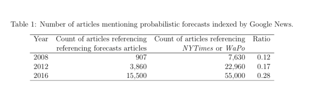 

What's more, there is good evidence that one side will be more affected. Our research (see results below) suggests that _candidate who is ahead in the polls is more affected_ by probablistic forecasts. In 2016, that was Hillary. 

And irrespective of 2016, it's outlets with a _left-leaning audience_ that publish and cover election forecasts. The websites that present their poll aggregation results in terms of probabilities have left-leaning (negative) social media audiences---only realclearpolitics.com, which doesn’t emphasize win-probabilities, has a conservative audience:

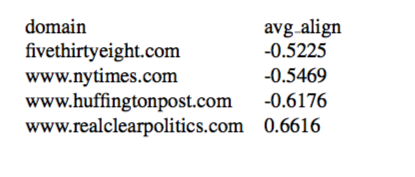

These data come from the average self-reported ideology of people who share links to various sites hosting poll-aggregators on Facebook, data that come from [this paper](http://science.sciencemag.org/content/early/2015/05/06/science.aaa1160.full)’s [replication materials](http://dx.doi.org/10.7910/DVN/LDJ7MS). 

When you look at the balance of coverage of probabilistic forecasts on major television broadcasts, there is more coverage on MSNBC, which has a more liberal audience.

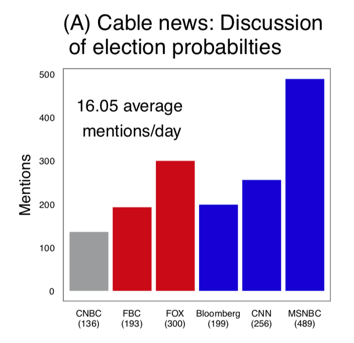

**How much influence do forecasters really have?**

It's increadibly difficult to tease out when one media outlet is influencing another. However, a freak event in 2018 allows us to get some traction on this question, and suggests that FiveThirtyEight's 2018 coverage was highly influential.  

After FiveThirtyEight's real-time forecast suddenely moved the the GOP's odds of taking the House from single digits to about 60% at around 8:15PM, PredictIt's odds on the GOP rose above 50-50, & _U.S. government bond yields rose 2-4 basis points._  FiveThirtyEight then altered it's prediction system and the markets calmed down. 

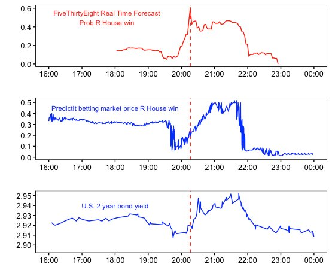

This spike seems to have occurred because a number of big, [Republican-dominated districts started reporting returns before those that went toward Democrats](https://fivethirtyeight.com/live-blog/2018-election-results-coverage/#3495) and because it was making inferences from partial vote counts:

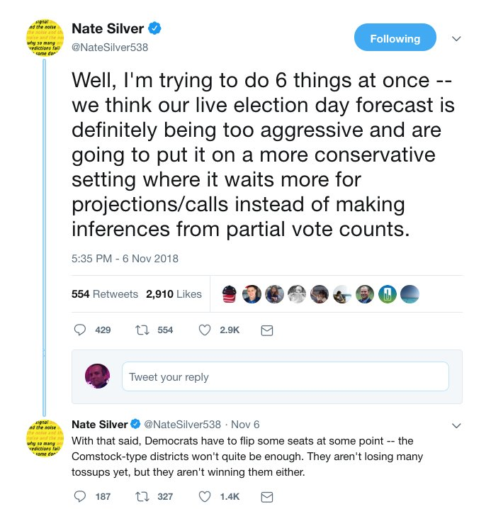

This was [first reported by Colby Smith & Brian Greeley of FT.com](https://ftalphaville.ft.com/2018/11/07/1541617447000/Debt-markets-let-us-know-what-they-think-about-Republicans-last-night/). They report that because markets expected to see more inflation under a Republican House (high spending, low taxes) the U.S. Bond yield rose. 

Was this just a correlation? Possibly, but there was pretty much nothing else happening in the U.S., and it was like 1 am in Europe, as pointed out in the FT.com piece above.

Josh Tucker suggested that [538 might be driving prediction markets](http://themonkeycage.org/2012/10/convergence-between-polls-and-prediction-markets-in-us-presidential-election/) back in 2012 in a Monkey Cage blogpost. 

**Our research on forecasting and perception**

[Our research](/pdf/aggregator.pdf) shows that probablistic election forecasts make a race look less competitive. Participants in a national probability survey-experiment were substantially more certain that one candidate would win a hypothetical race after seeing a probablistic forecast than after seeing the equivalent vote share estimate and margin of error. This is a big effect---those are confidence intervals not standard errors, with p-values below $$10^{-11}$$. 

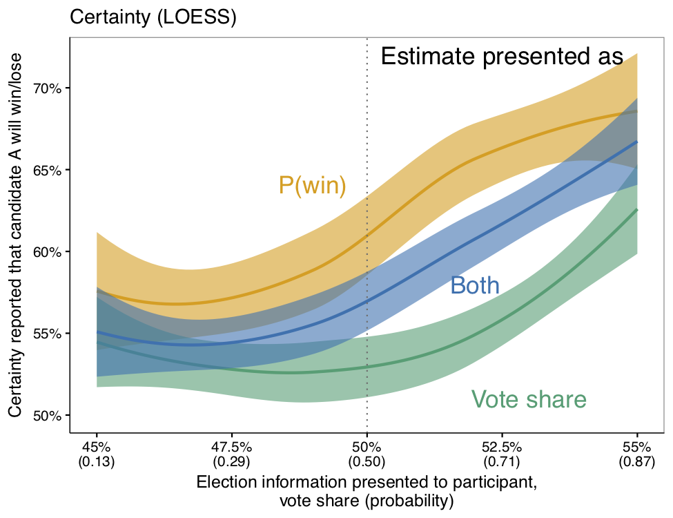

**Why do people do this?**

More research is needed here but we do have some leads. First, small differences in the election metric most familiar to the public—vote share estimates—generally correspond to very large differences in the probability of a candidate’s chance of victory. 

Andy Gelman referenced this in passing in a [2012 blogpost](https://andrewgelman.com/2012/10/22/is-it-meaningful-to-talk-about-a-probability-of-65-7-that-obama-will-win-the-election/) questioning the decimal precision (0.1 percent) that 538 used to communicate its forecast on its website: 

> That’s right: a change in 0.1 of win probability corresponds to a 0.004 percentage point share of the two-party vote. I can’t see that it can possibly make sense to imagine an election forecast with that level of precision...

Second, people sometimes confuse probabilistic forecasts with vote share projections, and incorrectly conclude that a candidate is projected to say win 85% percent of the vote, rather than to having an 85% chance of winning the election. About 1 in 10 peope did this in our experiment. 

As [Joshua Benton pointed out in a tweet](https://twitter.com/jbenton/status/1059898288139354112), TalkingPointsMemo.com [made this very mistake](https://talkingpointsmemo.com/news/issa-calls-race-early):

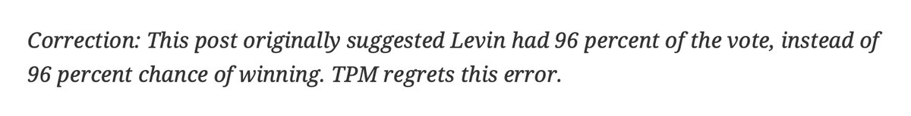

Finally, people tend to think in qualitative terms about the probability of events , . An 85% likelihood that something will happen means it's going to happen. These studies may help explain why after the 2016 election, so many criticized forecasters for “getting it wrong” (see [this](https://www.nytimes.com/2016/11/10/technology/the-data-said-clinton-would-win-why-you-shouldnt-have-believed-it.html
) and [this](http://www.slate.com/articles/news_and_politics/politics/2016/01/nate_silver_said_donald_trump_had_no_shot_where_did_he_go_wrong.html)).

**What about voting?**

Perhaps most critically, we show that probabilistic forecasts showing more of a blowout can lower voting. In Study 1, we find limited evidence of this based on self reports. In Study 2, we show that when participants are faced with incentives designed to simulate real world voting, they are less likely to vote when probabilistic forecasts show higher odds of one candidate winning. Yet they are not responsive to changes in vote share.

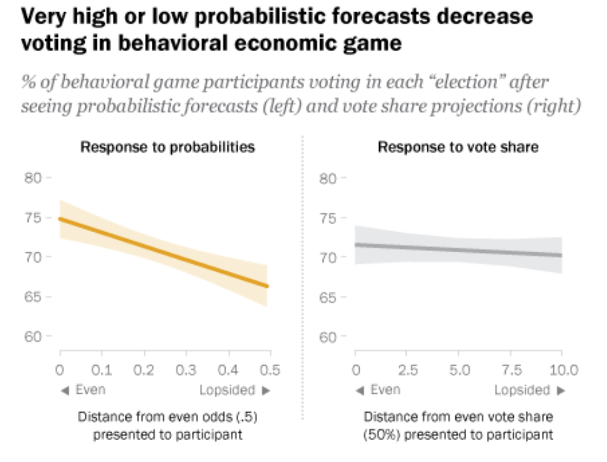

**Could this actually affect real world voting?**

Consider 2016---an unusually high number of Democrats thought the leading candidate would *win by quite a bit*:

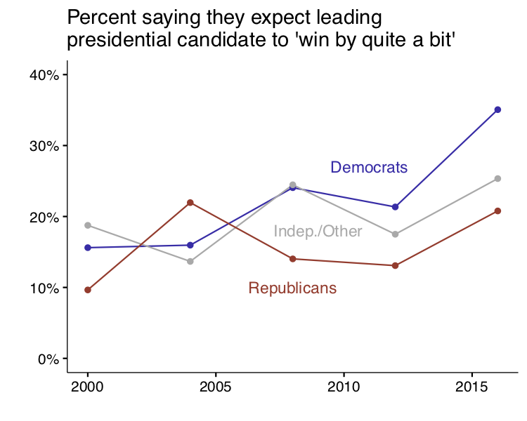

And people who say the leading candidate will *win by quite a bit* in pre-election polling are about three percentage points less likely to say they voted after the election than people who say it’s a close race. That’s after controlling for election year, prior turnout, and party identification. 

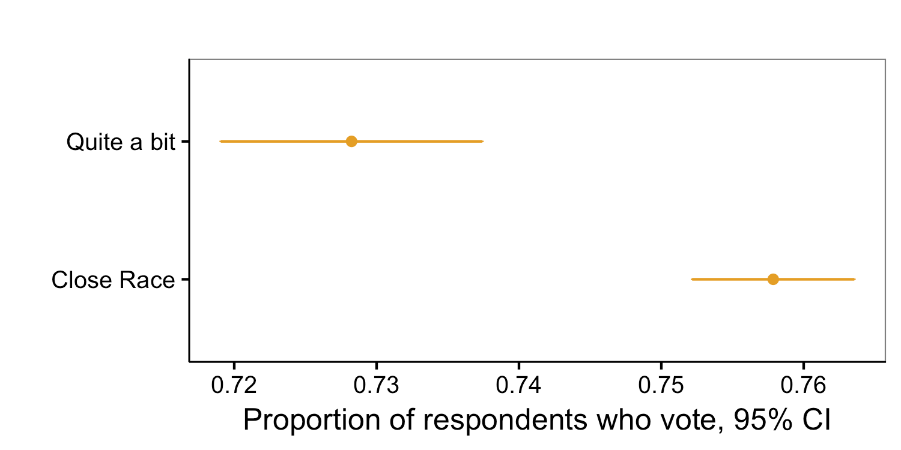

The data here are from the [American National Election Study (ANES)](https://electionstudies.org) and go back to 1952.

Past social science research also provides evidence that the perception of a close race boosts turnout. Some of the best evidence comes from work that analyzes the effects of releasing exit polling results before voting ends, which clearly removes uncertainty. Work examining the effects of East Coast television networks’ “early calls” for one candidate or another on West Coast turnout generally find small but substantively meaningful effects, despite the fact that these calls occur [late on election day](https://repository.upenn.edu/cgi/viewcontent.cgi?article=1018&context=asc_papers), see also [this](https://academic.oup.com/poq/article-pdf/50/3/331/5135691/50-3-331.pdf?casa_token=Ize8hznQUHAAAAAA:6tMTMfvGSN4tFXyyXbwkew4E47cLlCG8FegNu4ulkzqHE3hJZMzfurBb-Y1GWQcvLbZTYUysOMebxg). Similar work exploiting voting reform as a natural experiment [shows a full 11 percentage point decrease](https://eprints.qut.edu.au/83681/1/1-s2.0-S0014292115000483-main.pdf) in turnout in the French overseas territories that voted after exit polls were released. These designs are not confounded with the tendency for campaigns to invest more in campaigns in competitive races.

Researchers consistently find robust correlations between tighter elections and higher turnout [see this](https://www.sciencedirect.com/science/article/abs/pii/S0261379405000910); and [this](https://biopen.bi.no/bi-xmlui/bitstream/handle/11250/2389104/Geys_ES%202016.pdf?sequence=5&isAllowed=y) for reviews]. Furthermore, there is evidence from statistical models that [prior election returns also explain turnout](https://digitalcommons.unl.edu/cgi/viewcontent.cgi?article=1052&context=poliscifacpub) above and beyond campaign spending, particularly when good polling data is unavailable. 

Field experiments provide additional evidence that perceptions of higher electoral competition increases turnout. This work finds substantive effects on turnout when polling results showing a closer race are delivered [via telephone]((https://huber.research.yale.edu/materials/67_paper.pdf)) [among those who were reached] but null results when relying on [postcards](https://www.nber.org/papers/w23071) to deliver closeness messages. Finally, one study conducted in the weeks leading up to the 2012 presidential election found higher rates of self-reported, post-election turnout when delivering ostensible polling results showing Obama neck-and-neck with Romney [which was not consistent with the extant polling data showing a comfortable Obama lead](http://www.aapor.org/AAPOR_Main/media/AnnualMeetingProceedings/2013/Session_C-5-1-Vannette.pdf).

**Could this affect politicians as well?**

Candidates’ perceptions of the closeness of an election can affect campaigning and representation , . 

These perceptions can also shape policy decisions—-for example, prior to the 2016 election, the Obama administration’s confidence in a Clinton victory was reportedly a factor in the muted response to [Russian intervention in the election](https://www.washingtonpost.com/graphics/2017/world/national-security/obama-putin-election-hacking/). 

And former FBI Director James Comey, because of his confidence in a Clinton victory, said he felt that it was his duty to write a letter to Congress on October 28 saying he was reopening the investigation into her emails. Comey explained his actions based on his certain belief in a Clinton win: ''[S]he's gonna be elected president, and if I hide this from the American people, she'll be illegitimate the moment she's elected, the moment this comes out'' . Nate Silver at one point said ''[the Comey letter probably cost Clinton the Election](https://fivethirtyeight.com/features/the-comey-letter-probably-cost-clinton-the-election/).'' 

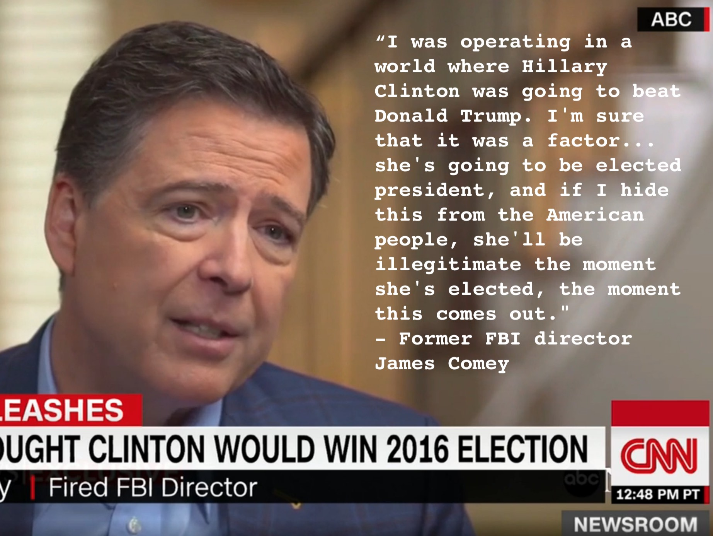

**Media coverage**
[Washington Post](https://www.washingtonpost.com/news/politics/wp/2018/02/06/clintons-achilles-heel-in-2016-may-have-been-overconfidence/?utm_term=.619133ce9312), [FiveThirthyEight’s Politics Podcast](https://fivethirtyeight.com/features/politics-podcast-whats-so-wrong-with-nancy-pelosi/), [New York Magazine](http://nymag.com/intelligencer/2018/02/americans-dont-understand-election-probabilities.html?gtm=bottom&gtm=bottom), [Political Wire](https://politicalwire.com/2018/02/06/election-forecasts-lower-voter-turnout/).
