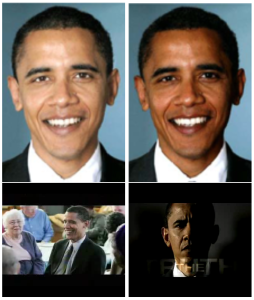
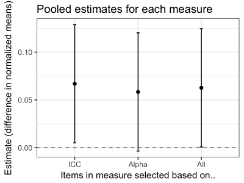
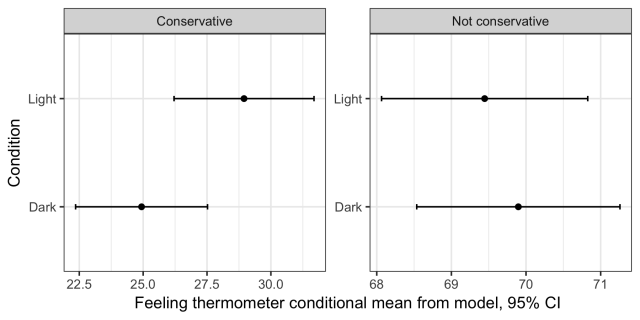

This post presents a replication of [Messing et al](/pdf/HSVmetricsCampaignsDarknessPOQFINAL.pdf). (2016, study 2), which showed that exposure to darker images of Barack Obama increased stereotype activation, as indicated by the tendency to finish incomplete word prompts\-\--such as "W E L \_ \_ \_ \_"\-\--in stereotype-consistent ways ("WELFARE").

Overall, the replication shows that darker images of even [counter-stereotypical exemplars like Barack Obama](http://www.sciencedirect.com/science/article/pii/S0022103110002635) can increase stereotype activation, but that the strength of the effect is weaker than conveyed in the original study.  A reanalysis of the original study conducted in the course of this replication effort unearthed a number of problems that, when corrected, yield estimates of the effect that are consistent with those documented in the replication. This reanalysis also follows.

I\'m posting this to

1.  disseminate a [corrected version of the original study](/pdf/HSVmetricsCampaignsDarknessPOQFINAL.pdf);
2.  show how I found those problems with the original study in the course of conducting this replication;
3.  circulate these generally confirmatory findings, along with a pooled analysis revealing a stronger effect among conservatives; and
4.  provide a demonstration of how replication almost always enhances our knowledge about the original research, which I hope may encourage others to invest the time and money in such efforts.

First some context.

The original study that formed the basis of the manuscript shows that more negative campaign ads in 2008 were also more likely to contain darker images of President Obama. In 2009 when I started this work, I was most proud of the method to collect data on skin complexion outlined in study 1.  I included another study, what\'s now study 3, which shows that 2012 ANES survey-takers were more likely to respond negatively to Chinese characters after being presented with darker images of Obama (this is called the [Affect Misattribution Procedure (AMP)](http://onlinelibrary.wiley.com/doi/10.1111/spc3.12148/abstract)).
But the AMP was not a true experiment and a reviewer was concerned that Study 3 did not provide sufficiently rigorous, causal evidence that darker images alone can cause negative affect.  So I conducted an experiment that would establish a causal link between darker images of Obama and something I thought was even more important\-\--stereotype activation. There were strong reasons to expect this effect based on past lab studies showing links between [darker skin](https://ase.tufts.edu/psychology/tuscLab/documents/pubsCognitive2002.pdf) and [negative stereotypes about Blacks](https://www.ncbi.nlm.nih.gov/pubmed/12088132), and past observational studies showing far more [negative socioeconomic outcomes across the board among darker versus lighter skinned Black Americans](https://wcfia.harvard.edu/files/wcfia/files/2007_27_hochschild.pdf). We found an effect and published the three studies.

This replication effort was prompted by a post-publication reanalysis and [critique](http://www.ljzigerell.com/?p=3622), which raised questions about potential weaknesses in the original analysis. My aim in replicating the study was to bring new data to the discussion and make sure we hadn't polluted the literature with a false discovery.

The main objection was the way we formed our stereotype consistency index. The items assessing stereotype consistency comprised 11 words with missing blank spaces (e.g., L A \_ \_). Each fragment had as one possible solution a stereotype-related completion. The complete list follows: L A \_ \_ (LAZY): C R \_ \_ \_ (CRIME); \_ \_ O R (POOR); R \_ \_ (RAP); WEL \_ \_ \_ \_ (WELFARE); \_ \_ C E (RACE); D \_ \_ \_ Y (DIRTY); B R \_ \_ \_ \_ \_ (BROTHER); \_ \_ A C K (BLACK); M I \_ \_ \_ \_ \_ \_ (MINORITY); D R \_ \_ (DRUG).

The author pointed out that there were many potential ways to analyze the original data\-\--he claimed over 16 thousand. Yet very few of these are consistent with generally accepted research practices. We\'ve known, arguably since the [16th century](http://www.jstor.org/stable/2333051?origin=crossref&seq=1#page_scan_tab_contents), that combining several measures reduces measurement error and hence variance in estimation. This is particularly important in social science, and especially for this particular study\-\--it would be unwise to attempt to use a single word completion or an arbitrary subset thereof to measure a complex, noisy construct like stereotype activation as measured via a word completion game. Rather, taking the [average or constructing an index based on clustering several measures](https://web.stanford.edu/~jrodden/issues_apsr.pdf) should be expected to result in far less measurement error, which is what we did.

Still, I am sympathetic to concerns about the [garden of forking paths](http://www.stat.columbia.edu/~gelman/research/unpublished/p_hacking.pdf), which is part of the motivation for this replication.

In the original study, I formed this index based on what I judged to be the most unambiguously negative word-completions (lazy, dirty, poor), consistent with past work suggesting that darker complexion activates the [most ](https://ase.tufts.edu/psychology/tuscLab/documents/pubsCognitive2002.pdf)[negative](https://www.ncbi.nlm.nih.gov/pubmed/12088132) stereotypes about Blacks. I calculated that these were the three variables that also maximized interclass correlation (ICC). As a robustness check, I also computed a measure that maximized alpha reliability (AR). This measure contained more items, and also seemed to include stereotype-consistent word completions that were on balance negative\-\--lazy, dirty, poor, crime, black, and welfare. I should have but did not report results based on a simple average of these items, which was not conclusive.

[The critical reanalysis](http://www.ljzigerell.com/?p=3622) cited above shows a handful of statistically significant patterns that are inconsistent with the expectations in the original study, which is suggestive evidence that it\'s quite possible to find signal in noise if you\'re analyzing arbitrary sets of variables with the originally collected data. However, as shown below in the much larger replication sample below, none of these patterns replicate.

The critique also noted that we did not include an analysis of several trailing questions we included on the original survey. The concern is the [file drawer problem](http://science.sciencemag.org/content/345/6203/1502) - the incentives against and frequent failure to report null results - which obscures knowledge and is bad for the scientific enterprise.

I included those measures based on [past work](https://papers.ssrn.com/sol3/papers.cfm?abstract_id=1643225) using the same images as stimuli, which found that darker images prompted more negative evaluations of Obama among people with more negative associations with Blacks, as measured using the Implicit Associations Test (IAT). But testing a specification that conditioned on our main outcome of interest\-\--stereotype-consistent word completions\-\--would mean conditioning on a post-treatment variable, particularly worrisome since we saw an effect on stereotype activation in the study.

Below, I pool the data and report another specification that does not require us to condition on post-treatment variables. It takes advantage of the fact that conservatives had significantly higher levels of stereotype activation (which was documented in the original study), and shows that the effect is in fact stronger among this subgroup, providing preliminary evidence in favor of this hypothesis.

The remainder of this post will present my own reanalysis of the original data, the replication, and finally some additional analysis of the data now possible with the larger, pooled data set.

**Re-analysis of original data**

In the process of collecting data for the replication studies, I used the same interface, simply appending the new data as additional respondents completed the survey experiment. When I geo-coded the IP address data in the full data set, I found a discrepancy between the cases I originally geo-coded as U.S. cases, and the cases that now resolved to U.S. locations in the complete data set.  Many of these respondents appeared in sequence, suggesting they may have been skipped, perhaps due to issues related to connectivity to the geo-location server I used.

This prompted me to conduct a full re-analysis of the data, which yields smaller estimates of stereotype activation. First, re-estimating the index yielded different items\-\--\'black\' in place of \'dirty\' for the ICC measure and \'race\' in place of \'welfare\', \'crime\', and \'dirty\' in the AR measure. This is due in part to the way I computed the original indices and in part due to correcting the geo-coding issue. In the original study, I computed the index of variables that maximized alpha and ICC by hand because the epiCalc::alphaBest function (now epiDisplay::alphaBest) does not return results (nor an error message) for these data. For reanalysis, I wrote a function that computed variables to include in the index via successive removal of items. The overall alpha is actually slightly lower in new AR measure, while the new ICC measure has a slightly higher correlation coefficient.

For the sake of transparency, I first report results based on the original items included in the index as reported in Messing et al. 2015 using the updated data, then report the new ICC and AR measures.

Using the original indices with the errantly remove cases included, instead of a 36% increase in stereotype-consistent word completions using the ICC measure, this meant a revised estimate of a 20% increase in stereotype activation (M\_Light = 0.33, M\_Dark = 0.41, T(859.0) = 2.08, P = 0.038, two-sided). For the AR measure, instead of a 13% increase (M\_Light = 0.97, M\_Dark = 1.11, T(626.72) = 1.77, P = 0.078, two-sided), this meant an 8% increase (M\_Light = 0.98, M\_Dark = 1.06, T(850.9) = 1.12, P = 0.265, two-sided).

Re-estimating the indices when including all U.S. cases translates to less conclusive findings\-\--a revised estimate of an 8% increase in stereotype activation in the original study (M\_Light = 0.79, M\_Dark = 0.86, T(850.7) = 1.27, P = 0.203, two-sided) using the ICC measure, and an 8% increase (M\_Light = 0.87, M\_Dark = 0.91, T(839.1) = 0.77, P = 0.439, two-sided) using the AR measure.

A slightly smaller effect was also observed when examining differences between conservatives and other participants. Correcting the geo-coding error and updating the indices reduced the estimate of stereotype activation for conservatives. Instead of a 53% increase, the original ICC measure yields a 29% increase (M\_Other = 0.35, M\_Conservative = 0.49, T(205.9) = 2.49, P = 0.013, two-sided).  The new ICC measure yields an 18% increase (M\_Other = 0.80, M\_Conservative = 0.98, T(207.9) = 2.41, P = 0.017, two-sided).  For the AR measure, instead of a 29% increase, this meant an 18% increase using either measure (original: M\_Other = 0.99, M\_Conservative = 1.18, T(210.4) = 2.11, P = 0.036, two-sided) (new: M\_Other = 0.86, M\_Conservative = 1.05, T(214.3) = 2.47, P = 0.014, two-sided).

**The replication**

I conducted one exact replication and one very close replication with slightly different images, which I pooled for a total of 3,151 respondents, substantially more than the 630 included in the original writeup.  This gives me more statistical power and more precise estimates of the effect in question. (I provide results for each design separately - one of which appears underpowered - at the end of this post).

To be clear, I did not pre-register this replication. However, I\'ve tried to err on the side of exhaustive reporting when the original study did not provide exacting specificity in analyzing the new data. Due to the nature of this replication\-\--the presentation of the same analysis conducted in the original study\-\--the p-values provide highly informative, if not conclusive evidence regarding the nature of the effect.

The average reported age was 36; 52% of participants identified as female; 84% identified as White, 8% as Black; 5% as Hispanic; and 3% as Other. 52% identified as liberal, 27% as moderate, 22% as conservative.

Recomputing the ICC index yielded the following items: black, poor, drug. Recomputing the AR index yielded: lazy, black, poor, welfare, crime, drug, which is close to the original study.

In the replication data, the ICC yields a 5% increase in stereotype activation (M\_Light = 0.90, M\_Dark = 0.95, T(3142.8) = 1.56, P = 0.119, two-sided). Similarly, the alpha measure yields a 5% increase (M\_Light = 1.04, M\_Dark = 1.09, T(3145.8) = 1.70, P = 0.089, two-sided).

The original study isn\'t completely clear on the question of whether a replication should report on the recomputed ICC and AP measures, or the exact same items as in the original study, so it\'s worth reporting those as well. The *original* ICC measure yields a 3% increase in stereotype activation (M\_Light = 0.36, M\_Dark = 0.37, T(3148.9) = 0.51, P = 0.611, two-sided). Using the *original* AR measure yields a 6% increase (M\_Light = 1.01, M\_Dark = 1.07, T(3147.9) = 1.91, P = 0.057, two-sided).

Finally, it\'s worth reporting on an index that simply uses all stereotype-consistent items in the replication reveals a 5% increase in stereotype activation (M\_Light = 1.30, M\_Dark = 1.37, T(3147.7) = 2.05, P = 0.040, two-sided).

A pooled analysis, after normalizing the ICC and AR measures, yields similar results:

    =================================================
                          ICC     Alpha      ALL
    -------------------------------------------------
      (Intercept)       -0.041   -0.028    1.292***
                        (0.034)  (0.034)  (0.036)
      cond: Dark/Light   0.067*   0.058    0.067*
                        (0.032)  (0.032)  (0.034)
      study              0.006   -0.001    0.008
                        (0.023)  (0.023)  (0.025)
    -------------------------------------------------
      R-squared             0.0      0.0       0.0
      N                  4012     4012      4012
    =================================================

I also replicated this study with a different, lesser-known Black politician (Jesse White). However, a manipulation check revealed that only 36% of respondents said the candidate was Black in the "light" condition, compared to 83% in the darker condition, suggesting that any analysis would be severely confounded by perceived race of the target politician. (I did not ask this question in the Barack Obama studies).

**Additional analysis**

The superior power afforded by pooling all three studies may allow the exploration of treatment heterogeneity. [Past work](https://papers.ssrn.com/sol3/papers.cfm?abstract_id=1643225) suggests the possibility that darker images might cause people inclined toward more stereotype-consistent responses to evaluate politicians more negatively. However, this analysis would [condition on post-treatment variables](http://andrewgelman.com/2017/09/12/conditioning-post-treatment-variables-can-ruin-experiment/), which in this case is particularly concerning since the treatment affects stereotype activation according to the original study and replication above.  As an alternative, I consider a specification that uses conservative identification instead, which is a strong predictor of stereotype activation (as shown in the original study), but shouldn't be affected by the treatment. It reveals evidence for the predicted interactions, suggesting that when conservatives are exposed to darker rather than lighter images of Obama, they have slightly "colder" feelings toward the former president (P = 0.039), perceive him to be less competent (P = 0.061), and less trustworthy (P = 0.083).

    =================================================================
                                 obama_therm  competence    trust
    -----------------------------------------------------------------
      (Intercept)                 69.446***    4.213***    3.867***
                                  (0.705)     (0.029)     (0.031)
      cond: Dark/Light             0.451       0.024       0.045
                                  (0.989)     (0.041)     (0.044)
      iscons                     -40.497***   -1.574***   -1.625***
                                  (1.565)     (0.064)     (0.069)
      cond: Dark/Light x iscons   -4.462*     -0.167      -0.165
                                  (2.160)     (0.089)     (0.095)
    -----------------------------------------------------------------
      R-squared                        0.3         0.3         0.2
      N                             3932        3928        3926
    =================================================================

A plot of the model predictions for the thermometer ratings suggests that the effect is concentrated among conservatives.

**Conclusion**

The more items one uses to form an index, the less noise we should expect, and the more likely any replication attempt should be expected to succeed.  It should also mean greater statistical precision. This could explain the remaining discrepancy between this study and the original after adjusting for the geo-coding error pointed out above. It\'s also possible that something about the timing or the subjects recruited in the replication studies that explain the observed differences.

Nonetheless, this replication provides evidence that darker images of Black political figures, or at least of President Barack Obama, do in fact activate stereotypes.  This much larger sample suggests that the true effect is smaller than what I found in the original study, which as noted above, contained some errors.

Replication materials available on [dataverse](http://dx.doi.org/10.7910/DVN/WY7PR8).

**Appendix**

Below I present alternate specifications estimated without pooling. These specifications suggest first that replication 2 (as well as the original study) was not well-powered. It also suggests that the outcome measures with more items yield more reliable estimates.

Outcome measure summing all items:

Replication 1: M\_Light = 1.29, M\_Dark = 1.36, T(2115.4) = -1.59, P = 0.113, two-sided

Replication 2: M\_Light = 1.30, M\_Dark = 1.39, T(982.7) = -1.35, P = 0.177, two-sided

Original Alpha outcome measure:

Replication 1: M\_Light = 0.99, M\_Dark = 1.06, T(2114.9) = -1.79, P = 0.073, two-sided

Replication 2: M\_Light = 1.04, M\_Dark = 1.09, T(979.8) = -0.85, P = 0.393, two-sided

Newly estimated Alpha outcome measure:

Replication 1: M\_Light = 1.02, M\_Dark = 1.09, T(2109.4) = -1.77, P = 0.077, two-sided

Replication 2: M\_Light = 1.07, M\_Dark = 1.10, T(984.6) = -0.53, P = 0.597, two-sided

Original ICC outcome measure:

Replication 1: M\_Light = 0.89, M\_Dark = 0.94, T(2100.6) = -1.49, P = 0.137, two-sided.

Replication 2: M\_Light = 0.93, M\_Dark = 0.96, T(985.9) = -0.67, P = 0.506, two-sided

Newly estimated ICC outcome measure

Replication 1: M\_Light = 0.35, M\_Dark = 0.36, T(2122.5) = -0.22, P = 0.826, two-sided

Replication 2: M\_Light = 0.38, M\_Dark = 0.40, T(978.7) = -0.72, P = 0.472, two-sided
 
A replication of prior [critique and reanalysis](http://www.ljzigerell.com/?p=3622).  The patterns that run contrary to our original findings are not significant in the replication data.

  
<table style="height:1612px;" width="584">
<tbody>
<tr>
<td><strong>Variable</strong></td>
<td><strong>effect size</strong></td>
<td><strong>p-value</strong></td>
</tr>
<tr>
<td>feeling therm</td>
<td>-0.028</td>
<td>0.439</td>
</tr>
<tr>
<td>race minority welfare crime rap</td>
<td>0.022</td>
<td>0.538</td>
</tr>
<tr>
<td>race minority welfare rap</td>
<td>0.017</td>
<td>0.629</td>
</tr>
<tr>
<td>race minority rap</td>
<td>0.011</td>
<td>0.752</td>
</tr>
<tr>
<td>race</td>
<td>0.006</td>
<td>0.861</td>
</tr>
<tr>
<td>minority</td>
<td>-0.013</td>
<td>0.713</td>
</tr>
<tr>
<td>rap</td>
<td>0.024</td>
<td>0.502</td>
</tr>
<tr>
<td>welfare</td>
<td>0.014</td>
<td>0.695</td>
</tr>
<tr>
<td>comp</td>
<td>-0.013</td>
<td>0.72</td>
</tr>
<tr>
<td>crime</td>
<td>0.016</td>
<td>0.659</td>
</tr>
<tr>
<td>trust</td>
<td>0.002</td>
<td>0.946</td>
</tr>
<tr>
<td>brother</td>
<td>0.042</td>
<td>0.236</td>
</tr>
<tr>
<td>drug</td>
<td>0.008</td>
<td>0.822</td>
</tr>
<tr>
<td>lazy</td>
<td>0.026</td>
<td>0.474</td>
</tr>
<tr>
<td>black</td>
<td>0.084</td>
<td>0.019</td>
</tr>
<tr>
<td>dirty</td>
<td>0.028</td>
<td>0.438</td>
</tr>
<tr>
<td>poor</td>
<td>-0.002</td>
<td>0.957</td>
</tr>
<tr>
<td>allwcs</td>
<td>0.073</td>
<td>0.04</td>
</tr>
<tr>
<td>original</td>
<td>0.018</td>
<td>0.611</td>
</tr>
<tr>
<td>alpha</td>
<td>0.068</td>
<td>0.057</td>
</tr>
</tbody>
</table>
