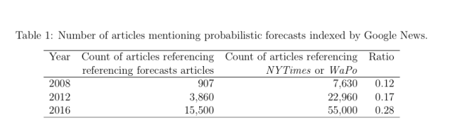
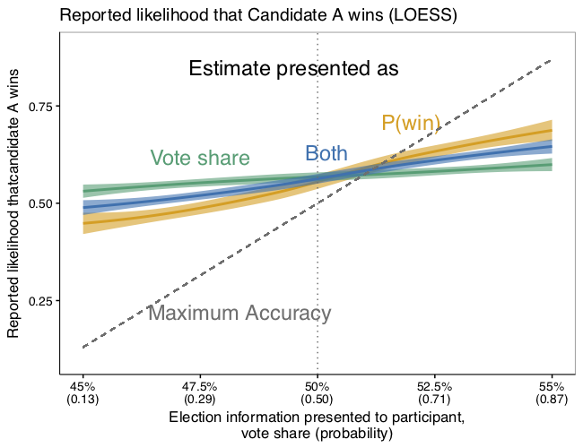
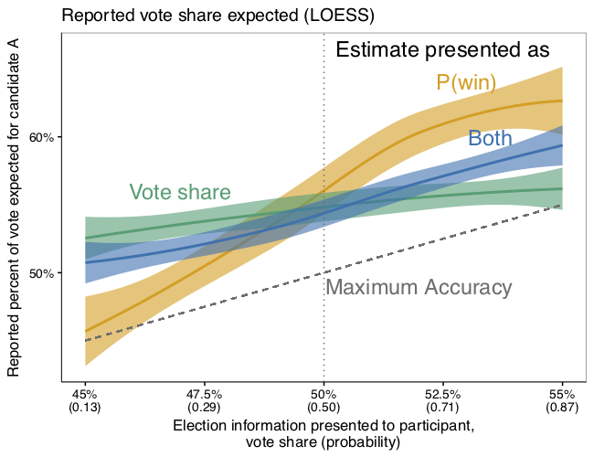
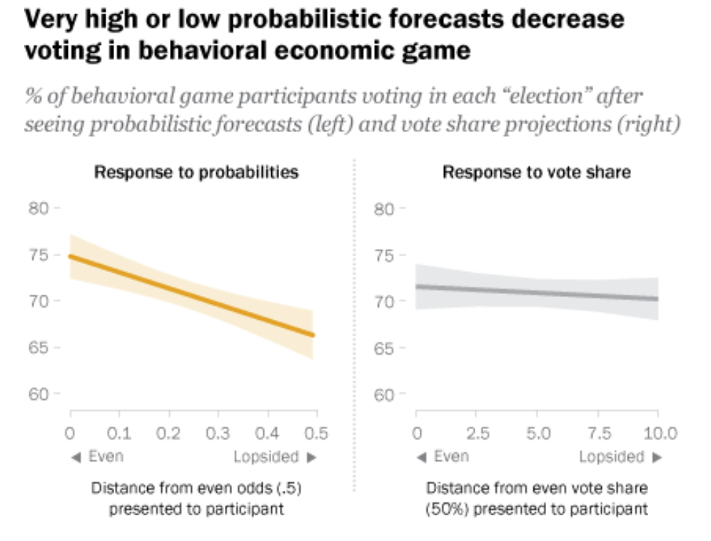
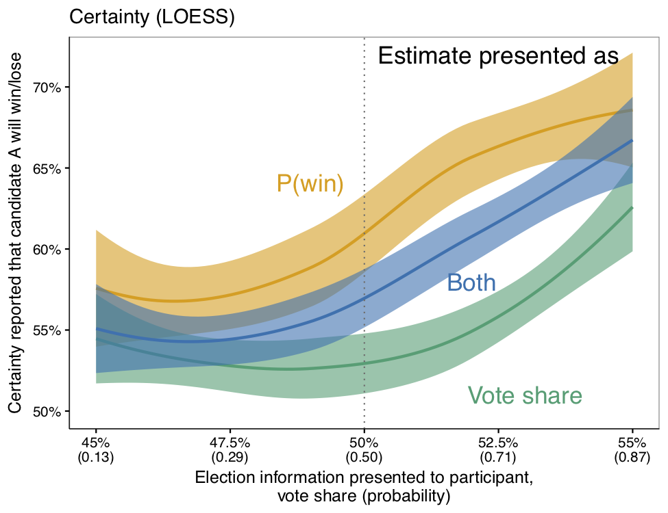
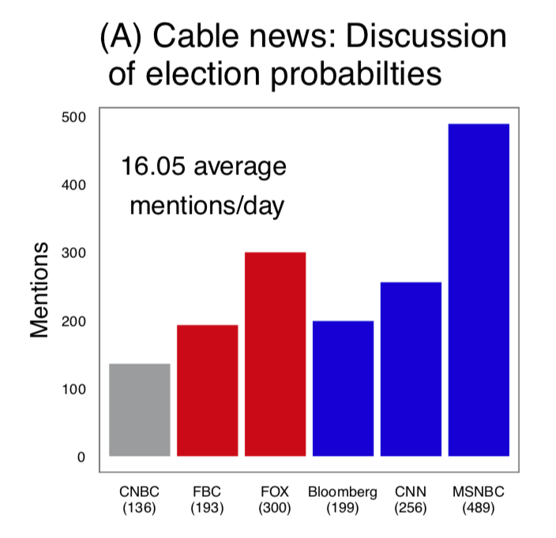
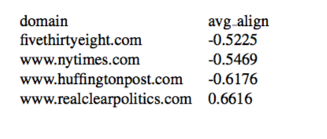
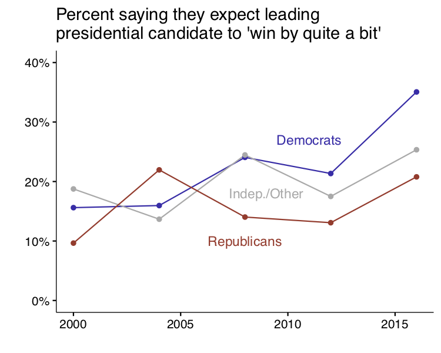
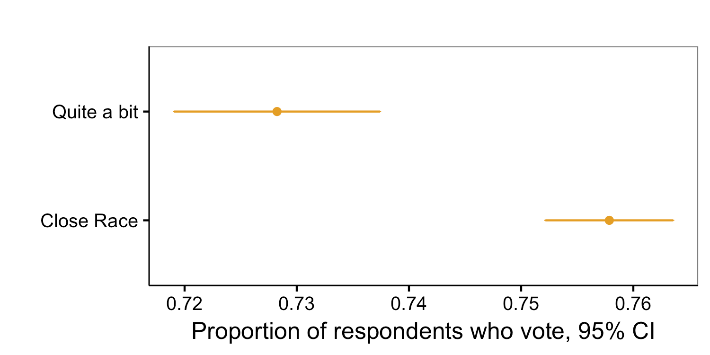

Do you remember the night of Nov 8, 2016? I was glued to election coverage and obsessively checking probabilistic forecasts, wondering whether Clinton might do _so well_ that she’d win in places like my home state of Arizona. Although FiveThirtyEight had Clinton's chances at beating Trump at around 70%, most other forecasters had her at around 90%.

When she lost, [many on both sides of the aisle](https://www.nytimes.com/2016/11/10/us/politics/donald-trump-election-reaction.html) were shocked. My co-authors and I wondered if America's seeming confidence in a Clinton victory wasn’t driven in part by increasing coverage of probabilistic forecasts. And, if a Clinton victory looked inevitable, what did that do to turnout?

 


We weren't alone. Clinton herself was quoted in [New York Magazine](http://nymag.com/daily/intelligencer/2017/05/hillary-clinton-life-after-election.html?mid=nymag_press) after the election:

> I had people literally seeking absolution... ‘_I’m so sorry I didn’t vote. I didn’t think you needed me._’ I don’t know how we’ll ever calculate how many people thought it was in the bag, because the percentages kept being thrown at people — ‘_Oh, she has an 88 percent chance to win!_’

Enter our recent [blog post](http://www.pewresearch.org/fact-tank/2018/02/06/use-of-election-forecasts-in-campaign-coverage-can-confuse-voters-and-may-lower-turnout/) and [paper released on SSRN](https://papers.ssrn.com/abstract=3117054), “Projecting confidence: How the probabilistic horse race confuses and de-mobilizes the public,” by Sean Westwood, Solomon Messing, and Yphtach Lelkes. While our work cannot definitively say whether probabilistic forecasts played a decisive role in the 2016 election, it does indeed show that compared to more conventional vote share projections, probabilistic forecasts can confuse people, can give people more confidence that the candidate depicted as being ahead will win, may decrease turnout, and that liberals in the U.S. are more likely to encounter them. We appreciate the media attention to this work, including coverage by the [Washington Post](https://www.washingtonpost.com/news/politics/wp/2018/02/06/clintons-achilles-heel-in-2016-may-have-been-overconfidence/), [New York Magazine](http://nymag.com/daily/intelligencer/2018/02/americans-dont-understand-election-probabilities.html), and the [Political Wire](https://politicalwire.com/2018/02/06/election-forecasts-lower-voter-turnout/). What's more, FiveThirtyEight devoted much of their Feb. 12 [Politics Podcast](https://fivethirtyeight.com/features/politics-podcast-whats-so-wrong-with-nancy-pelosi/) to a spirited, and at points critical discussion of our work. We are open to criticism and will respond to some of the questions raised in this post. Below, we’ll show that the evidence in our study and in other research is _not_ inconsistent with our headline, as the hosts suggest—we'll detail the evidence that probabilistic forecasts _confuse_ people, irrespective of their technical accuracy. We’ll also discuss where we agree with the podcast hosts. Furthermore, we'll discuss a few topics which, judging from the hosts discussion, may not have come through clearly enough in our paper. We'll reiterate what this work contributes to social science—how the paper adds to our understanding of how people think about probabilistic forecasts and how they may decrease voting, particularly for the leading candidate's supporters and among liberals in the U.S. We’ll then walk readers through the way we mapped vote share projections to probabilities in the study. Finally we’ll discuss why this work matters, and conclude by pointing out future research we’d like to see in this area.

**What’s new here?**

The research contains a number findings that are new to social science:

*   Presenting forecasted win-probabilities gives potential voters the impression that one candidate will win more decisively, compared with vote share projections (Study 1).
*   Higher win probabilities, but _not_ vote share estimates, _decrease voting_ in the face of the trade-offs embedded in our election simulation (Study 2). This helps confirm the findings in Study 1 and adds to the evidence from past research that people vote at lower rates when they perceive an election to be uncompetitive.
*   In 2016, probabilistic forecasts were covered more extensively than in the past and tended to be covered by outlets with more liberal audiences.

**Where we agree**

If what you care about is conveying an accurate sense of whether one candidate will win, probabilistic forecasts do this slightly better than vote share. And, they seem to give people an edge on accuracy when interpreting the vote share if your candidate is behind. Of course, people can be confused and still end up being accurate, as we'll discuss below.

We also agree that people often do not accurately judge the likelihood of victory after seeing a vote share projection. That makes sense because, as the study shows, people appear to largely ignore the margin of error, which they’d need to map between vote share estimates and win probabilities.

We also agree that a lot of past work shows that people stay home when they think an election isn’t close. What we’re adding to that body of work is evidence that compared with vote share projections, probabilistic forecasts give people the impression that one candidate will win more decisively, and may thus _more powerfully_ affect turnout.

**Does the evidence in our study contradict our headline?**

Our headline isn’t about accuracy, it’s about _confusion_. And the evidence from this research and past work taken as a whole suggests that probabilistic forecasts confuse people — something that came up at the end of segment — even if the result sometimes is technically higher accuracy.

1\. People in the study who saw only probabilistic forecasts were more likely to confuse probability and vote share. After seeing probabilistic forecasts, 8.6% of respondents mixed up vote share and probability, while only 0.6% of respondents did so after seeing vote share projections. We’re defining “mixed-up” as reporting the win-probability we provided as the vote share and vice-versa.

2\. Figure 2B (Study 1) shows that people get their candidate’s likelihood of winning very wrong, even when we explicitly told them the probability a candidate will win. It’s true that they got slightly closer with a probability forecast, but they are still far off.



Why might this be? A lot of past research and evidence suggests that people have trouble understanding probabilities, as noted at the end of the podcast. People have a tendency to think about [probabilities in subjective terms](https://chicagounbound.uchicago.edu/cgi/viewcontent.cgi?article=1384&context=law_and_economics), so they have trouble understanding [medical risks](https://www.ncbi.nlm.nih.gov/pubmed/26161749) and even [weather forecasts](http://pubman.mpdl.mpg.de/pubman/item/escidoc:2101059/component/escidoc:2101058/GG_30_Chance_2005.pdf).

Nate Silver has himself [made the argument](https://fivethirtyeight.com/features/the-media-has-a-probability-problem/) that [the backlash](https://www.nytimes.com/2016/11/10/technology/the-data-said-clinton-would-win-why-you-shouldnt-have-believed-it.html) we saw to data and analytics in the wake of the 2016 election is due in part to the media misunderstanding probabilistic forecasts.

As the podcast hosts pointed out, people _underestimated_ the true likelihood of winning after seeing both probabilistic forecasts and vote share projections. It’s possible that people are skeptical of any probabilistic forecast in light of the 2016 election. It’s possible they interpreted the likelihood not as hard-nosed odds, but in rather subjective terms — _what might happen_, [consistent with past research](https://chicagounbound.uchicago.edu/cgi/viewcontent.cgi?article=1384&context=law_and_economics). Regardless, they do not appear to reason about probability in a way that is consistent with how election forecasters define the probability of winning.

3\. Looking at how people reason about vote share — the way people have traditionally encountered polling data — it’s clear from our results that when a person’s candidate is ahead and they see a probabilistic forecast, they rather dramatically overestimate the vote share. On the other hand, when they are behind, they get closer to the right answer.

But we know from past research that people have a “[wishful](http://journals.sagepub.com/doi/abs/10.1177/0956797609356421) [thinking](http://www.tandfonline.com/doi/abs/10.1207/s15324834basp1304_6)” [bias](https://academic.oup.com/ijpor/article-abstract/9/2/105/713900), meaning they say their candidate is doing better than polling data suggests. That’s why there’s a positive bias when people are evaluating how their candidate will do, according to Figure 2A (Study 1).



The pattern in the data suggest that people are more accurate after seeing a probabilistic forecast for a losing candidate because of this effect, and _not_ necessarily because they better understand that candidate’s actual chances of victory.

4\. Perhaps even more importantly, _none_ of the results here changed when we excluded the margin of error from the projections we presented to people. That suggests that the public may not understand error in the same way that statisticians do, and therefore may not be well-equipped to understand what goes into changes in probabilistic forecast numbers. And of course, very small changes in vote share projection numbers and estimates of error correspond to much larger swings in probabilistic forecasts.

5\. Finally, as we point out in the paper, if probabilistic forecasters do not account for total error, they can really overestimate a candidate’s probability of winning. Of course, that’s because an estimate of the probability of victory bakes in estimates of error, which recent work has found is [often about twice as large as the estimates of sampling error](http://www.stat.columbia.edu/~gelman/research/unpublished/polling-errors.pdf) provided in many polls.

As [Nate Silver has alluded to](https://fivethirtyeight.com/features/the-polls-were-skewed-toward-democrats/), if the forecaster does not account unobserved error, including error that may be correlated across surveys — he/she will artificially inflate the estimated probability of victory or defeat. Of course, FiveThirtyEight _does_ attempt to account for this error, and released far more conservative forecasts than others in this space in 2016.

Speaking in part to this issue, [Andrew Gelman and Julia Azari](http://www.stat.columbia.edu/~gelman/research/published/what_learned_in_2016_5.pdf) recently concluded that “polling uncertainty could best be expressed not by speculative win probabilities but rather by using the traditional estimate and margin of error.” They seemed to be speaking about other forecasters, and did not directly reference FiveThirtyEight.

At the end of the day, it’s easy to see that a vote share projection of 55% means that “55% of the votes will go to Candidate A, according to our polling data and assumptions.” However, it’s less clear that an 87% win probability means that “if the election were held 1000 times, Candidate A would win 870 times, and lose 130 times, based on our polling data and assumptions.”

And most critically, we show that probabilistic forecasts showing more of a blowout could potentially lower voting. In Study 1, we provide limited evidence of this based on self reports. In Study 2, we show that when participants are faced with incentives designed to simulate real world voting, they are less likely to vote when probabilistic forecasts show higher odds of one candidate winning. Yet they are not responsive to changes in vote share.



**What’s with our mapping between vote share and probability?**

The podcast questions how a 55% vote share with a 2% margin of error is equivalent to an 87% win probability. This illustrates a common problem people have when trying to understand win probabilities — -it’s difficult to reason about the relationship between win-probabilities and vote share without actually running the numbers.

You can express a projection as either (1) the average vote share (can be an electoral college vote share or the popular vote share)

$$ \hat \mu_v = \frac{1}{N}\sum_{i}^{N}\bar x_i$$ 

and margin of error 

$$\hat \mu_v \pm T^{0.975}_{df = N} \times \frac{ \hat \sigma_v}{\sqrt N}$$ 

Here the average for each survey is $$\bar x_i$$, and there are $$N = 20$$ surveys.

Or (2) the probability of winning — the probability that the vote share is greater than half, based on the observed vote share and standard error:

$$1 - \Phi \left (\frac{.5 - \hat \mu_v}{\hat\sigma_v} \right )$$

Going back to the example above, here’s the R code to generate those quantities:

```R
svy_mean = .55 
svy_SD = 0.04483415 # see appendix 
N_svy = 20 
margin_of_error = qt(.975, df = N_svy) * svy_SD/sqrt(N_svy) 

svy_mean 
[1] 0.55 

margin_of_error 
[1] 0.02091224 

prob_win = 1-pnorm(q = .50, mean = svy_mean, sd = svy_SD) 
prob_win 
[1] 0.8676222 
```

More details about this approach are in our appendix. This is similar to how the Princeton Election Consortium generated win probabilities in 2016.

Of course, one can also use an approach based on simulation, as FiveThirtyEight does. In the case of the data we generated for our hypothetical election in Study 1, this approach is not necessary. However we recognize that in the case of real-world presidential elections, a simulation approach has clear advantages by virtue of allowing more flexible statistical assumptions and a better accounting of error.

**Why does this matter?**

To be clear, we are not analyzing real-world election returns. However, a lot of past [research](https://huber.research.yale.edu/materials/67_paper.pdf) [shows](http://www2.gsu.edu/~polsnn/priorbeliefs.pdf) that when people [think](https://www.jstor.org/stable/1953324?seq=1#page_scan_tab_contents) an election is [in the bag](https://repository.upenn.edu/cgi/viewcontent.cgi?referer=&httpsredir=1&article=1018&context=asc_papers), they tend to [vote in real-world elections](https://www.sciencedirect.com/science/article/pii/S0014292115000483) at [lower rates](https://www.jstor.org/stable/2748722?seq=1#page_scan_tab_contents). Our study provides evidence that probabilistic forecasts give people more confidence that one candidate will win and suggestive evidence that we should expect them to vote at lower rates after seeing probabilistic forecasts.

This matters _a lot more_ if one candidate’s potential voters are differentially affected, and there’s evidence that may be the case.

1\. Figure 2C in Study 1 suggests that the _candidate who is ahead_ in the polls will be more affected by the increased certainty that probabilistic forecasts convey.




2\. When you look at the balance of coverage of probabilistic forecasts on major television broadcasts, there is more coverage on MSNBC, which has a more liberal audience.



3\. Consider who shares this material in social media--specifically the average self-reported ideology of people who share links to various sites hosting poll-aggregators on Facebook, data that come from [this paper](http://science.sciencemag.org/content/early/2015/05/06/science.aaa1160.full)’s [replication materials](http://dx.doi.org/10.7910/DVN/LDJ7MS). The websites that present their results in terms of probabilities have left-leaning (negative) social media audiences. Only realclearpolitics.com, which doesn’t emphasize win-probabilities, has a conservative audience:



4\. In 2016, the proportion of American National Election Study (ANES) respondents who thought the leading candidate would “win by quite a bit” was unusually high for Democrats...




5\. And we know that people who say the leading presidential candidate will “win by quite a bit” in pre-election polling are about three percentage points less likely to report voting shortly after the election than people who say it’s a close race — and that’s after conditioning on election year, prior turnout, and party identification. The data here are from the ANES and go back to 1952.




These data do not conclusively show that probabilistic forecasts affected turnout in the 2016 election, but they do raise questions about the real world consequences of probabilistic forecasts.

**What about media narratives?**

We acknowledge that these effects may change depending on the context in which people encounter them — though people can certainly encounter a lone probability number in media coverage of probabilistic forecasts. We also acknowledge that our work cannot address how these effects compare to and/or interact with media narratives.

However, other work that is relevant to this question has found that aggregating all polls [reduces the likelihood that news outlets](https://academic.oup.com/poq/article-abstract/80/4/943/2738970?redirectedFrom=fulltext) focus on unusual polls that are more sensational or support a particular narrative.

In some ways, the widespread success and reliance on these forecasts represents a triumph of scientific communication. In addition to greater precision compared with one-off horserace polls, probabilistic forecasts can quantify how likely a given U.S. presidential candidate is to win using polling data and complex simulation, rather than leaving the task of making sense of state and national polls to speculative commentary about “paths to victory,” as we point out in the [paper](https://papers.ssrn.com/sol3/papers.cfm?abstract_id=3117054). And as one of the hosts noted, we aren’t calling for an end to election projections.

**Future work**

We agree with the hosts that there are open questions about whether the public gives more weight to these probabilistic forecasts than other polling results and speculative commentary. We have also heard questions raised about how much probabilistic forecasts might _drive_ media narratives. These questions may prove difficult to answer and we encourage research that explores them.

We hope this research continues to create a dialogue about how to best communicate polling data to the public. We would love to see more research into how the public consumes and is affected by election projections, including finding the most effective ways to convey uncertainty.
