### TLDR: 

1. [UPDATED SEPT 30] Yesterday, Science [published a letter I wrote](/pdf/science.adk1211.pdf) arguing that there is little evidence of algorithmic bias in Facebook’s feed ranking system that would serve to increase ideological segregation, also known as [the "Filter Bubble" hypothesis](https://books.google.com/books/about/The_Filter_Bubble.html?id=Qn2ZnjzCE3gC). 
2. This contradicts claims in [González-Bailón et al 2023](https://www.science.org/doi/full/10.1126/science.ade7138) that Newsfeed ranking increases ideological segregation. This claim was the main piece of evidence in the Science [Special Issue on Meta](https://www.science.org/toc/science/381/6656) that might support the controversial cover that suggested that Meta’s algorithms are “Wired to Split.”
3. The issue is that while domain-level analysis suggests feed-ranking increases ideological segregation, URL-level analysis shows *no difference* in ideological segregation before and after feed-ranking. 
4. And we should strongly prefer their URL-level analysis. Domain-level analysis *effectively mislabels highly partisan content* as "moderate/mixed," especially on websites like YouTube, Reddit, and Twitter ([aggregation bias/ecological fallacy](https://ori.hhs.gov/education/products/niu_authorship/mistakes/09mistake-a.htm)). 
5. Interestingly, the authors seem to agree---the discussion section points out problems with domain-level analysis. 
6. Another *Science* paper from the same issue, [Guess et al 2023](https://www.science.org/doi/10.1126/science.abp9364) shows (in the SM) that Newsfeed ranking actually *decreases* exposure to *political content* from like-minded sources compared with reverse-chronological feedranking. 
7. The evidence in the 4 recent papers is not consistent with a meaningful Filter Bubble effect in 2020; nor does it support the notion that Meta's algorithms are "Wired to Split."
8. Furthermore, domain-level aggregation bias is a big issue in a great deal of past research on ideological segregation, because domain-level analysis *understates* media polarization. Because [González-Bailón et al 2023](https://www.science.org/doi/full/10.1126/science.ade7138) gives both URL- and domain-level estimates, we can see the magnitude of aggregation bias. It's huge. 
9. I make a number of other observations about what we know about whether social media is polarizing and discuss implications for the controversial Science cover and Meta's flawed claims that this research is exculpatory. 
<!-- 6. None of this is the last word on social media algorithms---as [González-Bailón et al 2023](https://www.science.org/doi/full/10.1126/science.ade7138) point out, we need additional research on friend/page/group/etc recommender systems, which may polarize the graph itself.  -->

### Intro/ICYMI

  
Click to expand

Last week saw the release of a series of [excellent papers in *Science*](https://www.science.org/toc/science/381/6656). I was particularly interested in [González-Bailón et al 2023](https://www.science.org/doi/full/10.1126/science.ade7138), which measures "ideological segregation." This concept is based on [Matt Gentzkow and Jesse Shapiro's 2011 work](https://web.stanford.edu/~gentzkow/research/echo_chambers.pdf). As they note, "The index ranges from 0 (all conservative and liberal visits are to the same outlet) to 1 (conservatives only visit 100% conservative outlets and liberals only visit 100% liberal outlets)." 

This paper also replicates and extends my own work with Eytan Bakshy and Lada Adamic, also published in [*Science* in 2015](https://solomonmg.github.io/pdf/Science-2015-Bakshy-1130-2.pdf). 

To be clear [González-Bailón et al 2023](https://www.science.org/doi/full/10.1126/science.ade7138) goes a lot further, examining how these factors vary over-time, investigating clusters of isolated partisan media organizations, and patterns in the consumption of misinformation. They find (1) ideological segregation is high; (2) ideological segregation “increases after algorithmic curation” consistent with the “Filter Bubble” hypothesis; (3) there is a substantial right wing “echo chamber” in which conservatives are essentially siloed from the rest of the site (4) where misinformation thrives. 

I've had many years to think about issues related to these questions, after working with similar data from 2012 in my dissertation, and co-authoring a [Science paper](https://solomonmg.github.io/pdf/Science-2015-Bakshy-1130-2.pdf) while working at Facebook using 2014 data. I also saw the design (but not results) presented at the [2023 SSRC Workshop on the Economics of Social Media](https://www.ssrc.org/programs/digital-platforms-initiative/2023-ssrc-workshop-on-the-economics-of-social-media/), though I did not notice these issues until I saw the final paper. 

I put together these thoughts after discussion and feedback from Dean Eckles and Tom Cunningham, former colleagues at Stanford, Facebook, and Twitter. 

<!-- [Click here to read the backstory on Echo Chambers, Filter Bubbles, and Selective Exposure, including where my own past work fits in](#a-brief-history-of-echo-chambers-filter-bubbles-and-selective-exposure) -->

### A Brief History of Echo Chambers, Filter Bubbles, and Selective Exposure

  
Click to expand

<!-- 20 years ago I worked as a foreign media analyst and I noticed that a great deal of misinformation circulating in news websites in Indonesia and the Middle East came from Alex Jones' InfoWars (yes he's been around for a long time). I became fascinated with the question of how people get their media and how technology changes that.  -->

The conventional academic wisdom when I started my PhD was that we shouldn't expect to see much in the way of media effects ([Klapper 1960](https://books.google.com/books/about/The_Effects_of_Mass_Communication.html?id=CzcGAQAAIAAJ)) because people tended to "select into" content that reinforced their views ([Sears and Freedman 1967](https://www.jstor.org/stable/2747198)). 

In 2007, Cass Sunstein wrote ["Republic.com 2.0"](https://www.jstor.org/stable/j.ctt7tbsw), which warned that the internet could allow us to even more easily isolate ourselves into "information cocoons" and "echo chambers." Technology allows us to "filter" exactly what we want to see, and design our own programming. Cass also suggested this could lead to polarization. 

<!-- What's more, new media should be expected to further strengthen this "minimal effects" hypothesis ([Bennett and Iyengar 2008](https://citeseerx.ist.psu.edu/document?repid=rep1&type=pdf&doi=a2fcebd37ba1e919f662a287841b0356603cd0a4)).  -->

In 2009-2010, Sean Westwood and I ran a series of studies suggesting that [popularity and social cues](https://journals.sagepub.com/doi/10.1177/0093650212466406) in news aggregators and social media websites might be a way out of selective news consumption---we might be *more* exposed to cross-cutting views on platforms that feature a social component, and furthermore, this social component seemed to be more important that media "source" label. That was great in the abstract, but what happens on actual websites that people use? 

The extent to which widely used social media platforms might allow us to exit "echo chambers" depended on the extent of cross-partisan friendships and interactions on platforms like Facebook. I did a PhD internship at Facebook to look into that, and the question of whether encountering [political news on social media was ideologically polarizing](https://www.dropbox.com/s/nu39148ukbab34r/CH7brief.pdf?raw=true) (note that the results are as not well powered as I would like). That work evolved into dissertation chapters and eventually our [Science paper](https://solomonmg.github.io/pdf/Science-2015-Bakshy-1130-2.pdf)  

Now [Eli Parsner](https://en.wikipedia.org/wiki/Eli_Pariser) had just published a book on "[Filter Bubbles](https://books.google.com/books/about/The_Filter_Bubble.html?id=Qn2ZnjzCE3gC)" suggesting that media technologies like Google Search and Facebook NewsFeed not only allowed us to ignore the "other side," but actively filtering out search results and friends posts with perspectives from the other side.

What's more, a lot of people in the Human Computer Interaction (HCI) world were very interested in how one might examine this empirically, and I started collecting data with Eytan Bakshy that would do just that. The paper would allow us to quantify echo chambers created by our network of contacts, filter bubbles, and partisan selective exposure in social media by looking at exposure to [ideologically "cross-cutting" content](https://www.jstor.org/stable/3117813).  

We defined a few key components: 

**Random** - The set of content (external URLs) shared on Facebook writ large. 

**Potential** - The set of content shared by one's friends

**Exposed** - The set of content appearing in one's Newsfeed.

**Selected** - The set of content one clicks on.

**Endorsed** - The set of content one 'likes'. 

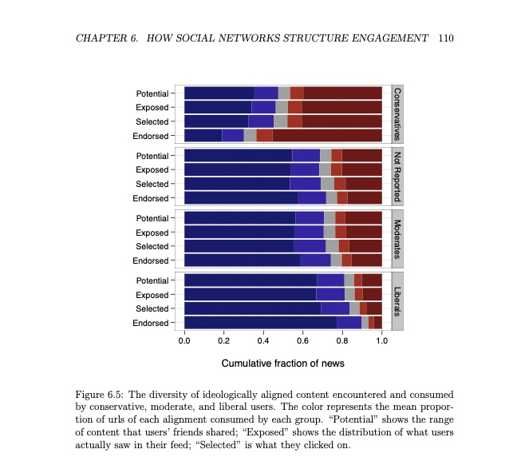

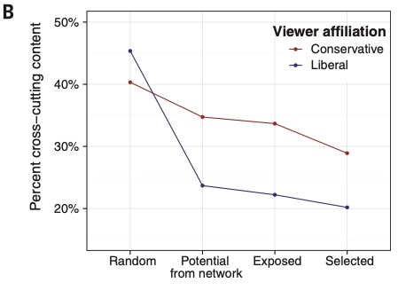

Unlike when I started to study social media in 2009 and no one was interested, in 2014, people understood that social media was an important force that was reshaping at least media if not society more broadly. And Science was particularly interested in the role of algorithms played in this environment. 

We published our results in [Science](https://solomonmg.github.io/pdf/Science-2015-Bakshy-1130-2.pdf), and the response from many was "well this is smaller than expected," including a piece in *Wired* from [Eli Parisner himself](https://www.wired.com/2015/05/did-facebooks-big-study-kill-my-filter-bubble-thesis/). David Lazer, one of the lead authors of [González-Bailón et al 2023](https://www.science.org/doi/full/10.1126/science.ade7138), also [wrote a perspective in *Science*](https://education.biu.ac.il/sites/education/files/shared/science-2015-lazer-1090-1.pdf). 

However, the piece immediately drew a great deal of criticism. This is in part because I wrote that exposure was driven more by individual choices than algorithms, which ignored the potential influence of friend recommendation systems and, more broadly, swept aside the extent to which interfaces structure interactions on websites, which my own dissertation work had shown was quite substantial. 

The study also had important limitations, many of which I addressed in a post suggesting how [future work could provide a more robust picture](https://solomonmg.github.io/post/exposure-to-ideologically-diverse-response/). 

I was (much later) tech lead for Social Science One (2018-2020), which gave external researchers access to data (the ['Condor' URLs data set](/pdf/Facebook_DP_URLs_Dataset.pdf)) via differential privacy. My goal was to enable the kind of work research done [González-Bailón et al 2023](https://www.science.org/doi/full/10.1126/science.ade7138). However, it soon became clear that Social Science One's data sharing model and differential privacy in particular was not suitable for ground-breaking research. 

I personally advocated (with Facebook Researcher and longtime colleague [Annie Franco](https://twitter.com/anniefranco)) for the collaboration model used in the Election 2020 project, wherein external researchers would collaborate with Facebook researchers. That model would have to shield the research from any interference from Facebook's Communications and Policy arm, which might attempt to interfere with the inturpretation or publication of any resulting papers, which would create ethical conflicts. 

I advocated for pre-registration to accomplish this, not merely to ensure scientific rigor but to protect against conflicts of interest and selective reporting of results. However, I left Facebook in January of 2020 and have not been deeply involved in the project since. 

[González-Bailón et al 2023](https://www.science.org/doi/full/10.1126/science.ade7138) does in fact accomplish most if not all of what I recommended future research do and goes much further than our original study, and the authors should be applauded for it. The paper shows that on Facebook (1) ideological segregation is high (in fact it's arguably higher than implied in the paper); (2) there is a substantial right wing "echo chamber" in which conservatives are siloed from the rest of the site (3) where misinformation thrives. When they start to talk about the filter bubble though, things get more complicated.

### Is there a Filter Bubble on Facebook

Are Facebook's algorithms "Wired to split" the public? This question is at the core of the recent *Science* issue, it's hotly debated in the field of algorithmic bias. A suspicion that the answer is "yes" has motivated a number of policy and regulatory actions. Armed with unprecendented data, [González-Bailón et al 2023](https://www.science.org/doi/full/10.1126/science.ade7138) seeks to answer this and other related questions. 

There are three relevant claims that answer this question in the text: (1) "ideological segregation is high and increases as we shift from potential exposure to actual exposure to engagement" in the abstract, (2) "The algorithmic promotion of compatible content from this inventory is positively associated with an increase in the observed segregation as we move from potential to exposed audiences" in the discussion section, and (3) "Segregation scores drawn from exposed audiences are higher than those based on potential audiences ... (the difference between potential and engaged audiences is only visible at the domain level)," in the caption of Figure 2.

These statements are generally confirmatory of algorithmic segregation, aka the [Filter Bubble hypothesis](https://books.google.com/books/about/The_Filter_Bubble.html?id=Qn2ZnjzCE3gC).

But look at Figure 2, on which these claims seem to be based. Figure 2B shows an increase in observed segregation as you move from potential to exposed audiences. BUT Figure 2C---describing the same phenomena---does *not* (as noted in the caption). 

, the study is consistent with a negligible Filter Bubble effect")

### So which is it?

First, what's the difference between these two figures? 2B aggregates things at the domain level (e.g., www.yahoo.com) while 2C aggregates things at the URL level (e.g., https://www.yahoo.com/news/pence-trumps-indictment-anyone-puts-002049678.html). That means 2B treats all shares from yahoo.com the same, while 2B looks at each story separately. 

If you're like me, when you think of political news, you have in mind domains like FoxNews.com or MSNBC.com, where it's likely that the website itself has a distinct partisan flavor. 

But YouTube.com and Twitter.com both appear in the "Top 100 Domains by Views" in the study's SM, which obviously host a ton of both far left and far right or "mixed" content. And indeed, Figure S10 below shows that there are an array of domains that host some far right content and some far left content.

 and some far left content.")

<!-- There's also just something about content that makes an argument that we seem to want to share, as suggested by analysis in my [dissertation](https://www.dropbox.com/s/zfw1d9j60hqjil7/sudiss.pdf?raw=true), which shows that NYT editorials are more likely than content from other sections to be shared (via email). Consider two OpEds at the NYT---one by conservative columnist Bret Stevens, the other by well-known liberal Nicholas Kristof. The former is going to be shared more by conservatives, the latter more by liberals.  -->

But even if we're talking about NYTimes.com it's not hard to see that for example, conservatives might be more likely to share conservative Op Eds from Bret Stevens, while liberals may be more likely to share Op Eds from Nicholas Kristof.

If you aggregate your analysis to the domain level, you'll miss this aspect of media polarization. 

### Domains or URLs
So which is right? [González-Bailón et al 2023](https://www.science.org/doi/full/10.1126/science.ade7138) suggests that we should prefer the URL-level analysis. Here's the passage in the discussion section, which describes why analyzing media polarization at the level of the domain is problematic: 

   "As a result of social curation, exposure to URLs is systematically more segregated than exposure to domains... *A focus on domains rather than URLs will likely understate, perhaps substantially, the degree of segregation in news consumption online.*" (Emphasis added)

What's more, past work (co-authored by one of the lead authors) shows that [domain-level analysis can indeed mask “curation bubbles”](https://osf.io/vbwer) in which "specific stories attract different partisan audiences than is typical for the outlets that produced them." 

You can see this in the data clear as day---let's go back to Figure 2A, which shows a massive increase in estimated segregation when using URLs rather than domains: 

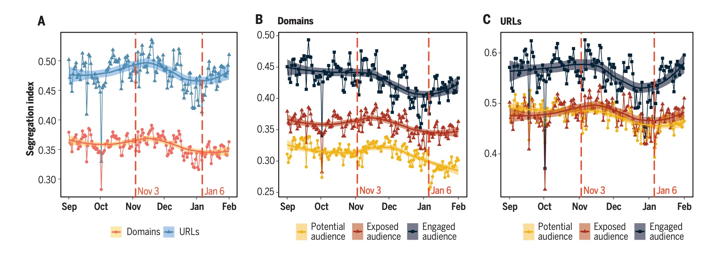

Returning to Figures 2B and 2C, it seems that the potential audience at domain level is *artificially less segregated*, due to the aggregation at the level of the domain.

### What explains the 'Filter Bubble discrepency'?

One possibility is that posts linking to content from "mixed" domains like YouTube, Reddit, Twitter, Yahoo, etc. do not score as well in feed-ranking. It's possible that partisan content on these domains is more likely to be downranked as misinformation or spam, or maybe Facebook-native videos (which render faster/better) have an edge over YouTube, or perhaps there are domain-level features in feed ranking, or maybe there is some other reason that content from 'non-mixed' domains just performs better in the rather complex recommendation system that powers Newsfeed ranking. 

Regardless, that would explain the results in Figure 2---making the potential audience look artificially broader than the actual audience, when you analyze content at the domain level. 

### What about the Reverse-Chron experiment?!

Surely we can paint a fuller picture of the impact of algorithmic ranking on media polarization with that other excellent recent *Science* paper which looked at the *causal* effect of turning off Newsfeed ranking. Maybe we can cross-reference that paper and get a clearer picture of what's happening. 

[Guess et al 2023](https://www.science.org/doi/10.1126/science.abp9364) shows that Newsfeed induces proportionally *more* exposure cross-cutting sources but also more exposure to like-minded sources. It reduces exposure to moderate or mixed sources. Importantly, this is not just news that news sources link to, it's all content that everyone posts, including life updates, pictures, videos, etc. 

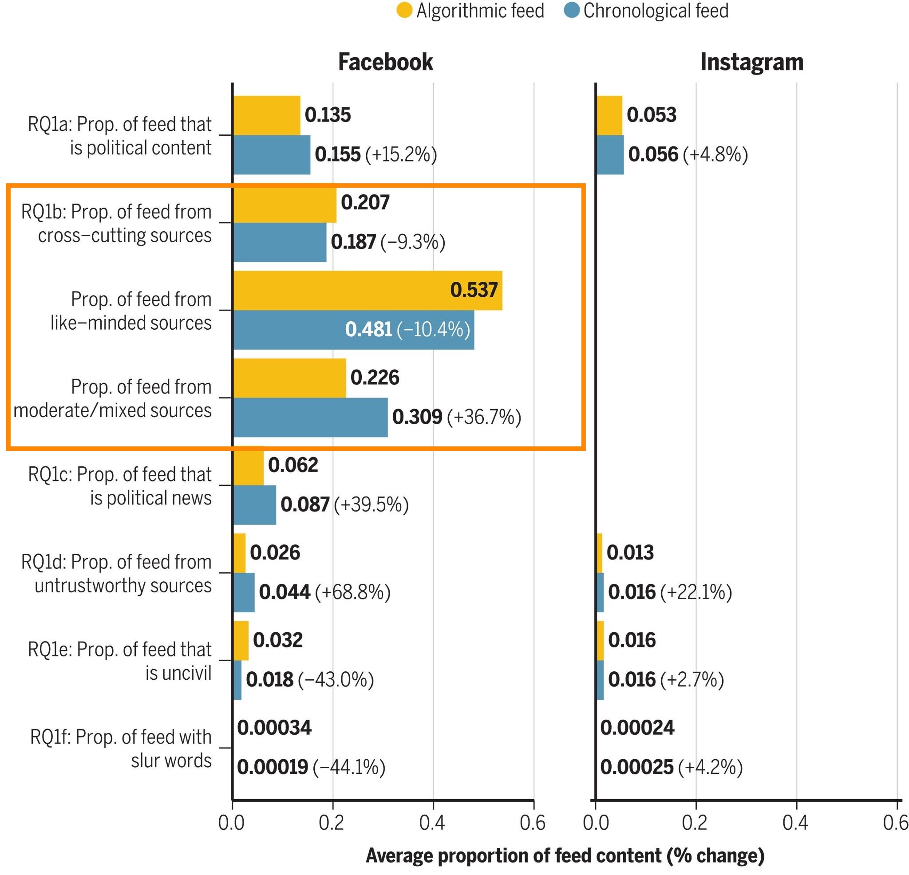

Ok, but what about political content? In the supplimentary materials, we see that when it comes to *political content*, Newsfeed ranking actually *decreases* exposure to political content from like-minded sources. 

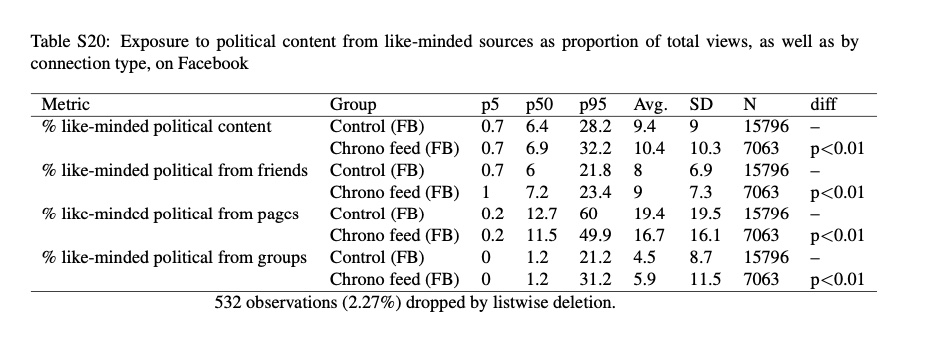

What about exposure to political content posted by cross-cutting sources? The SM doesn't provide that, but it does provide a paragraph noting that Newsfeed *decreased* exposure to political news from partisan sources relative to reverse-chron! 

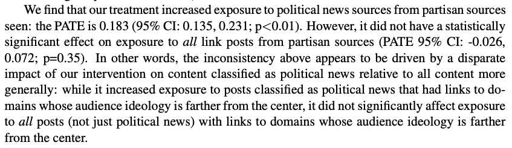

Now a big caveat here is that it's clear from the main results that political content is not doing well in Newsfeed ranking. Note that there are [reports that the company decided to downrank political and news content in 2021](https://www.wsj.com/articles/facebook-politics-controls-zuckerberg-meta-11672929976). 

Regardless, the results in the SM are not at all suggestive of a filter bubble, at least during the 2020 election---the experimental results suggest that if anything feedranking is showing us *less* polarizing content than we would see with reverse-chron. 

### How FB Groups impact estimates of algorithmic segregation

I sent a much earlier draft of this to [Sandra González-Bailón](https://www.asc.upenn.edu/people/faculty/sandra-gonzalez-bailon-phd) and [David Lazer](https://cssh.northeastern.edu/faculty/david-lazer/), lead authors for [González-Bailón et al 2023](https://www.science.org/doi/full/10.1126/science.ade7138). Sandra pointed me to Figure S14, which does show a slight increase in segregation post-ranking for URLs shared by users and pages, but shows the *opposite* for content shared in those often-contentious Facebook groups. 

<!-- People may be especially likely to come across "persons dissimilar to themselves, and with modes of thought and action unlike those with which they are familiar" [(Mill cited in Mutz and Mondak, 2006)](https://www.polisci.upenn.edu/sites/default/files/mutz_mondak_2006.pdf). And it seems likely based on the plot below that group posts are treated differently from page posts and friend posts in Facebook feedranking.  -->

So it's really *not* that there's no difference at all pre- and post- ranking, just that the difference is on average zero once you include groups. Of course, the population of people who see content from groups and/or pages in Newsfeed may be unusual, and future work should dig into this variation. 

I should also note that this small but real difference seems more or less consistent with what we [found in past work](https://www.science.org/doi/10.1126/science.aaa1160), which only examined news shared by users (excluding pages and groups). 

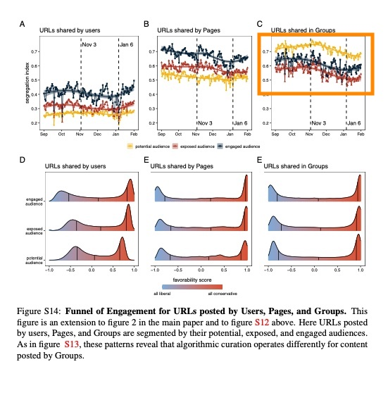

### The algorithm and the most politically engaged

There is also a hint of an increase in segregation post-ranking among the most politically engaged 10% of Facebook users. However, the paper notes that this trend "is only clear for domain-level data," which we've already established should not be used here. (Note that they define high political interest users as those in the "top 10% of engagement... (comments, likes, reactions, reshares) with content classified as political on Facebook...)"). 

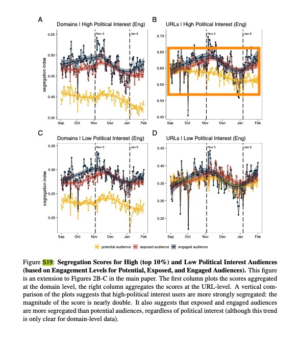

A similar pattern holds for the top 1% of users (Figure S23 in the SM). 

### Algorithmic segregation and ideology

Feed ranking seems to expose both conservatives and liberals to more liberal content. This is consistent with my priors that conservative content is more likely to violate policy and be taken down or subject to "soft actioning" (e.g., downranking) for borderline violations. 

So now things get messy---should we really say liberals are in a filter bubble (and conservatives aren't) if misinformation is included in that calculation? 

<!-- exposure to cross cutting content was thought to [reduce political participation](https://www.jstor.org/stable/3088437). -->

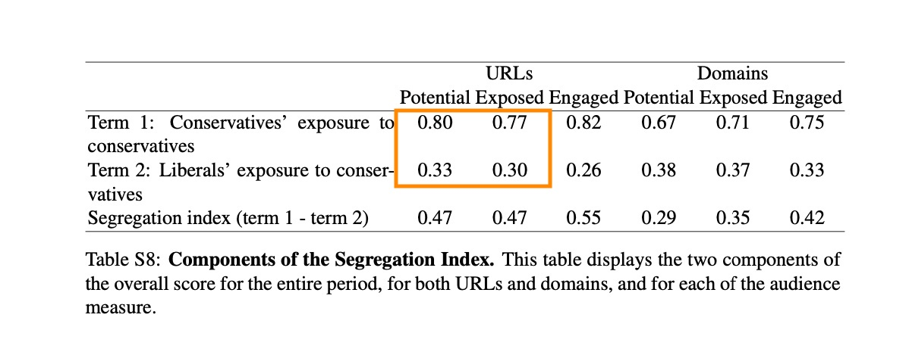

We can see a similar pattern when we look at exposure to cross-cutting content, which is the measure our 2015 Science paper used. Conservatives see more liberal content in feed than their friends share. 

We can also see that things have changed a lot since we wrote our original Science piece in 2015. Liberals seem to see *far* more cross-cutting content, conservatives less. 

<!-- What about how this compares to others ways we get media on the internet? The evidence is not great here, but [Flaxman et al 2016](https://academic.oup.com/poq/article/80/S1/298/2223402) show that ideological segregation is higher for search than for social media websites, but lower for news aggregators and direct navigation to news websites.  -->

### Brevity is a double-edged sword

Science gives authors only limited space and it would have been difficult to dig into everything I've written about in 2 pages. I also know better than almost anyone just how much work went into these papers (I would bet thousands of hours for each of several authors), and how difficult it can be explain everything perfectly when you're pulling off such a big lift. I should also point out that these papers are very nuanced, well-caveated, and careful not to overstate their results regarding the filter bubble or algorithmic polarization. 

Still, I do wish this work had squarely focused on URL-level analyses. 

### What this means for other studies

This also means that past estimates of ideological segregation based domain-level analysis probably *understate* media polarization in a big way. This includes those based on [Facebook data](https://journalqd.org/article/view/2586/2683), [browser data](https://onlinelibrary.wiley.com/doi/epdf/10.1111/ajps.12589), on data describing various [platforms](https://academic.oup.com/poq/article/80/S1/298/2223402)) or simply websites across the [internet](https://web.stanford.edu/~gentzkow/research/echo_chambers.pdf). I have said this for a long time but I did not think the magnitude was as strong as shown in [González-Bailón et al 2023](https://www.science.org/doi/full/10.1126/science.ade7138). 

### So, is Facebook polarizing?

It's very hard to give a good answer to this question. In "The Paradox of Minimal Effects," Stephen Ansolabehere points out that re-election depends overwhelmingly on whether the country is prosperous and at peace, not what happens with media politics. This is thought to be because people selectively consume media, which serves mainly to reinforce their beliefs; while at the same time, the sum total of people's private lived experiences correponds reasonably well to aggregated economic data. 

There's an argument that social media exists somewhere in between the conventional media and one's lived experiences. And what about evidence? As Sean Westwood and I have shown, partisan selectivity is far less severe when you [add a social element to news consumption](https://journals.sagepub.com/doi/10.1177/0093650212466406). What's more, field-experimental work I did shows that [increasing the prominence of political news in Facebook's Newsfeed](https://www.dropbox.com/s/nu39148ukbab34r/CH7brief.pdf?raw=true) shifted issue positions toward the majority of news encountered (left-leaning), particularly among political moderates. 

Tom Cunningham recently wrote a nice [summary of some of the evidence related to the question of whether any kind of media might increase affective polarization](https://tecunningham.github.io/posts/2023-07-27-meta-2020-elections-experiments.html#other-evidence-on-media-and-polarization), which we discussed at length. 

The evidence suggests any effect is likely small. First, we see that while social media is a global phenomenon, affective polarization is not---the [UK, Japan, and Germany have seen affective depolarization](https://direct.mit.edu/rest/article-abstract/doi/10.1162/rest_a_01160/109262/Cross-Country-Trends-in-Affective-Polarization?redirectedFrom=fulltext). 

Second, perhaps the highest quality experimental study on this question I've seen is [Broockman and Kalla (2022)](https://osf.io/jrw26/), which finds that paying heavy Fox News viewers to watch CNN has generally depolarizing effects, though as Tom points out, finds null effects on traditional measures of affective polarization. 

Third, Tom and I have also discussed an excellent experimental study attempting to shed light on this: "[Welfare Effects of Social Media](https://www.aeaweb.org/articles?id=10.1257/aer.20190658)," which concludes that Facebook is likely polarizing. They find that "deactivating Facebook for the four weeks before the 2018 US midterm election... makes people less informed, it also makes them less polarized by at least some measures, consistent with the concern that social media have played some role in the recent rise of polarization in the United States."

The study defines political polarization in an unusual way---including congenial media exposure---how much news you see from your own side---in its polarization index. Most political scientists would consider congenial media exposure as *the thing that might cause polarization*, but not an aspect of polarization in and of itself. 

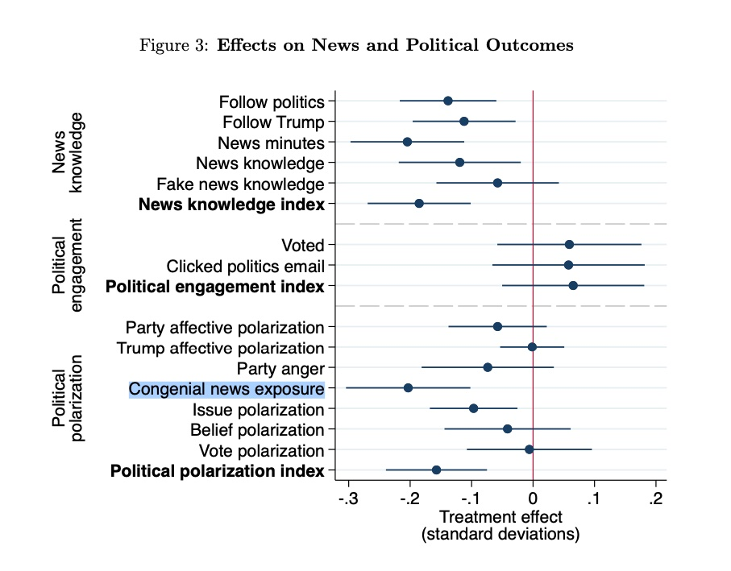

They do explain that their effects on affective polarization are not significant and they don't try to hide what's going into the measure. But you have to read beyond the abstract and the media headlines to really understand this point. 

<!-- They make the following claim in a footnote: "Online Appendix Table A16 shows that the effect on the political polarization index is *robust to excluding each of the seven individual component variables in turn*, although the point estimate moves toward zero and the unadjusted p-value rises to 0.09 when omitting congenial news exposure."  -->

Notably, in a robustness test in the appendix, the effect on the polarization loses statistical significance when you exclude this variable. 

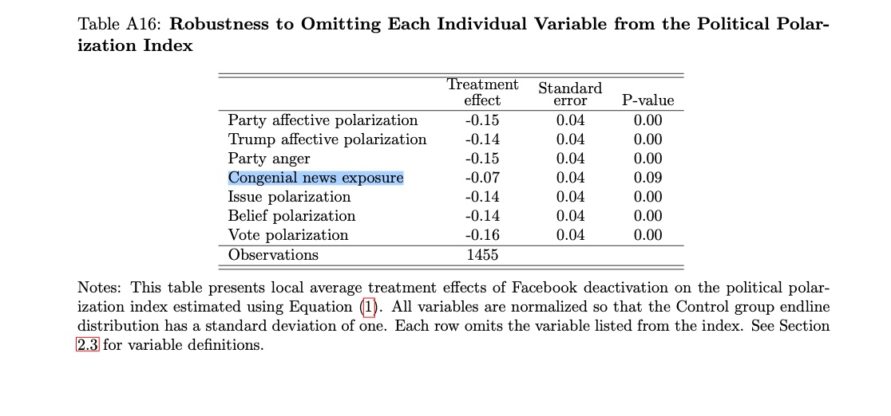

That means the folks who didn't deactivate Facebook had higher levels of political knowledge and higher levels of issue polarization. This makes sense because if a person doesn't know where the parties stand on an issue, she is less likely to be sure about where she ought to stand. 

### Implications for how this was publicized

All of this is relevant in light of the controversial Science Cover, which suggests Facebook's *algorithms* are "Wired to Split" us. It may be true, but the evidence across all 4 *Science* and *Nature* papers is not decisive on this question. 

None of the experiments published so far show an impact on affective or ideological polarization. What's more, the proper URL-level analyses in [González-Bailón et al 2023](https://www.science.org/doi/full/10.1126/science.ade7138) show only a modest 'Filter Bubble' for certain subsets of the data, and when it comes to political news, and the reverse-chronological feed ranking experiment shows Newsfeed ranking feeds us *less* polarized political content than would see in a reverse-chron Newsfeed. 

Of course, the spin from the Meta Comms team that these [results are exculpretory](https://www.wsj.com/articles/does-facebook-polarize-users-meta-disagrees-with-partners-over-research-conclusions-24fde67a) is also highly problematic. This claim is not only wrong but amatuerish and self-defeating from a strategic perspective, and I was surprised to read about it. 

For all the amazing work done to produce the experimental results, the data are too noisy to detect small but potentially compounding effects on polarization as suggested in [a post-publication review from Dean Eckles](https://statmodeling.stat.columbia.edu/author/dean/) and [Tom Cunningham](https://tecunningham.github.io/posts/2023-07-27-meta-2020-elections-experiments.html). 

What's more, even the excellent work done here in [González-Bailón et al 2023](https://www.science.org/doi/full/10.1126/science.ade7138) does not speak to the question of effects on polarization that other key recommender systems at Facebook may have: the People You May Know (PYMK) algorithm, which facilitates network connections on the website, along with the Pages You Might Like (PYML) and Groups You Might Like (GYML). The authors make a similar point in the Supplementary Materials, S3.2---pointing out that inventory, or the "potential audience," "results from another curation process determining the structure and composition of the Facebook graph, which itself results from social and algorithmic dynamics." 

This means that we should *not* necessarily conclude that exposure is all about individual choices and not algorithms based on the sum total of evidence we have (a point I should have better emphasized [in past work](https://solomonmg.github.io/pdf/Science-2015-Bakshy-1130-2.pdf))---algorithms may play an important role and as usual, more research is needed.  

It would seem to me that both Science and Meta Comms are both going beyond the data here. 

### Disclosures

As noted above, from 2018-2020, I was tech lead for Social Science One, which gave external researchers *direct* access to data (the ['Condor' URLs data set](/pdf/Facebook_DP_URLs_Dataset.pdf)) via differential privacy. However, that project has not yielded much research output for a number of organizational and operational reasons, including the fact that differential privacy is not yet suitable for such a complex project. 

While at Facebook, I personally advocated (with Annie Franco) for the collaboration model used in the Election 2020 project, wherein external researchers would collaborate with Facebook researchers. That model would have to shield the research from any interference from Facebook's Communications and Policy arm, which would violate scientific ethics. It would involve pre-registration, not merely to ensure scientific rigor but to protect against conflicts of interest and selective reporting of results. However, I left Facebook in January of 2020 and have not been deeply involved in the project since. 

I recently left Twitter (requesting to be in the first rounds of layoffs after Elon Musk took over) and started a job at NYU's CSMaP lab when my employment with Twitter ended. There are authors who are affiliated with my lab on the paper, including one of the PIs, Josh Tucker. My graduate school Advisor, Shanto Iyengar is also on the paper, and I consider the majority of the authors to be my colleagues and friends. 

See also my [disclosures page](/disclosures/). 

<!-- I do wish the samples and timeframes for the ranking experiments were bigger so we could understand potentially smaller effects, which may be very important.  -->
