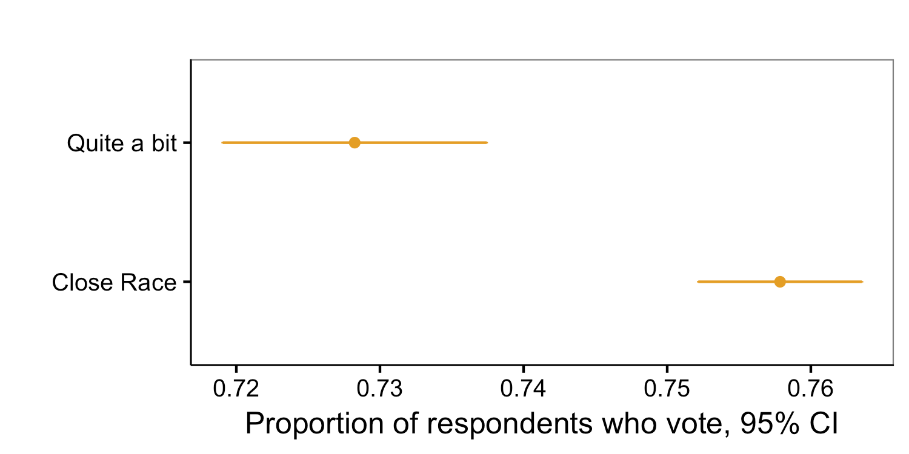
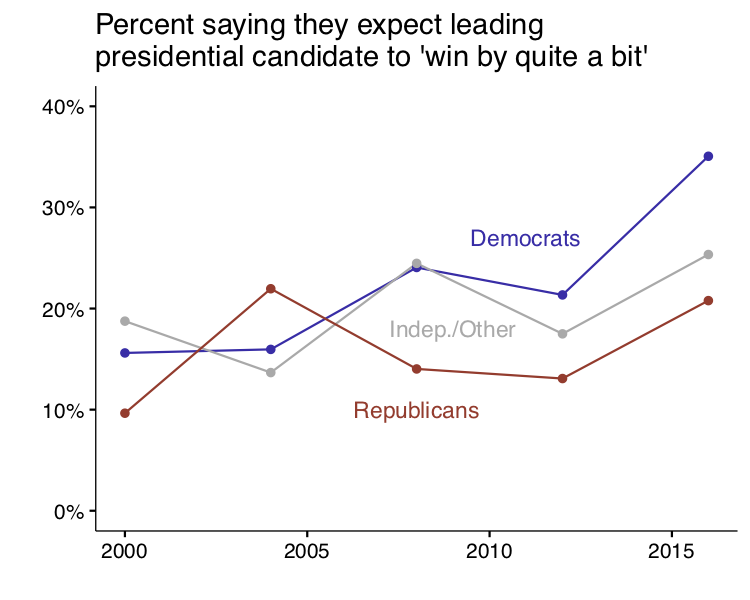
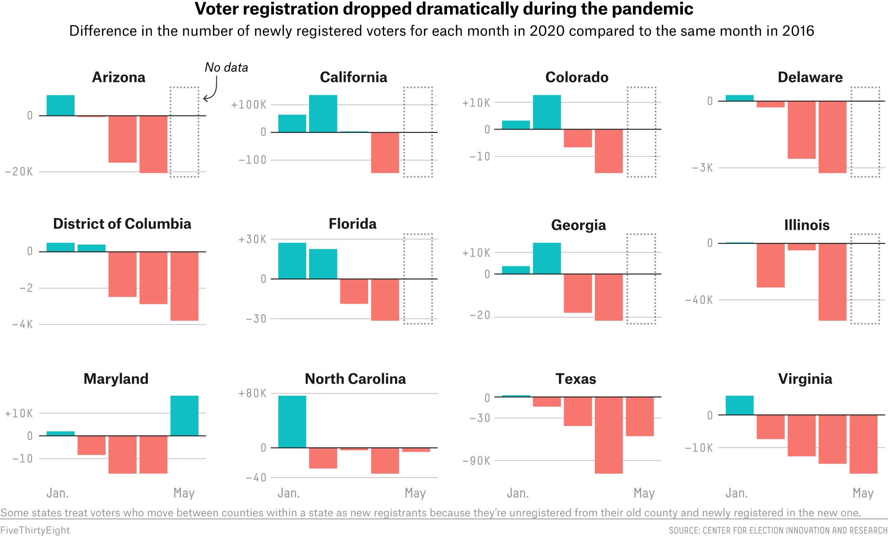
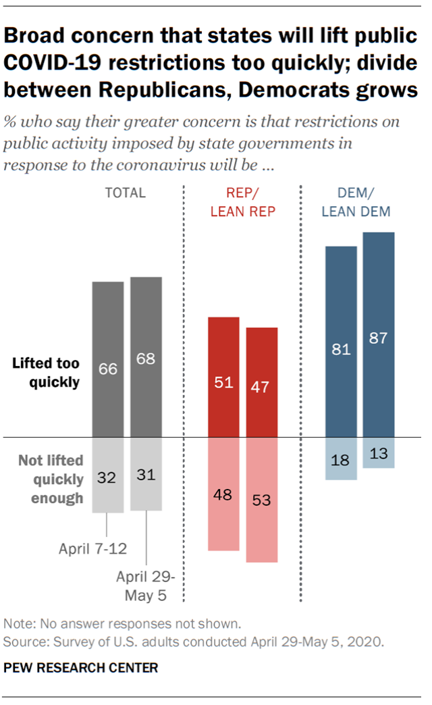

According to the latest polling research, Trump’s chances of hanging on to power beyond 2020 look pretty dismal. Nate Cohn published an impressive battleground [poll from New York Times/Sienna](https://www.nytimes.com/2020/06/25/upshot/poll-2020-biden-battlegrounds.html) showing Biden ahead of Trump by at least six points in pivotal states. The Economist’s forecast, powered by Elliott Morris and Andrew Gelman, is suggesting Biden is likely to get 64% of electoral college votes, and that if the election were held 100 times Biden would [win 90 times to Trump’s 10](https://statmodeling.stat.columbia.edu/2020/06/12/election-2020-is-coming-our-poll-aggregation-model-with-elliott-morris-of-the-economist/). 

At this point I would like to remind you of that feeling you felt on election night 2016. When a month earlier, [CNN's 'Poll of Polls' had Clinton up by 9 points](https://www.cnn.com/2016/10/23/politics/hillary-clinton-donald-trump-presidential-polls/index.html) and two prominent forecasters put Clinton’s chances at 99%. Remember that? 

I could probably stop there, but I’m not going to because although we've fixed some of the issues from 2016, we have COVID-19. And COVID will mess with our election in ways very likely to hurt Democrats, and I know of no pollster factoring this into their method or likely voter model. 

After 2016, Sean Westwood, Yphtach Lelkes and I began a multi-year research project (recently published in the [Journal of Politics](https://www.journals.uchicago.edu/doi/abs/10.1086/708682?mobileUi=0)) and found that when you have high confidence that one candidate will win, [you’re less likely to vote](https://solomonmg.github.io/project/projecting_confidence/). The fact that everyone thought Clinton would win in 2016 shaped Comey's decision to release his infamous letter that [some believe cost Clinton the election](https://fivethirtyeight.com/features/the-comey-letter-probably-cost-clinton-the-election/), changed the way campaigns operated, and likely [lowered Democratic turnout](https://solomonmg.github.io/pdf/aggregator.pdf). 

In addition to showing this in an experiment, one pattern that clearly pops out in the data we analyzed (ANES timeseries) is that people who think the leading candidate will win by quite a bit report voting at about a 3% lower rate. That's in line with other research showing that early exit polls indicating one candidate is likely to win [decrease turnout](https://www.jstor.org/preview-page/10.2307/2748722?seq=1), and are more likely to [affect Democrats](https://repository.upenn.edu/cgi/viewcontent.cgi?referer=&httpsredir=1&article=1018&context=asc_papers). Yet this is by no means an upper bound---one study found more decisive exit polling [depressed turnout by 11 points](https://www.sciencedirect.com/science/article/pii/S0014292115000483). 

While it's if anything a noisy indicator of the influence Clinton's ostensible lead may have had on Democrats compared with Republicans, the proportion of Democrats who thought Clinton would ‘win by quite a bit’ was much higher in 2016 than for Republicans, and much higher than it'd been in many years. 

To be clear, I no longer occupy the role of dispassionate observer--I’m actively working in politics at the moment. 

So while I like seeing Biden up, let me explain exactly why the margins we’re seeing could be a polling mirage. 

## COVID-19 ##
Are pollsters accounting for the likely decline in urban turnout due to COVID-19? Not if they are assuming typical levels of turnout across urban and rural areas. 

Make no mistake, COVID-19 is already affecting the political process---look at voter registration. As many colleagues who regularly deal with registration data have warned me, the usual rush of new voter registrations, often from young voters, have "fallen off a cliff." Registration numbers started stronger than ever as the new year began, but as [538 notes, fell to unprecedented levels in March](https://fivethirtyeight.com/features/voter-registrations-are-way-way-down-during-the-pandemic/) as pandemic social distancing measures took effect. 

So it's already hurting Democrats in terms of new registrations, but what might all this mean on election day? At first blush, it may be tempting to say to yourself, “COVID is affecting old people more than the young, and they break conservative so the left is probably fine,” before feeling slightly ashamed that you’re thinking about strategic considerations before the loss of life and sadness this statement implies. 

Think a little deeper and you’ll likely realize that so far COVID-19 has affected left-leaning people in left-leaning places---[non-White voters in urban areas](https://www.npr.org/2020/04/12/832455226/what-coronavirus-exposes-about-americas-political-divide) far more than their suburban/rural counterparts. Even the recent [surge in cases in sunbelt states](https://www.theatlantic.com/politics/archive/2020/06/coronavirus-surge-sun-belt-could-doom-trump/613495/) is hitting urban and non-White regions hardest. 

What’s more, conservatives seem to be far more likely to be willing risk going out and about than liberals. A Pew study shows [Republicans are far more likely](https://www.pewresearch.org/fact-tank/2020/05/07/americans-remain-concerned-that-states-will-lift-restrictions-too-quickly-but-partisan-differences-widen/) to support lifting COVID restrictions quickly than Democrats. 

With a deadly pandemic raging, will urban and non-urban voters go to the polls at the usual rates? 

Post-pandemic primary voting has meant a vast reduction in the number of polling places and a big increase in mail-in-ballots. We're seeing this in post-pandemic primaries like this Tuesday's in [Kentucky, New York, and Virginia](https://www.nytimes.com/2020/06/23/us/politics/kentucky-new-york-election-recap.html?action=click&module=Top%20Stories&pgtype=Homepage). 

In New York's primary, there were reports of [missing mail in ballots](https://www.thecity.nyc/2020/6/23/21300471/nyc-primary-missing-ballots-busted-machines-pandemic).  Kentucky also saw reports of [long lines that disportionately hit Black neighborhoods](https://www.motherjones.com/politics/2020/06/kentucky-slashes-polling-places-voting-rights-mcgrath-booker-lebron-james/), in a primary that will determine the Democrat who runs against Senate Majority Leader Mitch McConnell. 

What at first looks like maybe a silver lining is the surge in voting by mail-in ballot. And while Trump sees mail-in ballots as a [threat to his re-election](https://www.politico.com/news/2020/06/19/trump-interview-mail-voting-329307), the evidence is far from clear that widespread voting by mail would hurt his chances. 

On the contrary, Stanford’s Andy Hall estimates that universal vote by mail [should have no impact on either party's vote share](https://www.pnas.org/content/117/25/14052). However, as they note, vote by mail may very well have a disparate impact on minority voters, and their estimates assume that every voter is mailed a ballot, rather than needing to opt-in to voting by mail. 

And just today, the Supreme Court [denied an emergency request](https://www.nytimes.com/2020/06/26/us/supreme-court-texas-vote-by-mail.html?action=click&module=Top%20Stories&pgtype=Homepage) to allow all citizens in Texas to vote by mail. That’s not the last word, but conservatives are actively fighting measures like this one, which would have made it far easier to prepare to handle a deluge of mail-in ballots in the fall. 

Furthermore, we’re already seeing evidence in the primaries of [poll-workers failing to show up](https://www.nytimes.com/2020/03/09/us/virus-election-voting.html), lengthening the already long lines in urban areas that discourage voters. 

If [a little bit of rain can depress turnout in urban areas](https://faculty.ucmerced.edu/thansford/Articles/The%20Republicans%20Should%20Pray%20for%20Rain%20-%20Weather,%20Turnour,%20and%20Voting%20in%20U.S.%20Presidential%20Elections.pdf), fear of a deadly pandemic that spreads when you’re standing in line seems likely to as well. 

What’s more, it’s going to take longer to count mail in ballots, and there will almost certainly be confusion about results [as Poynter recently noted](https://www.poynter.org/fact-checking/2020/be-patient-on-election-night-2020-counting-the-returns-will-take-time/). Based on the President’s rhetoric around voting by mail, there will almost certainly be legal disputes about the legitimacy of certain results if not the election writ large. 

Buckle up. 

## Things Change ##
Six months ago the big story was the prospect of war with Iran after Trump killed Sulamani. The political world is fundamentally different now and it's more than possible that something important will happen between now and election day with political consequences. 

Does that matter? Andrew Gelman (yes, the same) and Gary King have a paper suggesting it doesn't---showing that we can [predict elections remarkably well despite how much polls fluctuate](https://www.jstor.org/preview-page/10.2307/194212?seq=1). "Thus, the general campaign for president seems irrelevant to the outcome ... despite all the media coverage of campaign strategy... *except in very close elections*." And [Alan Abramowitz's forecasting model](https://pollyvote.com/en/components/models/retrospective/fundamentals-plus-models/time-for-change-model/) which is the kind of model they are referencing and which has done extremely well in the past, has [Trump's chances in 2020 nearly even](https://www.rasmussenreports.com/public_content/political_commentary/commentary_by_alan_i_abramowitz/assessing_trump_s_chances_forecasting_the_2020_presidential_election) (though both the economy and Trump's polling numbers have suffered since).

So even if you're one of those people who think that in general the ebb and flow of historical events largely does not impact U.S. elections, it may matter more in 2020 than in a typical year, and that's before you even factor in a global pandemic that has upended life in America. 

OK, but how many people are really undecided about Trump? When asked who they’d vote for, 8 percent of people in Nate Cohn’s poll said something other than Biden or Trump. 

According to the American Association of Public Opinion Research 2016 post-mortem, [a tsunami of undecided voters went to Trump](https://www.aapor.org/Education-Resources/Reports/An-Evaluation-of-2016-Election-Polls-in-the-U-S.aspx), which was a major reason we thought Clinton was going to win in 2016. One controversial possibility is that some of these undecided voters were actually "[shy Trump supporters](https://morningconsult.com/2016/11/03/shy-trump-social-desirability-undercover-voter-study/)," which might explain the swing. Of course, another controversial possibility is that [the Comey letter cost Clinton the election](https://fivethirtyeight.com/features/the-comey-letter-probably-cost-clinton-the-election/). 

Regardless, Trump is more well-known now than in 2016 and there *are* fewer undecideds this time around. But we have no clue how these folks will break in 2020, and in 2016 they broke for Trump. 

## Correcting for Political Engagement ##
That 8 percent undecided number above may very well be an underestimate. Arguably the biggest problem in survey research today is that you can't fully adjust for the [bias toward high political knowledge respondents](https://www.pewresearch.org/fact-tank/2015/07/21/the-challenges-of-polling-when-fewer-people-are-available-to-be-polled/). And low political knowledge voters are more likely than others to be undecided. 

## Education ##
Likewise, it's difficult to survey Americans with low education. The **vast majority** of polls fail to recruit a representative swath of these potential voters and cannot fully adjust away the bias. 

OK so what? 

No election has [split on education like 2016](https://www.pewresearch.org/fact-tank/2016/11/09/behind-trumps-victory-divisions-by-race-gender-education/) going back to the beginning of Pew Research Center's data on this in 1980. Non-college Whites voted for Trump over their college educated counterparts by a **35 point margin**.  And the best retrospective analyses show that his biggest gains have [come from low-education White moderates in battleground states](https://williammarble.co/docs/vb.pdf) (and *not* as many have presumed, from those with conservative views on race and immigration, across the educational spectrum).  

Many 2016 polls did not adjust their samples to account for education---something that mattered far less in the past and something not easy to do correctly. They systematically underestimated Trump’s support in part because of this issue.

Although the NYT/Sienna poll and now many others do target and weight by education to increase representativeness, the [methodology](https://int.nyt.com/data/documenttools/nyt-siena-poll-methodology-june-2020/f6f533b4d07f4cbe/full.pdf) shows this poll (along with most) lump together everyone without a college degree. While the [AAPOR report concludes this may be ok](https://www.aapor.org/Education-Resources/Reports/An-Evaluation-of-2016-Election-Polls-in-the-U-S.aspx), Trump's support does appear to increase as education decreases, which means failing to disaggregate "no high school degree," "high school degree," and "some college" when adjusting for education may very well result in some bias in favor of Trump.

## Higher Error in Subnational Polls ##
The NYT/Sienna poll is one of the best subnational polls out there, but the error in battleground polls like this is generally [higher than national polls](https://yougov.co.uk/topics/politics/articles-reports/2016/11/11/first-thoughts-polling-problems-2016-us-elections). It's harder to reach the right mix of people in individual states in a short period of time which increases the error.  By error, I mean the actual error in predicting presidential vote share, not the reported "margin of error," which is usually [**around half the actual error**](https://www.nytimes.com/2016/10/06/upshot/when-you-hear-the-margin-of-error-is-plus-or-minus-3-percent-think-7-instead.html). 

The reported margin of error here is about 2%, so doubling that, 4%, plus the 8 percent who didn't say Biden or Trump means there may be 12% wiggle room, possibly more.

## Issues with the Voter File ##
The way pollsters recruit people for their survey has a huge impact on accuracy. If you don’t get data from the right mix of people you’re not going to get a good sense of which candidate is ahead, and you can only get so much juice out of adjusting your polls using approaches like weighting. 

Pollsters often use random-digit dialing to get a representative sample, but many of the best election surveys run today are now conducted by calling people from the voter file. The [Times used the voter file](https://www.nytimes.com/2018/09/06/upshot/live-poll-explainer.html) in part so they could poll congressional districts, which are drawn in such idiosyncratic shapes that they don’t line up with area codes nor almost any other data set with phone numbers. 

The Times uses the voter file to target specific subsets of the population that are hard to reach, such as low-education voters. Unfortunately, running a voter-file based poll may still not get enough low-education voters---as [Pew Research Center’s voter file study](https://www.pewresearch.org/methods/2018/10/09/performance-of-the-samples/) showed (it used the same voter file vendor as does the Times---L2). So you have to rely on statistical adjustment, increasing error. 

What’s more, in that Pew study only [62% of respondents who answered on a cell phone](https://www.pewresearch.org/methods/2018/10/09/comparing-survey-sampling-strategies-random-digit-dial-vs-voter-files/#overview-of-study-methodology) were the actual person on the voter file. And these quality issues vary a lot by state---remember, the file is first gathered by the secretary of state and is subject to local laws and regulations. For example, Wisconsin’s voter file is notoriously bad. 

All this increases total survey error and the chance that systematic biases will creep in. 

While the polling does indeed suggest better news than if it showed Trump ahead, this is still very likely a highly competitive race.
