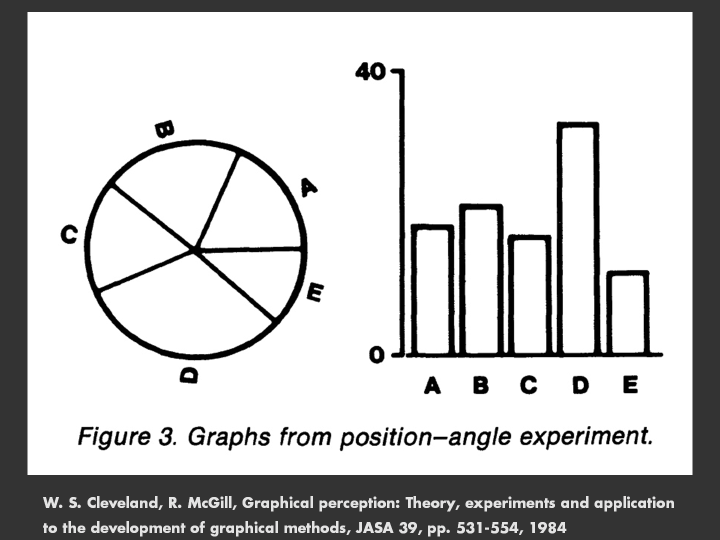
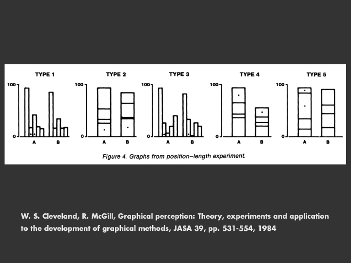
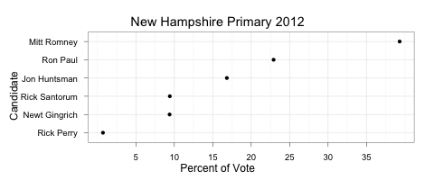
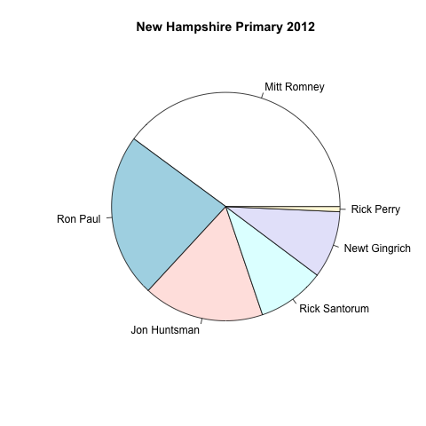
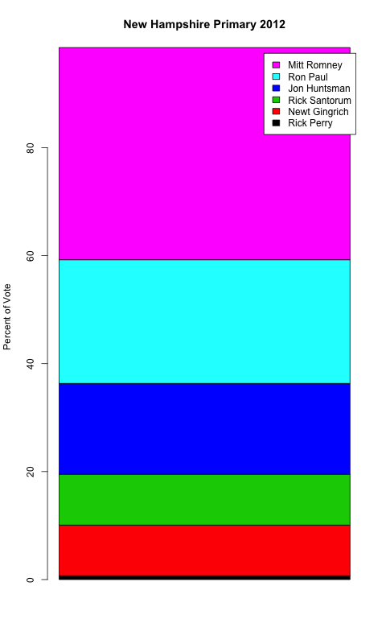
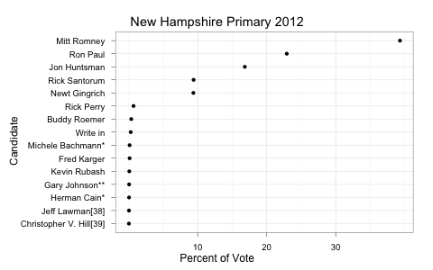
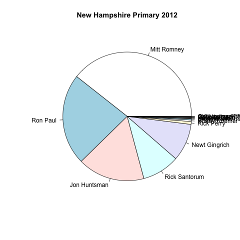
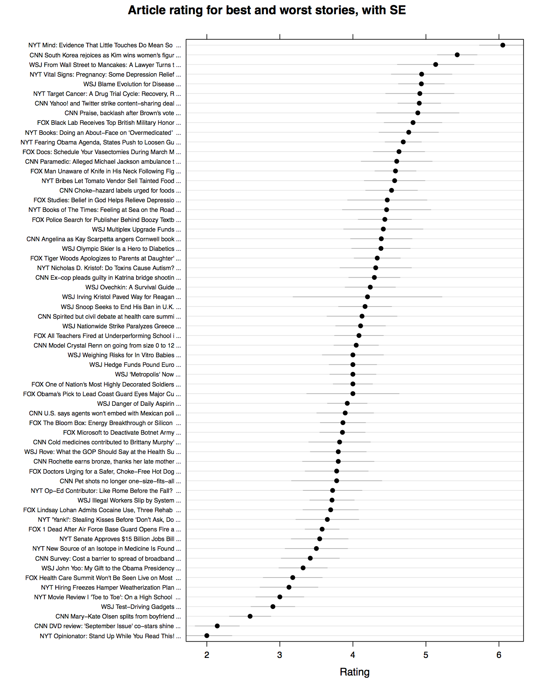

After my post on making [dotplots with concise code using plyr and ggplot](http://solomonmessing.wordpress.com/2011/11/26/putting-it-all-together-concise-code-to-make-dotplots-with-weighted-bootstrapped-standard-errors/), I got an email from my dad who practices immigration law and runs a [website with a variety of immigration resources and tools](http://www.messinglawoffices.com/default.aspx).  He pointed out that the post was written for folks who already know that they want to make dot plots, and who already know about bootstrapped standard errors.  That's not many people.

In an attempt to appeal to a broader audience, I'm starting a series in which I'll outline the key principles I use when developing a visualization.  In this post, I'll articulate these principles, which combine some of Tuft's aesthetic guidelines with Cleveland's scientific approach to visualization, which is based on the psychological processes involved in making sense of visualizations, and has been rigorously tested via randomized controlled experiments.  Based on these principles, I'll argue that dotplots and scatterplots are better than other types of plots (especially pie charts) in most situations.  In later posts, I'll demonstrate another innovation whose widespread use I'll credit to Cleveland and Tufte: the use of multiple panels (aka small multiples, trellis graphics, facets, generalized draftsman's displays, multivar charts) to clearly convey the same information embedded in more complex and difficult to read visualizations, including multiple line plots and mosaic plots. In future posts I'll also emphasize why it is important to provide some indication of the noise present in the underlying data using error bars or bands.  Along the way, I'll put you to the test--I'll present some visualizations of the same data using different visualization techniques and ask you to try to get as much information as you can in 2 seconds from each type of visualization.

A good visualization conveys key information to those who may have trouble interpreting numbers and/or statistics, which can make your findings accessible to a wider audience (more on this below).  Visualizations also give your audience a break from lexical processing, which is especially useful when you are presenting your findings--people can listen to you and process the findings from a well-designed visual at the same time, but most people have trouble listening while reading your PowerPoint bullet points.  Visualizations also convey key information embedded in massive amounts of data, which can aid your own exploratory analysis of data, no matter how massive.

Yet most visualizations are flawed, drawn using elements that make it unnecessarily difficult for the human visual system to make sense of things.  I see a lot of these visualizations attending research presentations, screening incoming draft manuscripts as the assistant editor for [Political Communication](http://www.tandf.co.uk/journals/upcp), and as a consumer of media info-graphics (CNN is especially bad, have a look at [this monstrosity](http://tech.fortune.cnn.com/tag/pie-chart/)).  Kevin Fox has an [especially compelling visual speaking to this here](http://fury.com/2010/03/why-3d-pie-charts-are-bad/). A big part of the problem is that Microsoft makes it easy to draw flashy but ultimately confusing visualizations in Excel.  If you are too busy to read this post in full, follow this short list of guidelines and you'll be on your way to producing elegant visualizations that impose a minimal cognitive burden on your audience:


1.  Never represent something in 2 or [worse yet 3 dimensions](http://www.psdgraphics.com/wp-content/uploads/2009/02/3d_pie_chart.jpg) if it can be represented in one---NEVER use pie charts, 3-D pie charts, stacked bar charts, or 3-D bar charts.

2.  Remove as much chart junk as possible--unnecessary gridlines, shading, borders, etc.

3.  Give your audience a sense of the noise present in your data--draw error bars or confidence bands if you are plotting estimates.

4.  If you want to plot multiple types of groups on a single outcome (the visual analog of cross-tabulations/marginals), use [multi-paneled plots](http://solomonmessing.files.wordpress.com/2011/11/trtbypid2.png?w=640). These can also help if [overploting looks too cluttered](http://www.bo.astro.it/~eps/buz10503/ff08.jpg).

5.  Avoid mosaic plots. Instead use [paneled histograms](http://wiki.stdout.org/rcookbook/Graphs/Facets%20(ggplot2)?action=AttachFile&do=get&target=hp_sex_smoker_free_free.png).

6.  Ditch the legend if you can (you almost always can).


The rest of the content in this series emphasizes why it makes sense to follow these guidelines. In this post I'll look at the first point in detail and touch on the sixth. These two guidelines are most relevant when you want to look at a quantitative variable (e.g., earnings, vote-share, temperature, etc.) across different qualitative groupings (e.g., industry segment, candidate, party, racial group, season, etc.).  This is one of the most common visualization tasks in business, media, and social science, and for this task people often use pie charts and/or bar charts, and occasionally dot plots.

**The science of graphical perception**

When most people think about visualization, they think first of [Edward Tufte](http://www.edwardtufte.com/tufte/).  Tufte emphasizes integrity to the data, showing relationships between phenomena, and above all else aesthetic minimalism.  I appreciate his ruthless crusade against [chart junk](http://chartjun%20k.karmanaut.com/) and [pie charts (nice quote from Data without Borders)](http://jakeporway.com/2011/08/data-without-borders-logo-contest/). We share an affinity for multipanel plotting approaches, which he calls "small multiples," (thanks to [Rebecca Weiss](http://www.stanford.edu/~rjweiss/) for pointing this out) though I think people give Tufte too much credit for their invention---both [juiceanalytics](http://www.juiceanalytics.com/writing/better-know-visualization-small-multiples/) and [infovis-wiki](http://www.infovis-wiki.net/index.php/Small_Multiples) write that Cleveland introduced the concept/principle. However, both Cleveland and Tufte published books in 1983 discussing the use of multipanel displays; [David Smith over at Revolutions](http://blog.revolutionanalytics.com/2011/11/small-multiples-of-the-sky.html) writes that "the "small-multiples" principle of data visualization \[was\] pioneered by Cleveland and popularized in Tufte's first book"; and the earliest reference to a work containing multipanel displays I could find was published \*long\* before Tufte's 1983 work--Seder, Leonard (1950), "Diagnosis with Diagrams—Part I", Industrial Quality Control (New York, New York: American Society for Quality Control) 7 (1): 11–19.


<iframe src="https://giphy.com/embed/11JbaLzOXsg6Fq" width="200" frameBorder="0" class="giphy-embed" align="right"></iframe>
I'm less sure about Tufte's advice to always show axes starting at zero, which can make comparison between two groups difficult, and to "show causality," which can end up misleading your readers.  Of course, the visualizations on display in the glossy pages of Tufte's books are beautiful.  But while his books are full of general advice that we should all keep in mind when creating plots, he does not put forth a theory of what works and what doesn't when trying to visualize data. 

Cleveland (with Robert McGill) develops such a theory and subjects it to rigorous scientific testing. In my last post I linked to one of Cleveland's studies showing that [dots (or bars) aligned on the same scale are indeed the best visualization to convey a series of numerical estimates](https://www.cs.ubc.ca/~tmm/courses/cpsc533c-04-spr/readings/cleveland.pdf).  In this work, Cleveland examined how accurately our visual system can process visual elements or "perceptual units" representing underlying data.  These elements include markers aligned on the same scale (e.g., dot plots, scatterplots, ordinary bar charts), the length of lines that are not aligned on the same scale (e.g., stacked bar plots), area (pie charts and mosaic plots), angles (also pie charts), shading/color, volume, curvature, and direction.

")

He runs two experiments: the first compares judgements about relative position (grouped bar charts) to judgements based only on length (stacked bar charts); the second compares judgements about relative position (ordinary bar charts) to judgements about angles/area (pie charts).  Here are the materials he uses, courtesy of the [Stanford Computer Graphics Lab](http://graphics.stanford.edu/):





The results are resoundingly clear---judgements about position relative to a baseline are dramatically more accurate than judgements about angles, area, or length (with no baseline).  Hence, he suggests that we replace pie charts with bar charts or dot plots and that we substitute stacked bar charts for grouped bar charts.

A striking and often overlooked finding in this work is the fact that the group of participants without technical training, "mostly ordinary housewives" as Cleveland describes them, performed *just as well* as the group of mostly men with substantial technical training and experience.   This finding provides evidence for something that I've long suspected: that visualizations make it easier for people lacking quantitative experience to understand your results, serving to level the playing field.  If you want your findings to be broadly accessible, it's probably better to present a visualization rather than a bunch of numbers.  It also suggests that if someone is having trouble interpreting your visualizations, it's probably your fault.

**Dotplots versus pie charts and stacked barplots**

Now let's put this to the test.  Take a look at each visualization below for two seconds, looking for the percent of the vote that Mitt Romney, Ron Paul, and Jon Huntsman got.

[](/img/primarydot2.png)[](/img/primarypie1.png)[](/img/primarystacked.png)

Which is easiest to read? Which conveys information most accurately? Let's first take a look at the most critical information--the order in which the candidates placed.  In all plots, the candidates are arrayed in order from highest to least vote share, and it's easy to see that Mitt won.  But once we start looking at who came in second, third, and so on, differences emerge.  It's slightly harder to process order in the pie chart because your eye has to go around the plot rather than up and down in a straight line.  In the stacked bar chart, we need to look up which color corresponds to which candidate's in the legend (as Tufte told us not to use), adding a layer of cognitive processing.

Second, which conveys estimates most accurately? The dot plot is the clear winner here.  We can quickly see that Romney got about 37%, Paul got about 24%, and Huntsman got about 16%, just by looking at dots relative to the axis.  When we look at the pie chart, it's really tough to estimate the exact percent each candidate got.  Same with the stacked bar chart. We could add numbers to the pie and bar charts, which would even things out to some extent, but then why not just display a table with exact percents?

One argument I used to hear all the time when I worked in industry is that pie charts "convey a sense of proportion."  Well, sure, I guess I can kind of guestimate that Ron Paul's vote share is about 1/4.  What about Jon Huntsman? Hmm, it looks like about 15 percent, which is 3/20.  But wait, why do I want to convert things into fractions anyway? I don't think in terms of fractions, I think in terms of percents.  And if I really care about proportion, I suppose I could extend the axis from 0 to 100.

Suppose I want to plot results for the top 15 candidates, not just the top 6?  Here's what happens:

[](/img/primarydot15.png)[](/img/primarypie15.png)

No contest, the pie chart fails completely.  We'd need to add a legend with colors for each candidate, which adds another layer of cognitive processing--we'd need to look up each color in the lengend as we go.  And even after adding the legend, you wouldn't be able to distinguish the lower performing candidates from say write-in votes because the pie slices would be too small.  The stacked bar chart will fail for the same reasons, so I've excluded it in the interest of brevity.  Note that we don't need to add colors to the dotplot to convey the same information, which saves an extra plotting element that we can use to represent something else (say candidate's campaign funds or total assets).  And, on top of it all, the dot plot takes up less screen/page real estate!

Why do I use dot plots instead of ordinary bar charts? A [nice visualization guide from perceptualedge.com](http://www.perceptualedge.com/articles/b-eye/encoding_values_in_graph.pdf) points out that often we want to only visualize differences between groups in a narrow range (they use an example wherein monthly expenses vary from \$4,250-\$5,500). But the length of a bar is supposed to facilitate accurate comparisons between values, so when you use a bar plot starting from \$4,250, the length between bars dramatically exaggerates the actual differences. Dot plots do not have this problem because dot encode values using only location, so one must reference the axis to interpret the value.

A related points is that bars are often used to convey counts--we use them in histograms to represent frequency and track say counts of dollars earned/raised in bar charts.  In fact, a team of doctors I work with at the med school recently sent in a manuscript to Radiology containing a bar chart plotting mean values between groups; they got back the following comment from the statistical reviewer: "the y-axis is quantitative but the data are represented using bars as if the data were counts."  People often use bar plots to convey estimates of means (and [I've certainly done this](http://www.stanford.edu/~messing/APSAPoster.pdf)), which can serve to exaggerate differences in means and hence effect sizes if you do not plot the bars from zero.

In addition, dot plots have aesthetic advantages.  They convey the numerical estimate in question with a single one-dimensional point, rather than a two dimensional bar.  There's simply less that the eye needs to process.  Accordingly, if a pattern across qualitative groupings exists, it's often easier to see with a dot plot.  For example, below I plot the average user ratings for each article to which [Sean Westwood](http://www.stanford.edu/~seanjw/) and I exposed subjects in a news reading experiment.  The pattern that emerges is an "S" curve in which one or two stories dominate the ratings, most are sort of average, and a few are uniformly terrible. Note that you'd probably want to use something like this more for yourself than to communicate your results to others as it might overload your audience with too much information--you'd do better to select a subset of these articles or remove some of the ones in the middle (thanks to Yph Lelkes for making this point).

[](/img/dotplot-story-rating.png)

One question that remains is if pie charts are so bad, why are they so common? Perhaps we like them because we find them comforting just as we find pies and pizza? Well if so we'd expect pie charts to be less common in places like Japan and China where people grow up eating different food.  Consider info-graphics in newspapers: I haven't yet done a systematic content analysis, but I was unable to find a single pie chart in Japan's Yomimuri Shimbun nor the Asahi Shimbun; nor in China's Beijing Daily nor Sing Tao Daily.  I did see plenty of maps, however, which I suppose one could argue are reminiscent of noodles.

**Implementation**

The most efficient way to produce solid visualizations with the ability to implement multiple panels, proper standard error estimates, and dot plots is probably in R using the ggplot2 package.  If you do not have time to learn R and remain tied to MS-Excel stick to ordinary barplots to visualize quantitative variables among multiple groups (not recommended).

Otherwise, if you don't already use it, [download R](http://cran.r-project.org/) and a decent editor like [Rstudio](http://rstudio.org/).  Then get started with ggplot2 and dot plots by running the following code chunk which will replicate the election figure above:

```r
pres <- read.csv("https://SolomonMg.github.io/img/primaryres.csv", as.is=T)

# sort data in order of percent of vote:
pres <- pres[order(pres$Percentage, decreasing=T), ]

# only show top 15 candidates:
pres <- pres[1:15,]

# create a precentage variable
pres$Percentage <- pres$Percentage*100

# reorder the Candidate factor by percentage for plotting purposes:
pres$Candidate <- reorder(pres$Candidate, pres$Percentage)

# To install ggplot2, run the following line after deleting the #
#install.packages("ggplot2")
library(ggplot2)
ggplot(pres, aes(x = Percentage, y = factor(Candidate) )) +
geom_point() +
theme_bw() + xlab("Percent of Vote") + ylab("Candidate") +
ggtitle("New Hampshire Primary 2012")
```

After loading our data and running a few preliminary data processing operations, we pass ggplot our data set, "pres," then we tell it what aesthetic elements we want to use, in this case that x is going to be our "Percentage" variable and y is going to be our "Candidate" variable. We tell ggplot that we want to display points for every xy pair. We also tell it to use the black and white theme, and pass some obscure axis options that ensures the axis plot correctly. Then we tell it what to label the x and y axis, and give it a title.

We can also reproduce the article ratings by story plot above using ggplot2 (even though I originally produced the plot using the lattice package).

```r
# To install ggplot2, run the following line after deleting the #
#install.packages("ggplot2")
library(ggplot2)
load(file("https://SolomonMg.github.io/img/db.Rda"))

# if you haven't installed dplyr, delete the # and run this line:
# install.packages("dplyr")
library(dplyr)
table(db$story)

# first we use plyr to calculate the mean rating and SE for each story
ratingdat <- db %>% group_by(story) %>%
summarise(M = mean(rating, na.rm=T),
SE = sd(rating, na.rm=T)/sqrt(length(na.omit(rating))),
N = length(na.omit(rating)))

# make story into an ordered factor, ordering by mean rating:
ratingdat$story <- factor(ratingdat$story)
ratingdat$story <- reorder(ratingdat$story, ratingdat$M)

# take a look at our handiwork:
ggplot(ratingdat, aes(x = M, xmin = M-SE, xmax = M+SE, y = story )) +
geom_point() + geom_segment( aes(x = M-SE, xend = M+SE,
y = story, yend=story)) +
theme_bw() + xlab("Mean rating") + ylab("Story") +
ggtitle("Rating article by Story, with SE")

# Now save
ggsave(file="plots/dotplot-story-rating.pdf", height=14, width=8.5)
```
