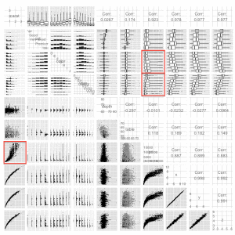

My last post railed against the [bad visualizations that people often use to plot quantitive data by groups, and pitted pie charts, bar charts and dot plots against each other for two visualization tasks.  Dot plots came out on top](/blog/visualization-series-insight-from-cleveland-and-tufte-on-plotting-numeric-data-by-groups/).  I argued that this is because humans are good at the cognitive task of comparing position along a common scale, compared to making judgements about length, area, shading, direction, angle, volume, curvature, etc.---a finding credited to Cleveland and McGill.  I enjoyed writing it and people seemed to like it, so I'm continuing my visualization series with the scatterplot.

## Scatterplots

A scatterplot is a two-dimensional plane on which we record the intersection of two measurements for a set of case items--usually two quantitative variables.  Just as humans are good at comparing position along a common scale in one dimension, our visual capabilities allow us to make fast, accurate judgements and recognize patterns when presented with a series of dots in two dimensions. This makes the scatterplot a valuable tool for data analysts both when exploring data and when communicating results to others. 

In this post---part 1---I'll demonstrate various uses for scatterplots and outline some strategies to help make sure key patterns are not obscured by the scale or qualitative group-level differences in the data (e.g., the relationship between test scores and income differs for men and women). The motivation in this post is to come up with a model of diamond prices that you can use to help make sure you don't get ripped off, specified based on insight from exploratory scatterplots combined with (somewhat) informed speculation. In part 2, I'll discuss the use of panels aka facets aka small multiples to shed additional light on key patterns in the data, and local regression (loess) to examine central tendencies in the data. There are far fewer bad examples of this kind of visualization in the wild than the 3D barplots and pie charts mocked in my last post, though I was still able to find [this lovely scatterplot + trend-line](http://www.showmethemath.com/Concepts_Explained/Scatter_Plot/homeworkScatterPlotAnswer.gif). 

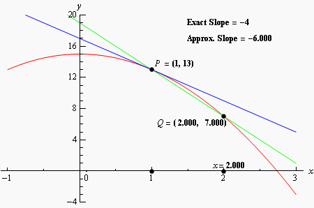

## Scatterplots and the Cartesian coordinate system

The scatterplot has a richer history than the visualizations I wrote about in my last post.  The scatterplot's face forms a two-dimensional Cartesian coordinate system, and DeCartes' invention/discovery of this eponymous plane in around 1657 represents one of the most fundamental developments in science.  The Cartesian plane unites measurement, algebra, and geometry, depicting the relationship between variables (or functions) visually. Prior to the Cartesian plane, mathematics was divided into algebra and geometry, and the unification of the two made many new developments possible.  Of course, this includes modern map-making---cartography, but the [Cartesian plane was also an important step in the development of calculus](http://en.wikipedia.org/wiki/Cartesian_coordinate_system#History), without which very little of our modern would would be possible.

The scatterplot is a powerful tool to help understand the relationship between variables, and especially if that relationship is non-linear. Say you want to get a sense of whether you're paying the right price when shopping for a diamond. You can use data on the price and characteristics of many diamonds to help figure out whether the price advertised for any given diamond is reasonable, and you can use scatterplots to help figure out how to model that data in a sensible way. Consider the important relationship between the price of a diamond and its carat weight (which corresponds to its size):

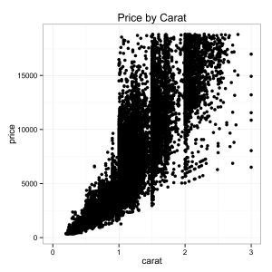

A few things pop out right away. We can see a non-linear relationship, and we can also see that the dispersion (variance) of the relationship also increases as carat size increases. With just a quick look at a scatterplot of the data, we've learned two important things about the functional relationship between price and carat size. And, we also therefore learned that running a linear model on this data as-is would be a bad idea.

## Diamonds
<a name="Diamonds"></a>

If you've ever used R, you've probably seen references to the diamonds data set that ships with Hadley Wickham's ggplot2. It records the carat size and the price of more than 50 thousand diamonds, from http://www.diamondse.info/ collected in [in 2008](http://r.789695.n4.nabble.com/Year-of-data-collection-for-diamonds-dataset-in-ggplot2-td4506598.html), and if you're in the market for a diamond, exploring this data set can help you understand what's in store and at what price point. This is particularly useful because each diamond is unique in a way that isn't true of most manufactured products we are used to buying---you can't just plug a model number and look up the price on Amazon. And even an expert cannot cannot incorporate as much information about price as a picture of the entire market informed by data (though there's no substitute for qualitative expertise to make sure your diamond is what the retailer claims).

But even if you're not looking to buy a diamond, the socioeconomic and political history of the diamond industry is fascinating. Diamonds birthed the mining industry in South Africa, which is now by far the largest and most advanced economy in Africa. I worked a summer in Johannesburg, and can assure you that South Africa's cities look far more like L.A. and San Francisco than Lagos, Cairo, Mogadishu, Nairobi, or Rabat. Diamonds have stoked conflicts ranging from the Boer Wars to modern day wars in Sierra Leone, Liberia, Côte d'Ivoire, Zimbabwe and the DRC, where the 200 carat Millennium Star diamond was sold to DeBeers at the height of the civil war in the 1990s. Diamonds were one of the few assets that Jews could conceal from the Nazis during [the "Aryanization of Jewish property"](http://www.archives.gov/research/holocaust/articles-and-papers/turning-history-into-justice.html) in the 1930s, and the Congressional Research Service reports that [Al Qaeda has used conflict diamonds to skirt international sanctions and finance operations from the 1998 East Africa Bombings to the September 11th attacks](http://royce.house.gov/uploadedfiles/rl30751.pdf). 

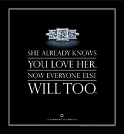

Though the diamonds data set is full of prices and fairly esoteric certification ratings, hidden in the data are reflections of how a [legendary marketing campaign permeated and was subsumed by our culture](http://www.nytimes.com/2013/05/05/fashion/weddings/how-americans-learned-to-love-diamonds.html), hints about how different social strata responded, and insight into how the diamond market functions as a result.

[The story starts in 1870](http://www.theatlantic.com/magazine/archive/1982/02/have-you-ever-tried-to-sell-a-diamond/304575/) according to The Atlantic, when many tons of diamonds were discovered in South Africa near the Orange River.  Until then, diamonds were rare---only a few pounds were mined from India and Brazil each year.  At the time diamonds had no use outside of jewelry as they do today in many industrial applications, so price depended only on scarce supply.  Hence, the project's investors formed the De Beers Cartel in 1888 to control the global price---by most accounts the most successful cartel in history, [controlling 90% of the world's diamond supply until about 2000](http://en.wikipedia.org/wiki/De_Beers#Diamond_monopoly).  But World War I and the Great Depression saw diamond sales plummet.


In 1938, according to the New York Times' account, the De Beers cartel wrote Philadelphia ad agency N. W. Ayer & Son, to investigate whether "the use of propaganda in various forms" might jump-start diamond sales in the U.S., which looked like the only potentially viable market at the time.  Surveys showed diamonds were low on the list of priorities among most couples contemplating marriage---a luxury for the rich, "money down the drain."  Frances Gerety, who the Times compares to Madmen's Peggy Olson, took on the DeBeers' account at N.W. Ayer & Son, and worked toward the company's goal "to create a situation where almost every person pledging marriage feels compelled to acquire a diamond engagement ring."  A few years later, she coined the slogan, "Diamonds are forever."

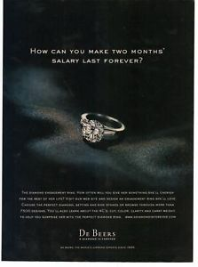

The Atlantic's Jay Epstein argues that this campaign gave birth to modern demand-advertising---the objective was not direct sales, nor brand strengthening, but simply to impress the glamour, sentiment and emotional charge contained in the product itself.  The company gave diamonds to movie stars, sent out press packages emphasizing the size of diamonds celebrities gave each other, loaned diamonds to socialites attending prominent events like the Academy Awards and Kentucky Derby, and persuaded the British royal family to wear diamonds over other gems.  The diamond was also marketed as a status symbol, to reflect "a man's ... success in life," in ads with "the aroma of tweed, old leather and polished wood which is characteristic of a good club."  A 1980s ad introduced the two-month benchmark: "Isn't two months' salary a small price to pay for something that lasts forever?"


By any reasonable measure, Frances Gerety succeeded---getting engaged means getting a diamond ring in America. Can you think of a movie where two people get engaged without a diamond ring? When you announce your engagement on Facebook, what icon does the site display?  Still think this marketing campaign might not be the most successful mass-persuasion effort in history?  I present to you a James Bond film, whose title bears the diamond cartel's trademark:


Awe-inspiring and terrifying.  Let's open the data set.  

The first thing you should consider doing is plotting key variables against each other using the ggpairs() function.  This function plots every variable against every other, pairwise.  For a data set with as many rows as the diamonds data, you may want to sample first otherwise things will take a long time to render.  Also, if your data set has more than about ten columns, there will be too many plotting windows, so subset on columns first.

```r
# Uncomment these lines and install if necessary:
#install.packages('GGally')
#install.packages('ggplot2')
#install.packages('scales')
#install.packages('memisc')
library(ggplot2)
library(GGally)
library(scales)
data(diamonds)
diasamp = diamonds[sample(1:length(diamonds$price), 10000),]
ggpairs(diasamp, params = c(shape = I('.'), outlier.shape = I('.')))
```

<!-- * R style note: I started using the "=" operator over "<-" after reading [John Mount's post on the topic](http://www.win-vector.com/blog/2013/04/prefer-for-assignment-in-r/?utm_source=rss&utm_medium=rss&utm_campaign=prefer-for-assignment-in-r), which shows how using "<-" (but not "=") incorrectly can result in silent errors.  There are other good reasons: 1.) WordPress and R-Bloggers occasionally mangle "<-" thinking it is HTML code in ways unpredictable to me; 2.) "=" is what every other programming language uses; and 3.) (as pointed out by Alex Foss in comments) consider "foo<-3" --- did the author mean to assign foo to 3 or to compare foo to -3?  Plus, 4.) the way R interprets that expression depends on white space---and if I'm using an editor like Emacs or Sublime where I don't have a shortcut key assigned to "<-", I sometimes get the whitespace wrong.  This means spending extra time and brainpower on debugging, both of which are in short supply.  
 -->
Anyway, here's the plot:

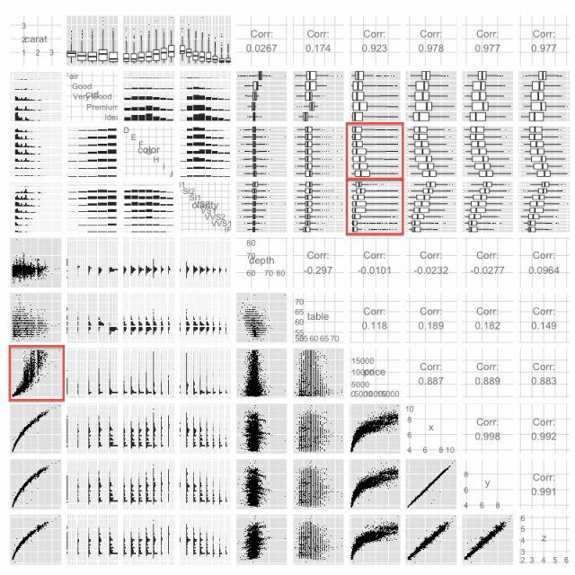

What's happening is that ggpairs is plotting each variable against the other in a pretty smart way. In the lower-triangle of plot matrix, it uses grouped histograms for qualitative-qualitative pairs and scatterplots for quantitative-quantitative pairs.  In the upper-triangle, it plots grouped histograms for qualitative-qualitative pairs (using the x-instead of y-variable as the grouping factor), boxplots for qualitative-quantitative pairs, and provides the correlation for quantitative-quantitative pairs.
What we really care about here is price, so let's focus on that.  We can see what might be relationships between price and clarity, and color, which we'll keep in mind for later when we start modeling our data, but the critical factor driving price is the size/weight of a diamond. Yet as we saw above, the relationship between price and diamond size is non-linear. What might explain this pattern?  On the supply side, larger contiguous chunks of diamonds without significant flaws are probably much harder to find than smaller ones.  This may help explain the exponential-looking curve---and I thought I noticed this when I was shopping for a diamond for my soon-to-be wife. Of course, this is related to the fact that the weight of a diamond is a function of volume, and volume is a function of x * y * z, suggesting that we might be especially interested in the cubed-root of carat weight.

On the demand side, customers in the market for a less expensive, smaller diamond are probably more sensitive to price than more well-to-do buyers. Many less-than-one-carat customers would surely never buy a diamond were it not for the social norm of presenting one when proposing.  And, there are *fewer* consumers who can afford a diamond larger than one carat.  Hence, we shouldn't expect the market for bigger diamonds to be as competitive as that for smaller ones, so it makes sense that the variance as well as the price would increase with carat size.

Often the distribution of any monetary variable will be highly skewed and vary over orders of magnitude. This can result from path-dependence (e.g., the rich get richer) and/or the multiplicitive processes (e.g., year on year inflation) that produce the ultimate price/dollar amount. Hence, it's a good idea to look into compressing any such variable by putting it on a log scale (for more take a look at [this guest post on Tal Galili's blog](http://www.r-statistics.com/2013/05/log-transformations-for-skewed-and-wide-distributions-from-practical-data-science-with-r/)).

```r
p = qplot(price, data=diamonds, binwidth=100) +
theme_bw() +
ggtitle('Price')
p
p = qplot(price, data=diamonds, binwidth = 0.01) +
scale_x_log10() +
theme_bw() +
ggtitle('Price (log10)')
p
```

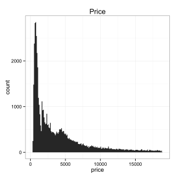

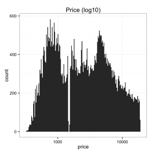

Indeed, we can see that the prices for diamonds are heavily skewed, but when put on a log10 scale seem much better behaved (i.e., closer to the bell curve of a normal distribution).  In fact, we can see that the data show some evidence of bimodality on the log10 scale, consistent with our two-class, "rich-buyer, poor-buyer" speculation about the nature of customers for diamonds.
Let's re-plot our data, but now let's put price on a log10 scale:

```r
p = qplot(carat, price, data=diamonds) +
scale_y_continuous(trans=log10_trans() ) +
theme_bw() +
ggtitle('Price (log10) by Carat')
p
```

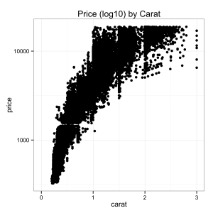

Better, though still a little funky---let's try using use the cube-root of carat as we speculated about above:

```r
cubroot_trans = function() trans_new('cubroot', transform= function(x) x^(1/3), inverse = function(x) x^3 )
p = qplot(carat, price, data=diamonds) +
scale_x_continuous(trans=cubroot_trans(), limits = c(0.2,3),
breaks = c(0.2, 0.5, 1, 2, 3)) +
scale_y_continuous(trans=log10_trans(), limits = c(350,15000),
breaks = c(350, 1000, 5000, 10000, 15000)) +
theme_bw() +
ggtitle('Price (log10) by Cubed-Root of Carat')
p
```

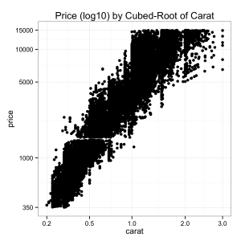

Nice, looks like an almost-linear relationship after applying the transformations above to get our variables on a nice scale.

## Overplotting
------------

Note that until now I haven't done anything about overplotting---where multiple points take on the same value, often due to rounding.  Indeed, price is rounded to dollars and carats are rounded to two digits.  Not bad, though when we've got this much data we're going to have some serious overplotting.

```r
head(sort(table(diamonds$carat), decreasing=TRUE ))
head(sort(table(diamonds$price), decreasing=TRUE ))
```

     0.3 0.31 1.01  0.7 0.32    1 
    2604 2249 2242 1981 1840 1558 

    605 802 625 828 776 698 
    132 127 126 125 124 121 

Often you can deal with this by making your points smaller, using "jittering" to randomly shift points to make multiple points visible, and using transparency, which can be done in ggplot using the "alpha" parameter.

```r
p = ggplot( data=diamonds, aes(carat, price)) +
geom_point(alpha = 0.5, size = .75, position='jitter') +
scale_x_continuous(trans=cubroot_trans(), limits = c(0.2,3),
breaks = c(0.2, 0.5, 1, 2, 3)) +
scale_y_continuous(trans=log10_trans(), limits = c(350,15000),
breaks = c(350, 1000, 5000, 10000, 15000)) +
theme_bw() +
ggtitle('Price (log10) by Cubed-Root of Carat')
p

```

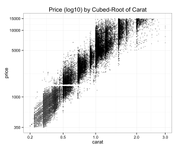

This gives us a better sense of how dense and sparse our data is at key places.

## Using Color to Understand Qualitative Factors
---------------------------------------------

When I was looking around at diamonds, I also noticed that clarity seemed to factor in to price.  Of course, many consumers are looking for a diamond of a certain size, so we shouldn't expect clarity to be as strong a factor as carat weight. And I must admit that even though my grandparents were jewelers, I initially had a hard time discerning a diamond rated VVS1 from one rated SI2. Surely most people need a loop to tell the difference. And, [according to BlueNile, the cut of a diamond has a much more consequential impact on that "fiery" quality that jewelers describe as the quintessential characteristic of a diamond](http://www.bluenile.com/diamonds/diamond-cut).  On clarity, the website states, "[Many of these imperfections are microscopic, and do not affect a diamond's beauty in any discernible way](http://www.bluenile.com/diamonds/diamond-clarity)." Yet, clarity seems to explain an awful lot of the remaining variance in price when we visualize it as a color on our plot:

```r
p = ggplot( data=diamonds, aes(carat, price, colour=clarity)) +
geom_point(alpha = 0.5, size = .75, position='jitter') +
scale_colour_brewer(type = 'div',
guide = guide_legend(title = NULL, reverse=T,
override.aes = list(alpha = 1))) +
scale_x_continuous(trans=cubroot_trans(), limits = c(0.2,3),
breaks = c(0.2, 0.5, 1, 2, 3)) +
scale_y_continuous(trans=log10_trans(), limits = c(350,15000),
breaks = c(350, 1000, 5000, 10000, 15000)) +
theme_bw() + theme(legend.key = element_blank()) +
ggtitle('Price (log10) by Cubed-Root of Carat and Color')
p
```

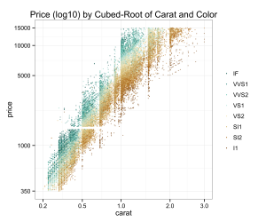


--------------------------------------------------------------------------

Despite what BlueNile says, we don't see as much variation on cut (though most diamonds in this data set are ideal cut anyway):

---------------------------------------------------------------------------------

```r
p = ggplot( data=diamonds, aes(carat, price, colour=cut)) +
geom_point(alpha = 0.5, size = .75, position='jitter') +
scale_colour_brewer(type = 'div',
guide = guide_legend(title = NULL, reverse=T,
override.aes = list(alpha = 1))) +
scale_x_continuous(trans=cubroot_trans(), limits = c(0.2,3),
breaks = c(0.2, 0.5, 1, 2, 3)) +
scale_y_continuous(trans=log10_trans(), limits = c(350,15000),
breaks = c(350, 1000, 5000, 10000, 15000)) +
theme_bw() + theme(legend.key = element_blank()) +
ggtitle('Price (log10) by Cube-Root of Carat and Cut')
p
```

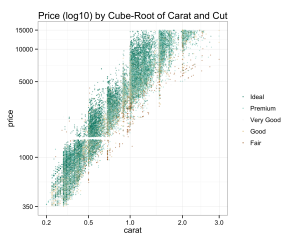

Color seems to explain some of the variance in price as well, though [BlueNile states that all color grades from D-J are basically not noticeable](http://www.bluenile.com/diamonds/diamond-color).

```r
p = ggplot( data=diamonds, aes(carat, price, colour=color)) +
geom_point(alpha = 0.5, size = .75, position='jitter') +
scale_colour_brewer(type = 'div',
guide = guide_legend(title = NULL, reverse=T,
override.aes = list(alpha = 1))) +
scale_x_continuous(trans=cubroot_trans(), limits = c(0.2,3),
breaks = c(0.2, 0.5, 1, 2, 3)) +
scale_y_continuous(trans=log10_trans(), limits = c(350,15000),
breaks = c(350, 1000, 5000, 10000, 15000)) +
theme_bw() + theme(legend.key = element_blank()) +
ggtitle('Price (log10) by Cube-Root of Carat and Color')
p
```

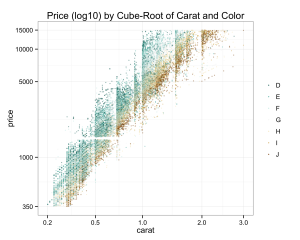


At this point, we've got a pretty good idea of how we might model price. But there are a few problems with our 2008 data---not only do we need to account for inflation but the diamond market is quite different now than it was in 2008. In fact, when I fit models to this data then attempted to predict the price of diamonds I found on the market, I kept getting predictions that were far too low. After some additional digging, I found the [Global Diamond Report](http://www.bain.com/publications/articles/global-diamond-report-2013.aspx). It turns out that prices plummeted in 2008 due to the global financial crisis, and since then prices (at least for wholesale polished diamond) have grown at a roughly a 6 percent compound annual rate. The [rapidly-growing number of couples in China buying diamond engagement rings](http://diamonds.blogs.com/diamonds_update/diamond-prices/) might also help explain this increase. After looking at data on PriceScope, I realized that [diamond prices grew unevenly across different carat sizes](http://www.pricescope.com/diamond-prices/diamond-prices-chart), meaning that the model I initially estimated couldn't simply be adjusted by inflation. While I could have done ok with that model, I really wanted to estimate a new model based on fresh data.

Thankfully I was able to put together a [python script to scrape diamondse.info](https://github.com/solomonm/diamonds-data/blob/master/dinfo.py) without too much trouble. This dataset is about 10 times the size of the 2008 diamonds data set and features diamonds from all over the world certified by an array of authorities besides just the Gemological Institute of America (GIA). You can read in this data as follows (be forewarned---it's over 500K rows):

```r
#install.packages('RCurl')
library('RCurl')
diamondsurl = getBinaryURL('https://raw.github.com/solomonm/diamonds-data/master/BigDiamonds.Rda')
load(rawConnection(diamondsurl))
```

My [github repository has the code necessary to replicate each of the figures above](https://github.com/solomonm/diamonds-data)---most look quite similar, though this data set contains much more expensive diamonds than the original. Regardless of whether you're using the original diamonds data set or the current larger diamonds data set, you can estimate a model based on what we learned from our scatterplots. We'll regress carat, the cubed-root of carat, clarity, cut and color on log-price. I'm using only GIA-certified diamonds in this model and looking only at diamonds under $10K because these are the type of diamonds sold at most retailers I've seen and hence the kind I care most about. By trimming the most expensive diamonds from the dataset, our model will also be less likely to be thrown off by outliers at the high end of price and carat. The new data set has mostly the same columns as the old one, so we can just run the following (if you want to run it on the old data set, just set data=diamonds).

```r
diamondsbig$logprice = log(diamondsbig$price)
m1 = lm(logprice~ I(carat^(1/3)),
data=diamondsbig[diamondsbig$price < 10000 & diamondsbig$cert == 'GIA',])
m2 = update(m1, ~ . + carat)
m3 = update(m2, ~ . + cut )
m4 = update(m3, ~ . + color + clarity)
#install.packages('memisc')
library(memisc)
mtable(m1, m2, m3, m4)
```

Here are the results for my recently scraped data set:

    ===============================================================
                        m1          m2          m3          m4     
    ---------------------------------------------------------------
    (Intercept)       2.671***    1.333***    0.949***   -0.464*** 
                     (0.003)     (0.012)     (0.012)     (0.009)   
    I(carat^(1/3))    5.839***    8.243***    8.633***    8.320*** 
                     (0.004)     (0.022)     (0.021)     (0.012)   
    carat                        -1.061***   -1.223***   -0.763*** 
                                 (0.009)     (0.009)     (0.005)   
    cut: V.Good                               0.120***    0.071*** 
                                             (0.002)     (0.001)   
    cut: Ideal                                0.211***    0.131*** 
                                             (0.002)     (0.001)   
    color: K/L                                            0.117*** 
                                                         (0.003)   
    color: J/L                                            0.318*** 
                                                         (0.002)   
    color: I/L                                            0.469*** 
                                                         (0.002)   
    color: H/L                                            0.602*** 
                                                         (0.002)   
    color: G/L                                            0.665*** 
                                                         (0.002)   
    color: F/L                                            0.723*** 
                                                         (0.002)   
    color: E/L                                            0.756*** 
                                                         (0.002)   
    color: D/L                                            0.827*** 
                                                         (0.002)   
    clarity: I1                                           0.301*** 
                                                         (0.006)   
    clarity: SI2                                          0.607*** 
                                                         (0.006)   
    clarity: SI1                                          0.727*** 
                                                         (0.006)   
    clarity: VS2                                          0.836*** 
                                                         (0.006)   
    clarity: VS1                                          0.891*** 
                                                         (0.006)   
    clarity: VVS2                                         0.935*** 
                                                         (0.006)   
    clarity: VVS1                                         0.995*** 
                                                         (0.006)   
    clarity: IF                                           1.052*** 
                                                         (0.006)   
    ---------------------------------------------------------------
    R-squared             0.888       0.892      0.899        0.969
    N                338946      338946     338946       338946    
    ===============================================================

Now those are some very nice R-squared values---we are accounting for almost all of the variance in price with the 4Cs.  If we want to know what whether the price for a diamond is reasonable, we can now use this model and exponentiate the result (since we took the log of price).  We need to multiply the result by exp(sigma^2/2), because the our error is no longer zero in expectation:

$$

$$ 
\begin{align*}
E(log(y) \mid \mathbf{X} = \mathbf{x}) &= E(\mathbf{X}\beta + \epsilon)\\
  E(y \mid \mathbf{X} = \mathbf{x}) &= E( exp( \mathbf{X}\beta + \epsilon ) )\\
  &= E( exp( \mathbf{X}\beta ) \times exp( \epsilon ) ) \\
  &= E( exp( \mathbf{X}\beta ) ) \times E( exp( \epsilon ) ) \\
  &= exp(\mathbf{X}\hat\beta) \times exp( \frac{\hat\sigma^2}{2} ) 
\end{align*}
$$

$$

To dig further into that last step, have a look at the [Wikipedia page on log-normal distributed variables](http://en.wikipedia.org/wiki/Log-normal_distribution#Arithmetic_moments).
Thanks to [Miguel](https://sites.google.com/site/miguelgodinhomatos/) for catching this.
Let's take a look at an example from Blue Nile. I'll use the full model, m4.

```r
# Example from BlueNile
# Round 1.00 Very Good I VS1 $5,601
thisDiamond = data.frame(carat = 1.00, cut = 'V.Good', color = 'I', clarity='VS1')
modEst = predict(m4, newdata = thisDiamond, interval='prediction', level = .95)
exp(modEst) * exp(summary(m4)$sigma^2/2)
```

The results yield an expected value for price given the characteristics of our diamond and the upper and lower bounds of a 95% CI---note that because this is a linear model, predict() is just multiplying each model coefficient by each value in our data. Turns out that this diamond is a touch pricier than expected value under the full model, though it is by no means outside our 95% CI. BlueNile has by most accounts a better reputation than diamondse.info however, and reputation is worth a lot in a business that relies on easy-to-forge certificates and one in which the non-expert can be easily fooled.

This illustrates an important point about generalizing a model from one data set to another. First, there may be important differences between data sets---as I've speculated about above---making the estimates systematically biased. Second, overfitting---our model may be fitting noise present in data set. Even a model cross-validated against out-of-sample predictions can be over-fit to noise that results in differences between data sets. Of course, while this model may give you a sense of whether your diamond is a rip-off against diamondse.info diamonds, it's not clear that diamondse.info should be regarded as a source of universal truth about whether the price of a diamond is reasonable. Nonetheless, to have the expected price at diamondse.info with a 95% interval is a lot more information than we had about the price we should be willing to pay for a diamond before we started this exercise.

An important point---even though we can predict diamondse.info prices almost perfectly based on a function of the 4c's, one thing that you should NOT conclude from this exercise is that *where* you buy your diamond is irrelevant, which apparently used to be conventional wisdom in some circles.  You will almost surely pay more if you [buy the same diamond at Tiffany's versus Costco](https://web.archive.org/web/20131231035425/http://www.businessweek.com/articles/2013-05-06/tiffany-vs-dot-costco-which-diamond-ring-is-better). But [Costco sells some pricy diamonds](https://web.archive.org/web/20140217105722/http://www.costco.com:80/2.12-ctw-Round-Brilliant-Cut-Internally-Flawless,-D-Color-Diamond-%22Audrey%22-Platinum-Wedding-Set.product.100006730.html) as well. Regardless, you can use this kind of model to give you an indication of whether you're overpaying.

Of course, the value of a natural diamond is largely socially constructed. Like money, diamonds are only valuable because society says they are----there's no obvious economic efficiencies to be gained or return on investment in a diamond, except perhaps in a very subjective sense concerning your relationship with your significant other. To get a sense for just how much value is socially constructed, you can compare the price of a natural diamond to a synthetic diamond, which thanks to recent technological developments are of comparable quality to a "natural" diamond. Of course, natural diamonds fetch a dramatically higher price.

One last thing---there are few guarantees in life, and I offer none here. Though what we have here seems pretty good, data and models are never infallible, and obviously you can still get taken (or be persuaded to pass on a great deal) based on this model. Always shop with a reputable dealer, and make sure her incentives are aligned against selling you an overpriced diamond or worse one that doesn't match its certificate. There's no substitute for establishing a personal connection and lasting business relationship with an established jeweler you can trust.


## One Final Consideration
-----------------------

Plotting your data can help you understand it and can yield key insights.  But even scatterplot visualizations can be deceptive if you're not careful.  Consider another data set the comes with the alr3 package---soil temperature data from Mitchell, Nebraska, collected by Kenneth G. Hubbard from 1976-1992, which I came across in Weisberg, S. (2005). *Applied Linear Regression*, 3rd edition. New York: Wiley (from which I've shamelessly stolen this example).
Let's plot the data, naively:

```r
#install.packages('alr3')
library(alr3)
data(Mitchell)
qplot(Month, Temp, data = Mitchell) + theme_bw()
```

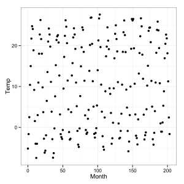

Looks kinda like noise.  What's the story here?
When all else fails, think about it.
What's on the X axis?  Month.  What's on the Y-axis?  Temperature.  Hmm, well there are seasons in Nebraska, so temperature should fluctuate every 12 months. 

But we've put more than 200 months in a pretty tight space.

Let's stretch it out and see how it looks:

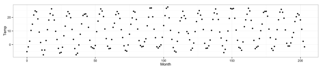

Don't make that mistake.

That concludes part I of this series on scatterplots.  Part II will illustrate the advantages of using facets/panels/small multiples, and show how tools to fit trendlines including linear regression and local regression (loess) can help yield additional insight about your data. 

You can also learn more about [exploratory data analysis via this Udacity course taught by my colleagues Dean Eckles and Moira Burke, and Chris Saden](https://www.udacity.com/course/ud651), which will be coming out in the next few weeks.
