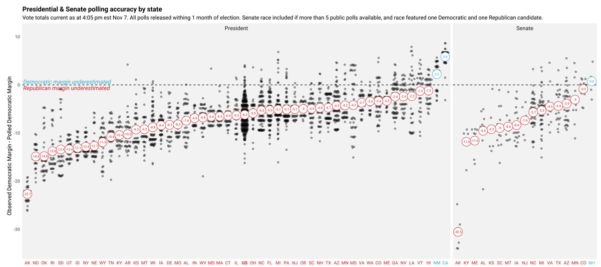
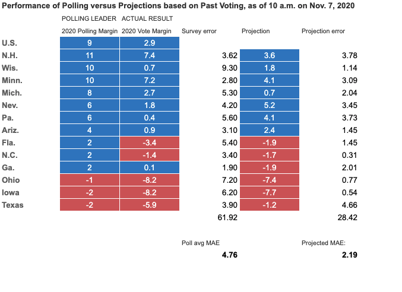
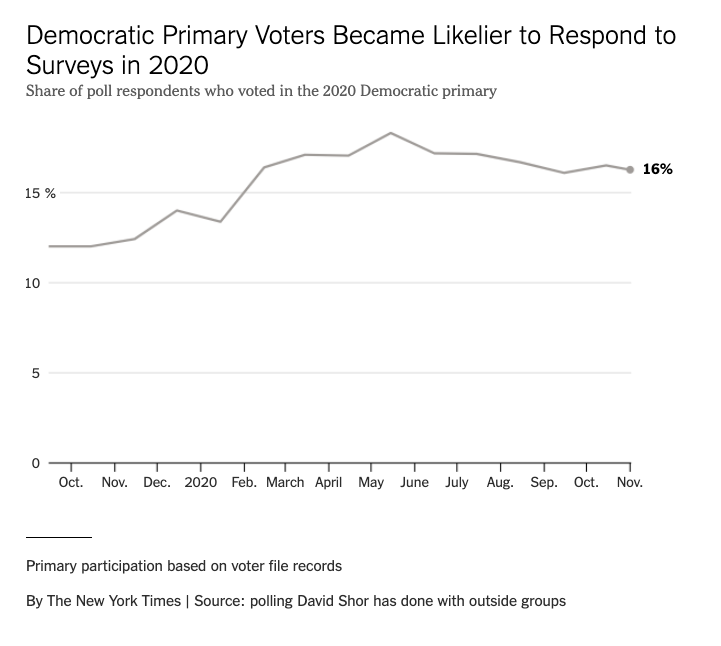
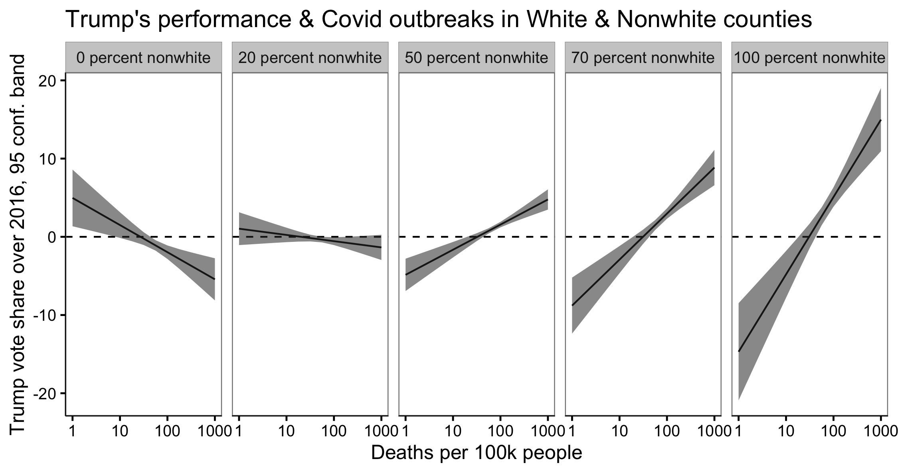
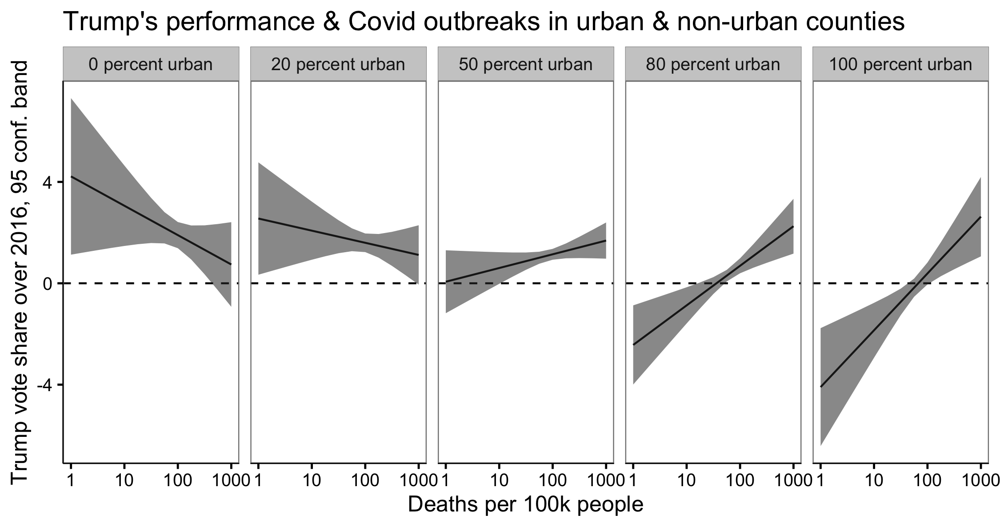

It’s becoming clear that the 2020 polls underestimated Trump’s support by anywhere from a 4-8 point margin depending on your accounting--a significantly worse miss than in 2016, when [state polls were off but the national polls did relatively well](https://fivethirtyeight.com/features/the-polls-are-all-right/). 

In fact, this year we were better off using projections based on past vote history in each state to predict how things would go in battleground states, as I'll show below. 

But I also want to start to ask questions about what happened this time around. The polling from 2018 looked encouraging, convincing many pollsters that the post-2016 reckoning had fixed many issues called out in the [2016 AAPOR report on election polling](https://www.aapor.org/Education-Resources/Reports/An-Evaluation-of-2016-Election-Polls-in-the-U-S.aspx). After 2018, FiveThirtyEight wrote that the ["Polls are Alright"](https://fivethirtyeight.com/features/the-polls-are-all-right/).

But the second Miami-Dade reported results from the 2020 election, we knew something was probably wrong with the 2020 polls.

<!-- <blockquote class="twitter-tweet"></blockquote> -->

As Stefan notes (we worked together at Pew Research Center's Data Labs), the error seems slightly lower in key battleground states, though the polls missed big in WI, perhaps in part due to its horrifically bad voter file data.

Unlike 2016, both state and national polls appeared to underestimate Trump's support, as this early (Nov 7) analysis from [Tom Wood](https://twitter.com/thomasjwood) shows: 

<blockquote class="twitter-tweet"></blockquote>

<!--  -->

## Polling versus past votes

Perhaps what surprised me the most about polling this time around was when I went to evaluate some election projections I put together in April that we used internally at Acronym to help evaluate where we might want to spend. I pulled in the [NYTimes polling averages](https://www.nytimes.com/live/2020/presidential-polls-trump-biden) and compared them with the latest state-level presidential results from the AP. I then did the same for the April projections. Turns out the projections were significantly more accurate than the polling averages: 

We used these projections, and other extant data (including the fact that there are two Senate races in play), when making what turned out to be a very lucky decision to start spending money in Georgia. We were one of the biggest and earliest spenders in that race. 

What are these projections? I simply took the last two state-level Presidential and U.S. House election totals, estimated each state's "trajectory," and added that to each state's Democratic margin from the previous cycle. 

(Note that I also weighted 60-40 toward the Presidential results, and slightly regularized both the latest margin and the trajectory toward zero.)

Informing this approach is work from [Yair Ghitza](https://catalist.us/yair-ghitza-phd/) describing what went wrong in 2016, which suggested polarization and other state-level trends would continue, in addition to national trends or "uniform swing." 

<blockquote class="twitter-tweet"></blockquote>
	

I should note that this may only have worked because of something peculiar about this election cycle--I haven't gone an back-tested this approach or anything like that. 

Seems I was not the only one who noticed this kind of pattern:

<blockquote class="twitter-tweet"></blockquote>

## What went wrong: The Usual Suspects

Humble-brag aside, it's worth asking what might have gone wrong with polling in 2020? 

The [2016 AAPOR report on election polling](https://www.aapor.org/Education-Resources/Reports/An-Evaluation-of-2016-Election-Polls-in-the-U-S.aspx) provides some guidance for how we might start to examine issues with the 2020 polls. 

**Undecided voters**: Undecideds broke toward Trump late in the election in 2016--polls found as many as 13 percent of voters were [undecided on election day or planned to vote for a third party](https://fivethirtyeight.com/features/the-invisible-undecided-voter/). According to Poynter, there were [half as many of these voters in 2020](https://www.poynter.org/fact-checking/2020/2020-is-not-like-2016-heres-whats-different/), so this is unlikely to be as big a factor as in 2016. 

**Low education non-response & adjustment**: In 2016, individuals lower levels of education were much less likely to answer polls but still voted, and broke for Trump. The national polls adjusted for this but state level polls did not, which is partially why forecasting models that rely on state-level polls missed so hard. 

While many state-level pollsters did this in 2020, Pew Research Center still [found problems with state level polling this time around](https://www.pewresearch.org/methods/2020/08/18/a-resource-for-state-preelection-polling/), for example failing to adjust for race and education simultaneously--non-college whites are far more likely to support Trump than non-college non-whites. 

What's more, pollsters adjusted only for college/non-college, which may not have been enough. They might need to use more fine grained adjustment--accounting for whether respondents have a high school degree and a college degree.  Also error/missing data when people complete education in a survey means trouble if you want to fully fix the issue. 

**Volunteerism & civic engagement**: Even if you adjust for low levels of non-response among individuals with lower education, pollsters still may have problems reaching [low civic engagement voters, a bias that seems to persist even after modeling/weighting adjustments](https://www.pewresearch.org/fact-tank/2015/07/21/the-challenges-of-polling-when-fewer-people-are-available-to-be-polled/). In the past this hasn't mattered as much, but these folks may be showing up to the polls for Trump. 

## Other Potential Factors

**Likely voter models**: This is difficult to fully unpack since each polling house does this slightly differently and not all publish their methods—some ask a battery of voter questions, some use models, some recruit off the voter file. But there’s only a weak relationship between who votes and who scores high on the likely voter battery. To make matters worse, 2020 was a very high-turnout election, which could have introduced even more instability into likely voter models. 

Another important point from Peter Suzman is that likely voter screens could have inflated estimates of Dem turnout if they asked if respondents had already voted---it was Democrats who voted early. 

<blockquote class="twitter-tweet"></blockquote>

However, that would only explain error in likely voter models, not polling based on registered voters, which also seemed to miss big this cycle, as I pointed out: 

<blockquote class="twitter-tweet"></blockquote>

**COVID-19**: I wrote about [this back in June](https://solomonmg.github.io/post/trumps-chances-are-better-than-they-look/). It's possible that COVID-19 made lines long and kept people home in urban areas and non-white communities. Yes we had record turnout but all it takes is a few percent of people who encounter a bit of voting friction, who fail to register in person, don’t get in person canvassing/gotv contact, don’t vote by mail early, and/or don’t vote in vote in person. 

At the same time, [David Shor points out](https://www.nytimes.com/2020/11/10/upshot/polls-what-went-wrong.html) in a piece by Nate Cohn at the New York Times, that "...after lockdown, Democrats just started taking surveys, because they were locked at home and didn’t have anything else to do."

Without Dems doing the usual in-person registration drives, organizing, canvassing, etc. plus long lines in the hardest hit areas, and with Democrats taking surveys at unusually high rates, we might expect to see Trump overperform in areas hit hardest by COVID-19.  

And indeed the data show just that. [NPR has a nice visualization of this](https://www.npr.org/sections/health-shots/2020/11/06/930897912/many-places-hard-hit-by-covid-19-leaned-more-toward-trump-in-2020-than-2016): 

<blockquote class="twitter-tweet"></blockquote>

Another possibility is that shutdowns, school closings, and job losses stoked anger & resentment in centrist & right-leaning voters. I remember watching a local FB group quickly organize around the issue of school-openings and eventually morph into a hub for protests.

EDIT: I took a look at his performance by the urbanicity and racial makeup of those counties and here's what I found:

Trump outperforms 2016 in non-white counties, and UNDER-performs in mostly-white counties. Same for more urban counties. That's consistent w/ covid hitting non-white counties much harder in terms of registration, long-lines, and lower VBM rates.

That seems to stand in sharp contrast to speculation that Trump would be hit hardest in areas where people are most likely to know someone with COVID. 

**Shy Trump voters**: There's a hypothesis out there that people are embarrassed to admit that they would vote for Trump. The evidence for this is limited--Kyle Dropp and co at Morning Consult did some experimental work on this and found that people were slightly more likely [in the 2016 primaries (but NOT the General and not in 2020)](https://morningconsult.com/form/shy-trump-2020/) to say that they would vote for Trump when answering via online survey compared with speaking with a live pollster over the phone. But they've done many follow-on surveys since and the pattern doesn't persist.  

<blockquote class="twitter-tweet"></blockquote>

I am skeptical that this could be as much of a factor as some on social media seem to be claiming, but it's hard to get good data to answer this question and acknowledge that absence of evidence is not evidence of absence. A number of commentators have claimed that since the polls underestimated support for all Republicans, this is an unlikely explanation. 

That sounds pretty air-tight at first glance but it's possible that some undecideds, perhaps embarrassed about having Trump as a figurehead of the Republican party, refused to say with certainty who they would actually vote for. Nevertheless, based on the pattern of results we've seen so far, this really can't explain very much of the polling error this time around. 

## The Role of Election Forecasts

If you're a forecaster, it's very easy to look at all the polling data and come away with overconfident estimates of a candidate’s support. Many forecasters in 2016 did just that, failing to account for the fact that error between states and pollsters were likely correlated, and producing estimates that put Clinton’s chances above 95%. 

The Huffington Post famously [roasted FiveThirtyEight](https://www.huffpost.com/entry/nate-silver-election-forecast_n_581e1c33e4b0d9ce6fbc6f7f) for trying to adjust for this state-level polling error the day before the 2016 election. 

But even when forecasters get it right, forecasting can create firm expectations that one candidate will win, which in 2016 was complicated by destiny-narrative driven by media coverage of election forecasting. 

Sean Westwood, Yph Lelkes and I recently published a [research paper](https://solomonmg.github.io/pdf/aggregator.pdf) in the Journal of Politics showing just how much additional confidence forecasts give us, and wrote about the implications for the 2020 election in a recent [USA Today op ed](https://www.usatoday.com/story/opinion/2020/10/01/election-forecasts-can-wrong-you-still-need-vote-column/5857993002/). 

I believe it was the sharp violation of expectations that was so disappointing to Clinton supporters and so invigorating for the MAGA crowd—the Washington elite had underestimated "real Americans" yet again.

