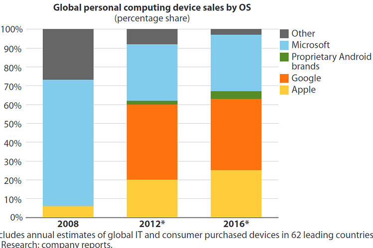
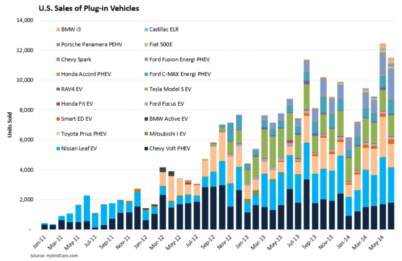
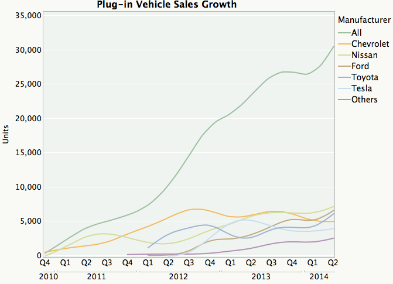
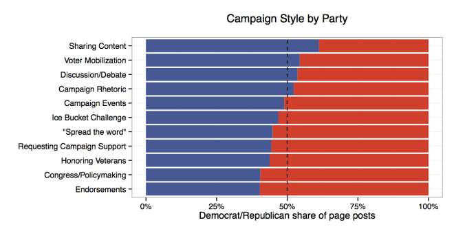
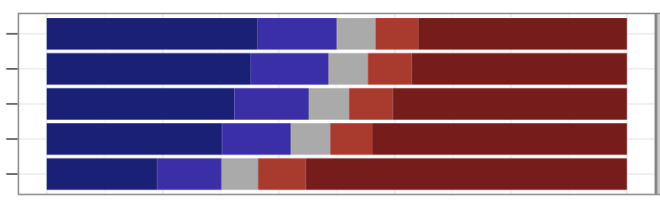

Yesterday a few of us on Facebook's Data Science Team released a [blogpost showing how candidates are campaigning on Facebook in the 2014 U.S. midterm elections](https://www.facebook.com/notes/10152581594083859/). It was [picked up in the Washington Post](http://www.washingtonpost.com/blogs/govbeat/wp/2014/10/10/how-candidates-use-facebook-motivation-more-than-persuasion/), in which [Reid Wilson](http://www.washingtonpost.com/people/reid-wilson) calls us \"data wizards.\" Outstanding.

I used [Hadly Wickham\'s](http://had.co.nz/) ggplot2 for every visualization in the post except a map that [Arjun Wilkins](http://web.stanford.edu/~arjunw/) produced using D3, and for the first time I used stacked bar charts.  Now as I\'ve stated previously, [one should generally avoid bar charts, and especially stacked bar charts](/blog/visualization-series-insight-from-cleveland-and-tufte-on-plotting-numeric-data-by-groups), except in a few specific circumstances.

But let\'s talk about when not to use stacked bar charts first\-\--I had the pleasure of chatting with Kaiser Fung of [JunkCharts](http://junkcharts.typepad.com/) fame the other day, and I think what makes his site so compelling is the mix of schadenfreude and [Fremdscham](http://betterthanenglish.com/fremdscham-german/) that makes taking apart someone else\'s mistake such an effective teaching strategy and such a memorable read. I also appreciate the subtle nod to [junk art](https://en.wikipedia.org/wiki/Found_object).

Here\'s a typical, terrible stacked bar chart, which I found on http://www.storytellingwithdata.com/ and originally published on a [Wall Street Journal blogpost](http://blogs.wsj.com/digits/2012/10/22/microsoft-windows-8-forrester/). It shows the share of the personal computing device market by operating system, over time. The problem with using a stacked bar chart is that there are only two common baselines for comparison (the top and bottom of the plotting area), but we are interested in the relative share for more than two OS brands. The post is really concerned with Microsoft, so one solution would be to plot Microsoft versus the rest, or perhaps Microsoft on top versus Apple on the bottom with \"Other\" in the middle. Then we\'d be able to compare the over time market share for Apple and Microsoft. As the author points out, an over time trend can also be visualized with line plots.



By far the worst offender I found in my 5 minute Google search was [from junkcharts](http://junkcharts.typepad.com/junk_charts/2014/08/one-guaranteed-to-make-stephen-few-cry-.html) and originally published on [Vox](http://www.vox.com/2014/7/28/5944065/electric-cars-plug-in-vehicles-rising-sales-US). These cumulative sum plots are so bad I was surprised to see them still up. The first problem is that the plots represent an attempt to convey way too much information\-\--either plot total sales or pick a few key brands that are most interesting and plot them on a multi-line chart or set of faceted time series plots. The only brand for which you can quickly get a sense of sales over time is the Chevy Volt because it\'s on the baseline. I\'m sure the authors wanted to also convey the proportion of sales each year, but if you want to do that just plot the relative sales. Of course, the order in which the bars appear on the plot has no organizing principle, and you need to constantly move your eyes back and forth from the legend to the plot when trying to make sense of this monstrosity.



As Kaiser notes in his post, less is often more. Here\'s his redux, which uses lines and aggregates by both quarter and brand, resulting in a far superior visualization:



So when \*should\* you use a stacked bar chart? Here are a two scenarios with examples, inspired by work with [Eytan Bakshy](http://eytan.github.io/) and conversations with [Ta Chiraphadhanakul](http://ta.virot.me/) and [John Myles White](http://www.johnmyleswhite.com/).

1. You care about comparing the proportion of two things, in this case the share of posts by Democrats and Republicans, along a variety of dimensions.  In this case those dimensions consist of keyword (dictionary-based) categories (above) and LDA topics (below).  When these are sorted by relative proportion, the reader gains insight into which campaign strategies and issues are used more by Republican or Democratic candidates.



2. You care about comparing proportions along an ordinal, additive variable such as 5-point party identification, along a set of dimensions.  I provide an example from a forthcoming paper below (I\'ll re-insert the axis labels once it\'s published).  Notice that it draws the reader toward two sets of comparisons across dimensions \-- one for strong democrats and republicans, the other for the set of \*all\* Democrats and \*all\* Republicans.



Of course, R code to produce these plots follows:

```r
# Uncomment these lines and install if necessary:
#install.packages('ggplot2')
#install.packages('dplyr')
#install.packages('scales')
library(ggplot2)
library(dplyr)
library(scales)
# We start with the raw number of posts for each party for
# each candidate. Then we compute the total by party and
# category.
catsByParty %>% group_by(party, all_cats) %>%
summarise(tot = summ(posts))
# Next, compute the proportion by party for each category
# using dplyr::mutate
catsByParty <- catsByParty %>%
group_by(all_cats) %>%
mutate(prop = tot/sum(tot))
# Now compute the difference by category and order the
# categories by that difference:
catsByParty <- catsByParty %>% group_by(all_cats) %>%
mutate(pdiff = diff(prop))
catsByParty$all_cats <- reorder(catsByParty$all_cats, -catsByParty$pdiff)
# And plot:
ggplot(catsByParty, aes(x=all_cats, y=prop, fill=party)) +
scale_y_continuous(labels = percent_format()) +
geom_bar(stat='identity') +
geom_hline(yintercept=.5, linetype = 'dashed') +
coord_flip() +
theme_bw() +
ylab('Democrat/Republican share of page posts') +
xlab('') +
scale_fill_manual(values=c('blue', 'red')) +
theme(legend.position='none') +
ggtitle('Political Issues Discussed by Party\n')
```
