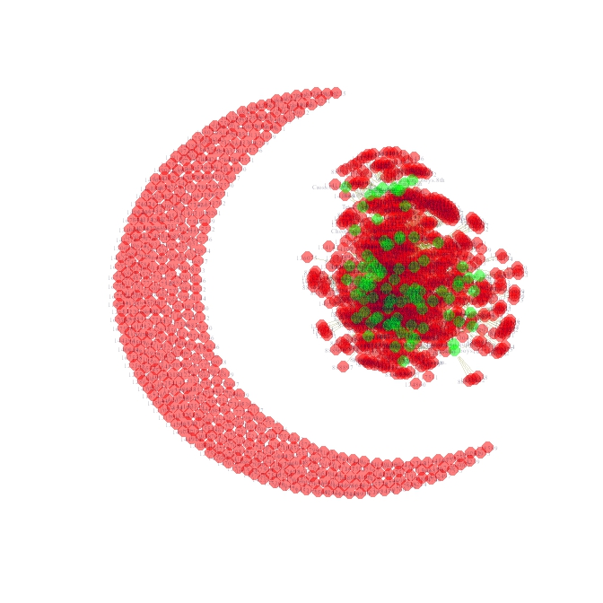
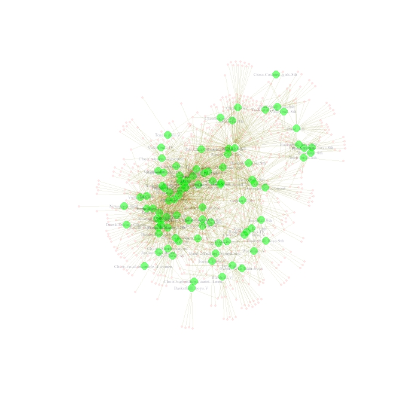
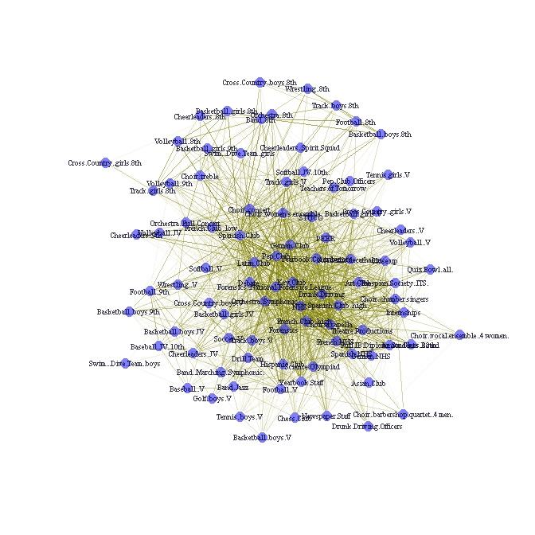
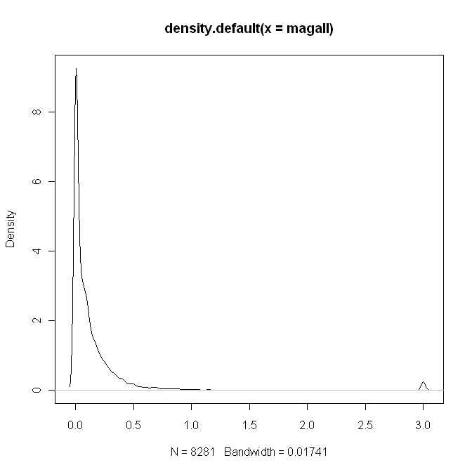
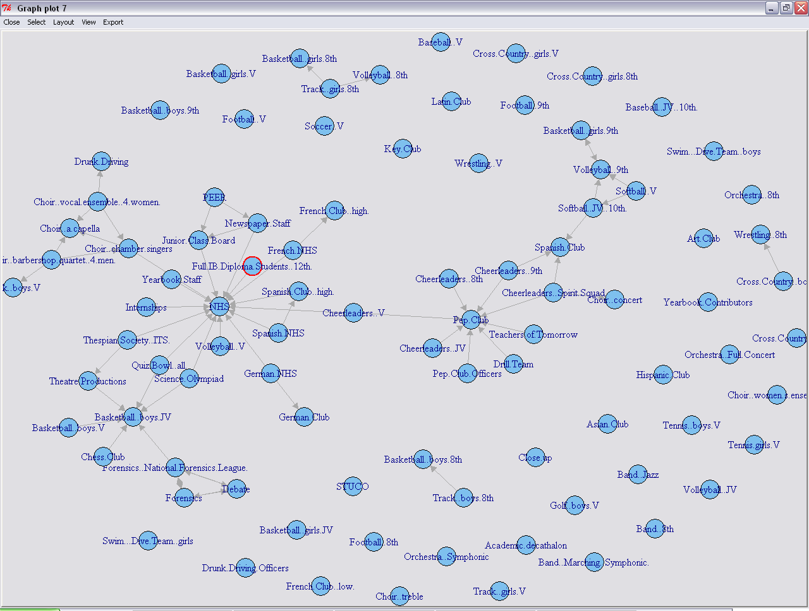
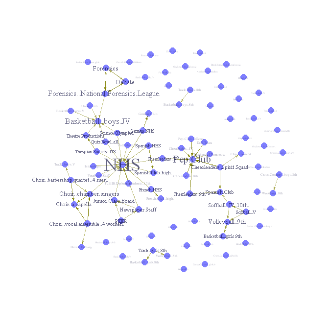

Data can often be usefully conceptualized in terms affiliations between people (or other key data entities). It might be useful analyze common group membership, common purchasing decisions, or common patterns of behavior. This post introduces bipartite/affiliation network data and provides R code to help you process and visualize this kind of data. I recently updated this for use with larger data sets, though I put it together a while back.

Preliminaries
-------------

Much of the material here is covered in the more comprehensive ["Social Network Analysis Labs in R and SoNIA,"](http://sna.stanford.edu/rlabs.php) on which I collaborated with Dan McFarland, Sean Westwood and Mike Nowak.
For a great online introduction to social network analysis see the online book [Introduction to Social Network Methods](http://www.faculty.ucr.edu/~hanneman/nettext/) by Robert Hanneman and Mark Riddle.

Bipartite/Affiliation Network Data
----------------------------------

A network can consist of different 'classes' of nodes. For example, a two-mode network might consist of people (the first mode) and groups in which they are members (the second mode). Another very common example of two-mode network data consists of users on a particular website who communicate in the same forum thread.
Here's a short example of this kind of data. Run this in R for yourself - just copy an paste into the command line or into a script and it will generate a dataframe that we can use for illustrative purposes:

```r
df <- data.frame( 
    person = c('Sam','Sam','Sam','Greg','Tom','Tom','Tom','Mary','Mary'), 
    group = c('a','b','c','a','b','c','d','b','d'), 
    stringsAsFactors = F)

df

person group
1    Sam     a
2    Sam     b
3    Sam     c
4   Greg     a
5    Tom     b
6    Tom     c
7    Tom     d
8   Mary     b
9   Mary     d
```

Fast, efficient two-mode to one-mode conversion in R {#c1}
----------------------------------------------------

Suppose we wish to analyze or visualize how the people are connected directly - that is, what if we want the network of people where a tie between two people is present if they are both members of the same group? We need to perform a two-mode to one-mode conversion.

To convert a two-mode incidence matrix to a one-mode adjacency matrix, one can simply multiply an incidence matrix by its transpose, which sum the common 1's between rows. Recall that matrix multiplication entails multiplying the k-th entry of a row in the first matrix by the k-th entry of a column in the second matrix, then summing, such that the ij-th row-column entry in resulting matrix represents the dot-product of the i-th row of the first matrix and the j-th column of the second. In mathematical notation:


$$
AB = \left [ 
  \begin{array}{cc}
      a & b  \\\\\\
      c & d
  \end{array} \right ]
  \left [ \begin{array}{cc}
      e & f  \\\\\\
      g & h
  \end{array} \right ] =
  \left [ 
  \begin{array}{cc}
    ae+bg & af+bh \\\\\\
    ce+dg & cf+dh
  \end{array} 
  \right ]
$$


Notice further that multiplying a matrix by its transpose yields the following:

$$
\begin{align}
AA' =
  \left[ 
  \begin{array}{cc}
      a & b  \\\\\\
      c & d
  \end{array} 
  \right]
  \left[ 
  \begin{array}{cc}
      a & c  \\\\\\
      b & d
  \end{array} 
  \right] =
  \left[ 
  \begin{array}{cc}
    aa+bb & ac+bd \\\\\\
    ca+db & cc+dd
  \end{array} 
  \right]
\end{align}
$$

Because our incidence matrix consists of 0's and 1's, the off-diagonal entries represent the total number of common columns, which is exactly what we wanted. We'll use the `%*%` operator to tell R to do exactly this. Let's take a look at a small example using toy data of people and groups to which they belong. We'll coerce the data to an incidence matrix, then multiply the incidence matrix by its transpose to get the number of common groups between people.

This is easy to do using the matrix algebra functions included in R. But first, you need to restructure your (edgelist) network data as an incidence matrix. An incidence will record a 1 for row-column combinations where a tie is present and 0 otherwise. One easy way to do this in R is to use the table function and then coerce the table object to a matrix object:

```r
m <- table( df )
M <- as.matrix( m )
```

If you are using the network or sna packages, a network object be coerced via `as.matrix(your-network)`; with the igraph package use `get.adjacency(your-network)`.

This is great, but what about if we are working with a really large data set? Network data is almost always sparse---there are far more pairwise combinations of potential connections than actual observed connections. Hence, we'd actually prefer to keep the underlying data structured in edgelist format, but we'd also like access to R's matrix algebra functionality.

We can get the best of both worlds using the Matrix library to construct a sparse triplet representation of a matrix. But we'd also like to avoid building the entire incidence matrix and just feed Matrix our edgelist directly, a point that came up in a recent conversation I had with [Sean Taylor](http://seanjtaylor.com/). We feed `Matrix` our 'person' column to index 'i' (rows in the new incidence matrix), our 'group' column to index j (columns in the new incidence matrix), and we repeat '1' for the length of the edgelist to denote an incidence.

```r
library('Matrix')
A <- spMatrix(nrow=length(unique(df$person)),
ncol=length(unique(df$group)),
i = as.numeric(factor(df$person)),
j = as.numeric(factor(df$group)),
x = rep(1, length(as.numeric(df$person))) )
row.names(A) <- levels(factor(df$person))
colnames(A) <- levels(factor(df$group))
A
```

We will either convert to the 'mode' represented by the columns or by the rows.
To get the one-mode representation of ties between rows (people in our example), multiply the matrix by its transpose. Note that you must use the matrix-multiplication operator `%*%` rather than a simple astrisk. The R code is:

```r
Arow <- A %*% t(A)
```

But we can still do better! The function tcrossprod is faster and more efficient for this:

```r
Arow <- tcrossprod(A)
```

Arow will now represent the one-mode matrix formed by the row entities---people will have ties to each other if they are in the same group, in our example. Here's what it looks like:

    Arow
    4 x 4 sparse Matrix of class "dgCMatrix"
         Greg Mary Sam Tom
    Greg    1    .   1   .
    Mary    .    2   1   2
    Sam     1    1   3   2
    Tom     .    2   2   3

To get the one-mode matrix formed by the column entities (i.e. the number of people) enter the following command:
```r
Acol <- t(A) %*% A
```

Again, we can use tcrossprod to make this even more efficient:

```r
Acol <- tcrossprod(t(A))
```

And the resulting co-membership matrix is as follows:

    Mcol
    group
    group a b c d
    a 2 1 1 0
    b 1 3 2 2
    c 1 2 2 1
    d 0 2 1 2

Although we've used a very small network for our example, this code is highly extensible to the analysis of larger networks with R.

Analysis of Two Mode Data and Mobility {#c1}
--------------------------------------

Let's work with some actual affiliation data, collected by Dan McFarland on student extracurricular affiliations. It's a longitudinal data set, with 3 waves - 1996, 1997, 1998.  It consists of students (anonymized) and the student organizations in which they are members (e.g. National Honor Society, wrestling team, cheerleading squad, etc.).
What we'll do is to read in the data, explore it, make a few two-to-one mode conversions, and visualize it.

```r
# Load the 'igraph' library
library('igraph')
# (1) Read in the data files, NA data objects coded as 'na'
magact96 = read.delim('https://solomonmg.github.io/assets/img/mag_act96.txt',
na.strings = 'na')
magact97 = read.delim('https://solomonmg.github.io/assets/img/mag_act97.txt',
na.strings = 'na')
magact98 = read.delim('https://solomonmg.github.io/assets/img/mag_act98.txt',
na.strings = 'na')
```

Missing data is coded as "na" in this data, which is why we gave R the command na.strings = "na".

These files consist of four columns of individual-level attributes (ID, gender, grade, race), then a bunch of group membership dummy variables (coded "1" for membership, "0" for no membership).  We need to set aside the first four columns (which do not change from year to year).

```r
magattrib = magact96[,1:4]
g96 <- as.matrix(magact96[,-(1:4)]); row.names(g96) = magact96$ID.
g97 <- as.matrix(magact97[,-(1:4)]); row.names(g97) = magact97$ID.
g98 <- as.matrix(magact98[,-(1:4)]); row.names(g98) = magact98$ID.
```

By using the `[,-(1:4)]` index, we drop those columns so that we have a square incidence matrix for each year, and then tell R to set the row names of the matrix to the student's ID. Note that we need to keep the "." after ID in this dataset (because it's in the name of the variable).
Now we load these two-mode matrices into igraph:

```r
i96 <- graph.incidence(g96, mode=c('all') )
i97 <- graph.incidence(g97, mode=c('all') )
i98 <- graph.incidence(g98, mode=c('all') )
```

### Plotting two-mode networks

Now, let's plot these graphs. The igraph package has excellent plotting functionality that allows you to assign visual attributes to igraph objects before you plot. The alternative is to pass 20 or so arguments to the `plot.igraph()` function, which gets really messy.

Let's assign some attributes to our graph. First we set vertex attributes, making sure to make them slightly transparent by altering the gamma, using the `rgb(r,g,b,gamma)` function to set the color. This makes it much easier to look at a really crowded graph, which might look like a giant hairball otherwise.
You can read up on the RGB color model [here](http://en.wikipedia.org/wiki/RGB_color_model).

Each node (or "vertex") object is accessible by calling `V(g)`, and you can call (or create) a node attribute by using the `$` operator so that you call `V(g)$attribute`. Here's how to set the color attribute for a set of nodes in a graph object:

```r
V(i96)$color[1:1295] <- rgb(1,0,0,.5)
V(i96)$color[1296:1386] <- rgb(0,1,0,.5)
```

Notice that we index the `V(g)$color` object by a seemingly arbitrary value, 1295.  This marks the end of the student nodes, and 1296 is the first group node. You can view which nodes are which by typing V(i96). R prints out a list of all the nodes in the graph, and those with a number are obviously different from those that consist of a group name.

Now we'll set some other graph attributes:

```r
V(i96)$label <- V(i96)$name
V(i96)$label.color <- rgb(0,0,.2,.5)
V(i96)$label.cex <- .4
V(i96)$size <- 6
V(i96)$frame.color <- NA
```

You can also set edge attributes. Here we'll make the edges nearly transparent and slightly yellow because there will be so many edges in this graph:
```r
E(i96)$color <- rgb(.5,.5,0,.2)
```

Now, we'll open a pdf "device" on which to plot. This is just a connection to a pdf file. Note that the code below will take a minute or two to execute (or longer if you have a pre- Intel dual-core processor).

```r
pdf('i96.pdf')
plot(i96, layout=layout.fruchterman.reingold)
dev.off()
```

Note that we've used the Fruchterman-Reingold force-directed layout algorithm here.  Generally speaking, the when you have a ton of edges, the Kamada-Kawai layout algorithm works well but, it can get really slow for networks with a lot of nodes. Also, for larger networks, layout.fruchterman.reingold.grid is faster, but can fail to produce a plot with any meaninful pattern if you have too many isolates, as is the case here. Experiment for yourself.
Here's what we get:



It's oddly reminiscent of a cresent and star, but impossible to read. Now, if you open the [pdf output](/img/i96.pdf), you'll notice that you can zoom in on any part of the graph ad infinitum without losing any resolution. How is that possible in such a small file? It's possible because the pdf device output consists of data based on vectors: lines, polygons, circles, elipses, etc., each specified by a mathematical formula that your pdf program renders when you view it. Regular bitmap or jpeg picture output, on the other hand, consists of a pixel-coordinate mapping of the image in question, which is why you lose resolution when you zoom in on a digital photograph or a plot produced with most other programs.

Let's remove all of the isolates (the cresent), change a few aesthetic features, and replot. First, we'll remove isloates, by deleting all nodes with a degree of 0, meaning that they have zero edges. Then, we'll suppress labels for students and make their nodes smaller and more transparent. Then we'll make the edges more narrow more transparent. Then, we'll replot using various layout algorithms:

```r
i96 <- delete.vertices(i96, V(i96)[ degree(i96)==0 ])
V(i96)$label[1:857] <- NA
V(i96)$color[1:857] <-  rgb(1,0,0,.1)
V(i96)$size[1:857] <- 2
E(i96)$width <- .3
E(i96)$color <- rgb(.5,.5,0,.1)
pdf('i96.2.pdf')
plot(i96, layout=layout.kamada.kawai)
dev.off()
pdf('i96.3.pdf')
plot(i96, layout=layout.fruchterman.reingold.grid)
dev.off()
pdf('i96.4.pdf')
plot(i96, layout=layout.fruchterman.reingold)
dev.off()
```

I personally prefer the Fruchterman-Reingold layout in this case. The nice thing about this layout is that it really emphasizes centrality--the nodes that are most central are nearly always placed in the middle of the plot. Here's what it looks like:



Very pretty, but you can't see which groups are which at this resolution. Zoom assets/in on the [pdf output](/img/samplepdf.pdf), and you can see things pretty clearly.

### Two mode to one mode data transformation

We've emphasized groups in this visualization so much, that we might want to just create a network consisting of group co-membership. First we need to create a new network object. We'll do that the same way for this network as for our example at the top of this page:

```r
g96e <- t(g96) %*% g96
g97e <- t(g97) %*% g97
g98e <- t(g98) %*% g98
i96e <- graph.adjacency(g96e, mode = 'undirected')
```

Now we need to tansform the graph so that multiple edges become an attribute ( `E(g)$weight` ) of each unique edge:

```r
E(i96e)$weight <- count.multiple(i96e)
i96e <- simplify(i96e)
```

Now we'll set the other plotting parameters as we did above:

```r
# Set vertex attributes
V(i96e)$label <- V(i96e)$name
V(i96e)$label.color <- rgb(0,0,.2,.8)
V(i96e)$label.cex <- .6
V(i96e)$size <- 6
V(i96e)$frame.color <- NA
V(i96e)$color <- rgb(0,0,1,.5)
# Set edge gamma according to edge weight
egam <- (log(E(i96e)$weight)+.3)/max(log(E(i96e)$weight)+.3)
E(i96e)$color <- rgb(.5,.5,0,egam)
```

We set edge gamma as a function of how many edges exist between two nodes, or in this case, how many students each group has in common. For illustrative purposes, let's compare how the Kamada-Kawai and Fruchterman-Reingold algorithms render this graph:

```r
pdf('i96e.pdf')
plot(i96e, main = 'layout.kamada.kawai', layout=layout.kamada.kawai)
plot(i96e, main = 'layout.fruchterman.reingold', layout=layout.fruchterman.reingold)
dev.off()
```

I like the Kamada-Kawai layout for this graph, because the center of the graph is too busy otherwise. And here's what the resulting plot looks like:


You can check out the difference between each layout yourself. Here's what the [assets/pdf output looks like](/img/i96e.pdf).  Page 1 shows the Kamada-Kawai layout and page 2 shows the Fruchterman Reingold layout.

### Group overlap networks and plots

Now we might also be interested in the percent overlap between groups. Note that this will be a directed graph, because the percent overlap will not be symmetric across groups--for example, it may be that 3/4 of Spanish NHS members are in NHS, but only 1/8 of NHS members are in the Spanish NHS. We'll create this graph for all years in our data (though we could do it for one year only).
First we'll need to create a percent overlap graph. We start by dividing each row by the diagonal (this is really easy in R):

```r
ol96 <- g96e/diag(g96e)
ol97 <- g97e/diag(g97e)
ol98 <- g98e/diag(g98e)
```

Next, sum the matricies and set any NA cells (caused by dividing by zero in the step above) to zero:

```r
magall <- ol96 + ol97 + ol98
magall[is.na(magall)] <- 0
```

Note that magall now consists of a percent overlap matrix, but because we've summed over 3 years, the maximun is now 3 instead of 1.
Let's compute average club size, by taking the mean across each value in each diagonal:

```r
magdiag <- apply(cbind(diag(g96e), diag(g97e), diag(g98e)), 1, mean )
```

Finally, we'll generate centrality measures for magall. When we create the igraph object from our matrix, we need to set weighted=T because otherwise igraph dichotomizes edges at 1. This can distort our centrality measures because now edges represent  more than binary connections--they represent the percent of membership overlap.

```r
magallg <- graph.adjacency(magall, weighted=T)
# Degree
V(magallg)$degree <- degree(magallg)
# Betweenness centrality
V(magallg)$btwcnt <- betweenness(magallg)
```

Before we plot this, we should probably filter some of the edges, otherwise our graph will probably be too busy to make sense of visually.  Take a look at the distribution of connection strength by plotting the density of the magall matrix:

```r
plot(density(magall))
```



Nearly all of the edge weights are below 1--or in other words, the percent overlap for most clubs is less than 1/3. Let's filter at 1, so that an edge will consists of group overlap of more than 1/3 of the group's members in question.

```r
magallgt1 <- magall
magallgt1[magallgt1<1] <- 0
magallggt1 <- graph.adjacency(magallgt1, weighted=T)
# Removes loops:
magallggt1 <- simplify(magallggt1, remove.multiple=FALSE, remove.loops=TRUE)
```

Before we do anything else, we'll create a custom layout based on Fruchterman.-Ringold wherein we adjust the coordates by hand using the tkplot gui tool to make sure all of the labels are visible. This is very useful if you want to create a really sharp-looking network visualization for publication.

```r
magallggt1$layout <- layout.fruchterman.reingold(magallggt1)
V(magallggt1)$label <- V(magallggt1)$name
tkplot(magallggt1)
```

Let the plot load, then maximize the window, and select to View -&gt; Fit to Screen so that you get maximum resolution for this large graph. Now hand-place the nodes, making sure no labels overlap:


Pay special attention to whether the labels overlap (or might overlap if the font was bigger) along the vertical. Save the layout coordinates to the graph object:

```r
magallggt1$layout <- tkplot.getcoords(1)
```

We use "1" here because only if this was the first tkplot object you called. If you called tkplot a few times, use the last plot object. You can tell which object is visible because at the top of the tkplot interface, you'll see something like "Graph plot 1" or in the case of my screenshot above "Graph plot 7" (it was the seventh time I called tkplot).

```r
# Set vertex attributes
V(magallggt1)$label <- V(magallggt1)$name
V(magallggt1)$label.color <- rgb(0,0,.2,.6)
V(magallggt1)$size <- 6
V(magallggt1)$frame.color <- NA
V(magallggt1)$color <- rgb(0,0,1,.5)
# Set edge attributes
E(magallggt1)$arrow.size <- .3
# Set edge gamma according to edge weight
egam <- (E(magallggt1)$weight+.1)/max(E(magallggt1)$weight+.1)
E(magallggt1)$color <- rgb(.5,.5,0,egam)
```

One thing that we can do with this graph is to set label size as a function of degree, which adds a "tag-cloud"-like element to the visualization:

```r
V(magallggt1)$label.cex <- V(magallggt1)$degree/(max(V(magallggt1)$degree)/2)+ .3
#note, unfortunately one must play with the formula above to get the
#ratio just right
```

Let's plot the results:

```r
pdf('magallggt1customlayout.pdf')
plot(magallggt1)
dev.off()
```

Note that we used the custom layout, which because we made part of the igraph object magallggt1, we did not need to specify in plot command.
assets/Here's the [pdf output](/img/magallggt1custom.pdf), and here's what it looks like:



This visualization reveals much more information about our network than our cresent-star visualization.


###  Mobility, Markov, and Transition Probabilities
In order to shed light on how people flow through these groups, we'll compute transition probabilities. These transition probabilities are more generally referred to as Markov chains. 

First we'll create a new matrix that multiplies 1996 magnet with 1997 magnet so you see the number of students moving from 1996 membership to 1997 memberships.

Before we actually do this, we need to do some data munging to make sure that the rows and columns for g96 and g97 are the same. We'll use the match() function for this.


```r
    
# First, let's get an idea of how many column-names (activities) and row
# names (student ids) are in common between the two years:
  
(cnames = intersect( colnames(g96), colnames(g97) ) )
(rnames = intersect( row.names(g96), row.names(g97) ) )
  
# Great, there are a lot of names in common. Now we
# need to make sure we are only using the rows
# and columns of each matrix that contain entries used in
# both years. We also need to make sure that the columns and
# rows are in the same order.
  
# In order to accomplish this we are going to exploit R's
# indexing capabilities. We are going to have R "rebuild"
# each matrix according to the order of rnames and cnames.
# We'll use the match() function to accomplish this.
g96matched = g96[ match(rnames, row.names(g96)), match(cnames, colnames(g96)) ]
g97matched = g97[ match(rnames, row.names(g97)), match(cnames, colnames(g97)) ]
  
# We need to do the same thing for the diagonal of the matrix g96e, which is
# our co-membership/affiliation matrix computed above:
mag96diagmatched = diag( g96e[ match(cnames, colnames(g96e)), 
  match(cnames, colnames(g96e)) ] )
  
# Now let's check to make sure things worked correctly:
which(row.names(g96matched) != row.names(g97matched))
which(colnames(g96matched) != colnames(g97matched))
```

Now that these are effectively matricies, we can multiply to get the transition probability matrix:

```r  
mag96_97 = t(g96matched) %*% g97matched
```

Let's munge the 97 and 98 data and repeat:

```r    

cnames = intersect( colnames(g97), colnames(g98) ) 
rnames = intersect( row.names(g97), row.names(g98) )
g97matched = g97[ match(rnames, row.names(g97)), match(cnames, colnames(g97)) ]
g98matched = g98[ match(rnames, row.names(g98)), match(cnames, colnames(g98)) ]
```

And again for the 97-98 transition:

```r      
mag97_98 = t(g97matched) %*% g98matched
```

Now we need to get the group-level membership matrix diagonal, ordered by the current set of columns. 

```r
mag96diagmatched = diag( g96e[ match(cnames, colnames(g96e)), 
  match(cnames, colnames(g96e)) ] )

mag97diagmatched = diag( g97e[ match(cnames, colnames(g97e)), 
  match(cnames, colnames(g97e)) ] )
  
mag98diagmatched = diag( g98e[ match(cnames, colnames(g98e)), 
  match(cnames, colnames(g98e)) ] )
```

And finally we can create the transition probability matrix! Divide magmob96_97 by mag96diagmatched in to get the transition probability matrix (Markov chain):

```r
magmob96_97 = mag96_97/mag96diagmatched 
magmob97_98 = mag97_98/mag97diagmatched
```  
  
Now add the matrices and divide by 2:
  
```r
mobility_all <- (magmob96_97 + magmob97_98)/2

```

Now plot as with the event-overlap graphs!
